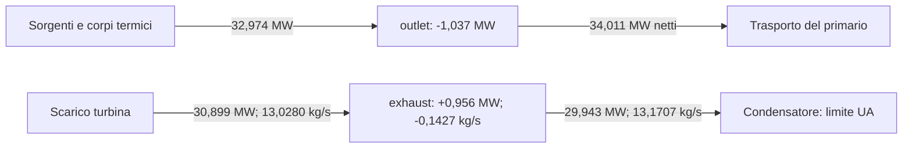

# Progetto — stato corrente e handoff

Questa pagina mantiene risultato verificato e ripresa del lavoro. Il
[README](../README.md) descrive il simulatore, la [roadmap](ROADMAP.md) pianifica
le consegne e il [changelog](../CHANGELOG.md) conserva la cronologia.

## Stato corrente

Checkpoint dell'**11 novembre 2026**, dopo la riparazione del trasporto di fase,
la diagnosi dei bilanci e la misura delle trenta direzioni sul punto riparato.

| Ambito | Stato verificato |
| --- | --- |
| Desktop ordinario | Exact-V9 e missione v3 invariati; controlli di identità e determinismo PASS. |
| Trasporto sotto C4 | Riparazione implementata nei quattro file previsti; saturazione pubblica e payload invariati. |
| Nuova misura | Due ricette identiche, tre checkpoint sani e nell'inviluppo. Verifica della riparazione PASS con adjudication 2. |
| Diagnosi dei bilanci | Altre due ricette, sei passi totali: stati identici alla misura precedente, bilanci termici e di exhaust ricostruiti. Limite del condensatore: superficie UA. |
| Sensibilità accoppiate | Raffinate le tre direzioni inizialmente mancanti; la misura estesa seleziona 19 colonne su 30, comprese tutte le sei grandezze non fluide. |
| Punto grezzo riparato | Massimo assoluto dei 75 residui scalati **8.582.400,421**, contro il criterio ≤1. |
| Equilibrio R3 e M10 | **R3 RED, M10 aperto**. Nessun seed installato, nessuna attivazione produttiva C4. |

Il valore H9 di 3.334.923,856 appartiene alla legge precedente. Restano storici
quel candidato, i suoi Jacobiani e le altre sonde già congelate: non sono una
baseline di equilibrio della legge riparata.

### Il problema da risolvere

Lo stadio usava energie di vapore e condensa storiche mentre il fluido era
risolto da C4. Ora le ricava dal provider della chiusura attiva, indicizzato
dalla pressione. Le modalità storiche conservano le proprietà bit per bit;
lo stesso principio viene applicato alla condensa del condensatore.

La misura reale conferma la correzione locale. L'accumulo di turbine-inlet è
18,963 kW al primo passo preparatorio, 19,224 kW al post-seed e **19,465 kW**
al primo Running, rispetto ai precedenti 1.006,560 kW. Tutti e tre rispettano
il limite dichiarato del 10%. Le energie registrate coincidono con quelle C4.

L'energia viene trasferita a valle: al primo Running `exhaust` accumula circa
955,9 kW e `outlet` perde circa 1.037,0 kW. La nuova diagnosi ne ricostruisce
i bilanci, ma il punto resta fuori equilibrio. Tre checkpoint nell'inviluppo
non sostituiscono le conferme di 100 passi o la qualificazione R3.


La figura spiega il significato della riparazione: correggere la proprietà
del trasporto rimuove lo scarto strutturale all'ingresso, mentre gli altri
inventari devono ancora trovare un punto stazionario con la nuova legge.

### Che cosa spiega la nuova diagnosi

La console diagnostica separata ha acquisito due volte la stessa ricetta:
due passi preparatori e un Running per ripetizione, sei passi complessivi.
Gli hash dello stato completo prima e dopo Running coincidono con la misura
precedente; coincidono anche i dodici inventari e le due ripetizioni.
Nessun file produttivo o di test è cambiato durante questa diagnosi.

| Nodo | Bilancio al primo Running | Significato |
| --- | --- | --- |
| `outlet` | Calore ricevuto 32,974 MW; trasporto energetico netto uscente 34,011 MW; accumulo −1,037 MW. | Il calore comprende 6,594 MW diretti e 26,380 MW ceduti da combustibile e struttura. |
| `exhaust` | Energia entrante 30,899 MW; uscente 29,943 MW; accumulo +0,956 MW. | Lo stadio e il condensatore trasportano energie specifiche diverse. |
| `exhaust`, massa | Ingresso 13,0280 kg/s; condensazione 13,1707 kg/s; accumulo −0,1427 kg/s. | L'energia cresce mentre la massa diminuisce: entrambi i bilanci devono essere soddisfatti. |

Il calore di `outlet` è ricostruito dalle sorgenti dei canali e dagli scambi
fra corpi termici e fluido. I bilanci indipendenti di combustibile e struttura
chiudono entro 0,01 W; i loro accumuli sono circa −2,04 e −1,02 kW.
L'analisi congelata ricava il trasporto netto di `outlet` per differenza dal
suo accumulo. In questo specifico passo la correzione idraulica non è scattata:
anche il calcolo con le portate registrate, 100,0477 e 99,9646 kg/s, e le
entalpie iniziali ricostruisce lo stesso trasporto entro 0,01 W. Questo
controllo non si estende automaticamente ai passi con correzione attiva.

Sul condensatore il limite effettivo è **27,597 MW**, imposto dalla superficie
di scambio UA, mentre la capacità installata è 40 MW. I bilanci di `exhaust`
chiudono entro 1e-6 kg/s e 0,01 W. Il fluido entrante porta 2,372 MJ/kg;
il condensatore preleva dal nodo 2,273 MJ/kg. Questa differenza descrive
un nodo non stazionario e non dimostra da sola un altro difetto di modello.



Il diagramma mostra due bilanci locali, non un collegamento diretto fra
`outlet` e lo scarico turbina. Le differenze fra entrate e uscite spiegano
gli accumuli. A stato e ingresso della turbina fissi, il solo raffreddamento
non può annullare insieme i due accumuli di `exhaust`: bilanciare la massa
lascerebbe +1,280 MW, mentre bilanciare l'energia darebbe −0,563 kg/s.
Sono confronti algebrici, non nuovi punti operativi o una prova di impossibilità
nel box di ricerca. Anche aumentare soltanto la temperatura del combustibile
sposterebbe il deficit da `outlet` al corpo termico: il prossimo confronto
deve osservare insieme inventari, sorgente nucleare e scambi termici.

### Che cosa aggiungono le sensibilità accoppiate

La prima prova ha misurato nove direzioni indipendenti e una combinazione
nucleare-termica. Quest'ultima coincide con la somma delle risposte entro lo
0,037% alla scala misurata. Includere combustibile e struttura distingue
energia aggiunta e calore trasferito: le tre colonne non fluide, quasi
collineari osservando i fluidi, si separano con i bilanci termici.

Il raffinamento successivo ha eseguito **70 ricette**, tutte sane,
nell'inviluppo e identiche nelle ripetizioni, entro 212 passi runtime.
Le due colonne di `pressure` ora rispettano i criteri a 2e-6, confrontate con
1e-6: scarti relativi inferiori allo 0,001%. La direzione compensata di massa
ed energia è verificata a 1e-4 con scarto dello 0,047% rispetto a 1e-5.

Per l'energia di `exhaust`, 3e-5 e 1e-4 concordano entro il 6,15%. Le coppie
di ampiezze maggiori falliscono ancora: il risultato è locale. La
decomposizione mostra che lo scarto deriva soprattutto dalla portata dello
stadio; il lavoro ideale resta invariato fra i due segni delle sonde.
Le coppie di turbina, generatore e perdite ricostruiscono quella netta entro
1e-6 N·m. Questo non dimostra un difetto fisico o una derivata uniforme.

La prova estesa ha poi misurato tutte le **30 direzioni** con **362 ricette**,
entro 1.088 passi runtime. Sono tutte sane e ripetibili; 334 restano
nell'inviluppo. I 43 punti sovrapposti alle prove precedenti conservano
identici inventari, residui, fasi e hash completi ai tre checkpoint.

| Parte della base | Risultato della prova estesa |
| --- | --- |
| Inventari fluidi | 13 colonne selezionate su 24. |
| Grandezze non fluide | Tutte e sei selezionate: valvola, pompe, popolazione neutronica e temperature. |
| Rango numerico diagnostico | 19 sulle 19 colonne selezionate, con soglia 1e-8 dopo normalizzazione. Non è un certificato di rango o sufficienza. |
| Quattro colonne di `control-out` e `turbine-inlet` | Alle due ampiezze minori mantengono il ramo ma non rispettano il 10%; la maggiore non è ammessa. |
| Sei colonne di drum, hotwell e suction | Almeno un segno cambia fase in un nodo della ricetta: nessuno stencil centrale ammesso. |
| Massa di `feedwater-inventory` | Lo stencil a 1e-6 è ammesso; le ampiezze maggiori cambiano fase e, per un segno, anche regime. Manca una seconda scala ammessa. |

Il nodo che cambia fase può essere diverso da quello perturbato: una sonda
di drum, per esempio, porta suction in miscela al primo Running. Controllare
solo il punto grezzo o il nodo variato perderebbe questa interazione.
La base resta incompleta: le undici colonne mancanti non vengono inventate
e le diciannove disponibili non qualificano da sole una famiglia o una proposta.

### Conservazione, portata e revisione della verifica

Nel condensatore resta la stessa legge di limite termico, inventario e portata
massima. La portata viene ricalcolata dalle nuove energie: al primo Running
è circa 13,170705 kg/s, con limite termico attivo. Non è un invariante numerico.

Il primo protocollo di misura richiedeva erroneamente portate uguali all'ingresso
turbina. La loro differenza, 0,000172517 kg/s, coincide invece con l'accumulo
di massa. Il suo esito **non conforme resta congelato**. L'adjudication 2,
successiva alla misura e senza nuove chiamate fisiche, confronta accumulo e
trasferimenti: errore circa 3,5e-12 kg/s, entro la tolleranza originale 1e-6.
Anche i bilanci energetici rispettano 0,01 W. Il criterio di radice resta ≤1.

### Come leggere il confronto numerico precedente

I 335–357 kW della revisione vincolata erano massimi delle soluzioni ai minimi
quadrati, non limiti inferiori del massimo energetico. La nuova revisione
ottimizza direttamente quel massimo e trova 125,0 kW con i soli inventari e
74,8 kW con le sei grandezze aggiuntive, nei medesimi box. Il rapporto è 59,8%,
oltre la soglia diagnostica del 50%; i residui di massa restano importanti.
Sono previsioni lineari storiche, non ricette o prove di impossibilità fisica.
L'esito congelato precedente non viene riscritto.

## Handoff

La prossima attività è **costruire direzioni compatibili con i rami osservati**.
Le prime tre colonne mancanti sono state raffinate, ma il controllo di tutto
il ciclo seleziona 19 direzioni su 30. Le undici restanti richiedono trattamenti
distinti per cambi di fase e mancato accordo fra ampiezze.

Dalla radice del repository:

```powershell
python .\eng\run-r3-repaired-missing-directions2.py review
python .\eng\run-r3-repaired-complete-basis3.py review
python .\eng\review-r3-stage-transport-repair-adjudication2.py review
```

Gli esiti attesi sono `PASS-REPAIRED-MISSING-DIRECTIONS-EVIDENCE`,
`PASS-REPAIRED-COMPLETE-BASIS-EVIDENCE` e
`PASS-STAGE-TRANSPORT-OWNERSHIP-REPAIR-ADJUDICATION2`. I replay non chiamano
l'impianto; `r3_passed` e `m10_closed` restano `false`. Gli altri replay
rimangono collegati nelle specifiche e nelle ricevute sottostanti.

1. Leggere il [risultato esteso](../eng/frozen-evidence/r3-repaired-complete-basis3/04-analysis.json)
   e la [specifica](../eng/contracts/r3-repaired-complete-basis3.md).
   Separare disponibilità dello stencil, linearità e rango numerico.
2. Per drum, hotwell, suction e massa di alimento, congelare un confronto
   con ampiezze più piccole, direzioni compensate o sonde unilaterali
   dichiarate. Una derivata unilaterale non diventa automaticamente una
   coordinata libera nei due versi. Verificare tutti i nodi e checkpoint,
   non solo la fase del nodo perturbato.
3. Per `control-out` e `turbine-inlet`, localizzare le differenze di portata
   e coppia e confrontare nuove scale. Conservare pesi, tolleranze, inviluppo
   e rami; non riusare i Jacobiani della legge precedente o promuovere una
   colonna cambiando il confronto dopo le misure.
4. Solo con la base revisionata, pianificare proposte ripetute e confrontare
   previsioni e risposta reale prima della ricerca. Il rango 19 non dimostra
   impossibilità; la concordanza locale non autorizza un passo estrapolato.
   Nessuna compensazione automatica degli inventari o modifica a UA.

Una radice osservata richiede ancora revisione, conferme indipendenti di 100
passi, R3 e la [sequenza di chiusura](ROADMAP.md#3-che-cosa-manca-dopo-r3-per-chiudere-m10).
Nessuna nuova ricerca o prova lunga è attualmente in corso.

## Evidenze e verifiche

| Riferimento | Ambito |
| --- | --- |
| [Piano revisionato](../eng/contracts/r3-stage-transport-ownership-repair-planning1.md) | Quattro file produttivi, identità storiche e portata del condensatore. |
| [Misura 1](../eng/contracts/r3-stage-transport-ownership-repair1.md) e [ricevuta](../eng/r3-stage-transport-ownership-repair1-returned.json) | Due ricette, verifiche preliminari e primo esito non conforme conservato. |
| [Adjudication 2](../eng/contracts/r3-stage-transport-repair-adjudication2.md) e [ricevuta](../eng/r3-stage-transport-repair-adjudication2-returned.json) | Verifica corretta del bilancio con accumulo, senza nuove misure. |
| [Obiettivo energetico](../eng/contracts/r3-op-energy-objective-review2.md) | Confronto coerente del massimo nel modello lineare storico. |
| [Diagnosi del punto riparato](../eng/contracts/r3-repaired-raw-owner-diagnostic1.md) e [ricevuta](../eng/r3-repaired-raw-owner-diagnostic1-returned.json) | Due ripetizioni identiche, scambi termici e bilanci di exhaust; nessuna perturbazione o ricerca. |
| [Sensibilità accoppiate](../eng/contracts/r3-repaired-coupled-sensitivity1.md) e [ricevuta](../eng/r3-repaired-coupled-sensitivity1-returned.json) | 82 ricette, sei direzioni indipendenti validate e confronto della sonda combinata; nessuna proposta o ricerca. |
| [Raffinamento delle direzioni](../eng/contracts/r3-repaired-missing-directions2.md) e [ricevuta](../eng/r3-repaired-missing-directions2-returned.json) | 70 ricette; tre colonne iniziali recuperate e decomposizione della coppia. |
| [Misura delle trenta direzioni](../eng/contracts/r3-repaired-complete-basis3.md) e [ricevuta](../eng/r3-repaired-complete-basis3-returned.json) | 362 ricette; 19 colonne selezionate e rango numerico diagnostico 19. Base incompleta, nessuna proposta o ricerca. |
| [Sintesi](validation/README.md) e [decisioni](validation/MODEL_DECISIONS.md) | Ambito delle conclusioni e vincoli durevoli. |

Compilazione Release: **zero avvisi e zero errori**. Suite ordinaria completa:
**1.409 superati, 167 espliciti esclusi, zero fallimenti**, su 414 file di test.
PASS anche il contratto CI e le baseline correnti, incluso Exact-V9.
Il controllo ordinario del vecchio CSV C4 è stato separato dalla regressione
attiva: dati e valori attesi storici restano intatti, nessun controllo ordinario
è stato spostato fra gli espliciti.
Il pacchetto conserva i log dei fallimenti iniziali e il successivo PASS completo.
Le console separate di diagnosi e sensibilità e il runner riutilizzabile compilano senza avvisi o errori;
preflight, fixture e replay PASS. Gli alberi `src` e `tests` coincidono con
quelli della suite completa appena citata, che non è stata rieseguita per
queste sole aggiunte diagnostiche.

I vecchi replay richiedono i propri commit: H4–H9 e revisione di sufficienza
`72b0910`; diagnostiche non fluide e revisione vincolata `ed35d9e`;
ricostruzione dello stadio 2 `35acc9a`. Su questo tree valgono i nuovi comandi.
I marcatori seguenti conservano riferimenti delle revisioni precedenti:

NRS-MARKER:R3-H-LOCAL-MODEL-DESIGN1-CURRENT

NRS-MARKER:R3-H-NUMERICAL-STOP-REVIEW1-CURRENT
