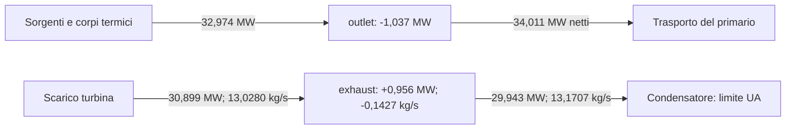
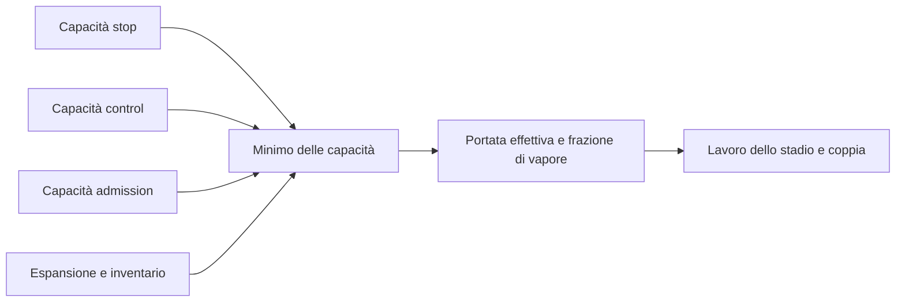
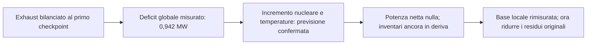

# Progetto — stato corrente e handoff

Questa pagina mantiene risultato verificato e ripresa del lavoro. Il
[README](../README.md) descrive il simulatore, la [roadmap](ROADMAP.md) pianifica
le consegne e il [changelog](../CHANGELOG.md) conserva la cronologia.

## Stato corrente

Checkpoint del **12 novembre 2026**, dopo le prove 23–25. Le proposte ora
minimizzano direttamente il massimo dei 75 residui originali, con vincoli
termici e operativi separati. La prova 23 ottiene una riduzione del **5,35%**
con tutti i controlli conformi. La prova 25 misura una riduzione del **21,36%**,
con salute, fase e inviluppo conservati, ma manca la soglia di previsione
operativa. Prima della ricerca serve isolare e misurare la risposta
accoppiata della riserva iniziale in suction.

| Ambito | Stato verificato |
| --- | --- |
| Desktop ordinario | Exact-V9 e missione v3 invariati; controlli di identità e determinismo PASS. |
| Trasporto sotto C4 | Riparazione implementata nei quattro file previsti; saturazione pubblica e payload invariati. |
| Nuova misura | Due ricette identiche, tre checkpoint sani e nell'inviluppo. Verifica della riparazione PASS con adjudication 2. |
| Diagnosi dei bilanci | Altre due ricette, sei passi totali: stati identici alla misura precedente, bilanci termici e di exhaust ricostruiti. Limite del condensatore: superficie UA. |
| Base direzionale | 30 direzioni misurate, rango numerico diagnostico 30; quattro coefficienti unilaterali e due direzioni accoppiate. |
| Prime proposte | Due passi ripetibili e nei controlli registrati, ma errore predittivo circa 15 volte la variazione prevista. Nessuna ricerca avviata. |
| Capacità di portata | Minimo delle cinque capacità riprodotto esattamente in 57 ricostruzioni su 38 ricette ripetute; proposte nel ramo admission a tutti i checkpoint. |
| Modello del minimo | Offline, senza passi runtime: errori delle proposte 1,78e-4 e 1,50e-4 contro 14,734 e 15,011 del modello affine; vincitori previsti in 16 sonde su 16. Confronto retrospettivo. |
| Proposte prospettiche | Sei previsioni congelate prima della misura, su tre rami: tutte conformi, errore massimo 4,7e-4 contro 0,10; vincitori corretti. Massimo pesato osservato da 1,157 a 1,056. Solo otto direzioni. |
| Altre 22 direzioni | Capacità osservate in 90 ricette ripetute, minimo esatto in 135 ricostruzioni. 17 direzioni, incluse le quattro unilaterali, non cambiano la portata dello stadio; cinque cambiano portata e vincitore. Nessun modello ristimato. |
| Modello sulle 30 direzioni | Ristimato offline; otto proposte congelate e quattro sonde doppie previste entro 2,4e-3. Poi otto previsioni nuove su quattro sequenze, con 26 direzioni mosse insieme: tutte conformi, errore massimo 1,8e-3. Verificati anche il ramo control e una sequenza mista. Ottimo previsto ancora circa 0,955. |
| Limite del passo | Diagnosi offline: accumulo di energia in exhaust (0,96 MW) e coppia si muovono insieme con la portata; la sola leva diretta vale 2,8 kW per ampiezza campionata. Per estrapolazione lineare servirebbe il 3,4% su exhaust:energy, oltre il limite del 2%. Nessuna ricerca dichiarata. |
| Leva di exhaust al 2% | 22 ricette sane, nell'inviluppo e ripetibili; secanti entro il 2,22% del riferimento. A +2% restano circa 0,412 MW nella combinazione energia-coppia. |
| Sonda positiva fino al 4% | 12 ricette sane, nell'inviluppo e ripetibili; cambio di segno della combinazione fra +3,5% e +4%. Solo dominio diagnostico: non un nuovo box di ricerca. A +3,5% energia del nodo quasi stazionaria, massa ancora in calo. |
| Bilanci accoppiati di exhaust | Prova 17 arrestata per cambio di fase di hotwell; rifiuto conservato. Prova 18: riserva iniziale dichiarata di circa 10 g in hotwell, 24 ricette e due aggiornamenti; massa ed energia di exhaust entro 1e-6 kg/s e 0,01 W al primo checkpoint. |
| Potenza globale | Prova 19: otto ricette; previsioni a metà e intero incremento nucleare-termico entrambe conformi. Al punto intero la potenza netta globale iniziale è numericamente nulla; dopo il seed e al primo Running restano +266 W e +284 W. |
| Nuovo punto diagnostico | Massimo assoluto dei 75 residui scalati **8.365.513,134**, contro ≤1. Domina l'energia di hotwell: +40,3 kW al primo checkpoint, con massa −0,0619 kg/s. Nessuna conferma di 100 passi. |
| Nuova base locale | Prova 20: 260 ricette, 22 direzioni recuperate. Prova 21: 196 ricette sulle otto mancanti; base di rango diagnostico 30, con 28 direzioni centrali e due unilaterali in suction. Nel centro limita expansion ai tre checkpoint. |
| Proposte nel nuovo punto | Prova 22: otto ricette, due previsioni conformi; errore massimo sulle variazioni circa 3,30e-4 contro 0,10. Quattro direzioni mosse a scala utile; expansion resta limitante. Massimo pesato da 0,81043 a 0,79454, ma massimo originale da 8.365.513,134 a **8.369.112,639**. |
| Criterio originale | Prova 23: otto ricette; passo al 25% conforme, massimo originale **7.917.982,871**, −5,35% rispetto al punto 19. Il passo al 50% è escluso per inviluppo della pompa primaria e margine termico. |
| Inviluppo nella proposta | Prova 24: otto ricette; derivate operative disponibili sulle trenta direzioni, previsione più interna alle soglie e margine termico di 10 W. Entrambe le proposte rispettano inviluppo e limiti termici, ma cambiano fase in suction al primo Running e restano escluse. |
| Riserva accoppiata di suction | Prova 25: otto ricette, riserva iniziale di massa ed energia fino a +1e-6 ciascuna. Fasi, inviluppo e limiti termici conservati; massimo originale **6.578.689,455**, −21,36%. Errore operativo 6,71% dell'intervallo contro 1%: previsione non conforme, nessun aggiornamento di ricerca. |
| Punto grezzo riparato | Massimo assoluto dei 75 residui scalati **8.582.400,421**, contro il criterio ≤1. |
| Equilibrio R3 e M10 | **R3 RED, M10 aperto**. Nessun seed installato, nessuna attivazione produttiva C4. |

Il valore H9 di 3.334.923,856 appartiene alla legge precedente. Restano storici
quel candidato, i suoi Jacobiani e le altre sonde già congelate: non sono una
baseline di equilibrio della legge riparata.

### Il problema da risolvere

Lo stadio usava energie di vapore e condensa storiche mentre il fluido era
risolto da C4. Ora le ricava dal provider della chiusura attiva, indicizzato
dalla pressione. Le modalità storiche conservano le proprietà bit per bit;
lo stesso principio viene applicato alla condensa del condensatore.

La misura reale conferma la correzione locale. L'accumulo di turbine-inlet è
18,963 kW al primo passo preparatorio, 19,224 kW al post-seed e **19,465 kW**
al primo Running, rispetto ai precedenti 1.006,560 kW. Tutti e tre rispettano
il limite dichiarato del 10%. Le energie registrate coincidono con quelle C4.

L'energia viene trasferita a valle: al primo Running `exhaust` accumula circa
955,9 kW e `outlet` perde circa 1.037,0 kW. La nuova diagnosi ne ricostruisce
i bilanci, ma il punto resta fuori equilibrio. Tre checkpoint nell'inviluppo
non sostituiscono le conferme di 100 passi o la qualificazione R3.


La figura spiega il significato della riparazione: correggere la proprietà
del trasporto rimuove lo scarto strutturale all'ingresso, mentre gli altri
inventari devono ancora trovare un punto stazionario con la nuova legge.

### Che cosa spiega la nuova diagnosi

La console diagnostica separata ha acquisito due volte la stessa ricetta:
due passi preparatori e un Running per ripetizione, sei passi complessivi.
Gli hash dello stato completo prima e dopo Running coincidono con la misura
precedente; coincidono anche i dodici inventari e le due ripetizioni.
Nessun file produttivo o di test è cambiato durante questa diagnosi.

| Nodo | Bilancio al primo Running | Significato |
| --- | --- | --- |
| `outlet` | Calore ricevuto 32,974 MW; trasporto energetico netto uscente 34,011 MW; accumulo −1,037 MW. | Il calore comprende 6,594 MW diretti e 26,380 MW ceduti da combustibile e struttura. |
| `exhaust` | Energia entrante 30,899 MW; uscente 29,943 MW; accumulo +0,956 MW. | Lo stadio e il condensatore trasportano energie specifiche diverse. |
| `exhaust`, massa | Ingresso 13,0280 kg/s; condensazione 13,1707 kg/s; accumulo −0,1427 kg/s. | L'energia cresce mentre la massa diminuisce: entrambi i bilanci devono essere soddisfatti. |

Il calore di `outlet` è ricostruito dalle sorgenti dei canali e dagli scambi
fra corpi termici e fluido. I bilanci indipendenti di combustibile e struttura
chiudono entro 0,01 W; i loro accumuli sono circa −2,04 e −1,02 kW.
L'analisi congelata ricava il trasporto netto di `outlet` per differenza dal
suo accumulo. In questo specifico passo la correzione idraulica non è scattata:
anche il calcolo con le portate registrate, 100,0477 e 99,9646 kg/s, e le
entalpie iniziali ricostruisce lo stesso trasporto entro 0,01 W. Questo
controllo non si estende automaticamente ai passi con correzione attiva.

Sul condensatore il limite effettivo è **27,597 MW**, imposto dalla superficie
di scambio UA, mentre la capacità installata è 40 MW. I bilanci di `exhaust`
chiudono entro 1e-6 kg/s e 0,01 W. Il fluido entrante porta 2,372 MJ/kg;
il condensatore preleva dal nodo 2,273 MJ/kg. Questa differenza descrive
un nodo non stazionario e non dimostra da sola un altro difetto di modello.



Il diagramma mostra due bilanci locali, non un collegamento diretto fra
`outlet` e lo scarico turbina. Le differenze fra entrate e uscite spiegano
gli accumuli. A stato e ingresso della turbina fissi, il solo raffreddamento
non può annullare insieme i due accumuli di `exhaust`: bilanciare la massa
lascerebbe +1,280 MW, mentre bilanciare l'energia darebbe −0,563 kg/s.
Sono confronti algebrici, non nuovi punti operativi o una prova di impossibilità
nel box di ricerca. Anche aumentare soltanto la temperatura del combustibile
sposterebbe il deficit da `outlet` al corpo termico: il prossimo confronto
deve osservare insieme inventari, sorgente nucleare e scambi termici.

### La base attuale e la sua verifica

Le prove precedenti hanno distinto sorgente nucleare e trasferimenti termici,
recuperato le sensibilità di pressure ed exhaust e selezionato 19 colonne
cartesiane su 30. Il confronto dei rami ha poi eseguito 394 ricette ripetibili,
tutte sane, 384 nell'inviluppo, portando le direzioni disponibili a 28.
Altre 114 ricette ripetibili, tutte sane e 110 nell'inviluppo, hanno misurato
le direzioni accoppiate che completano la base direzionale.

| Tipo di direzione | Contenuto e vincoli |
| --- | --- |
| 24 direzioni centrali isolate | Inventari e tutte le sei grandezze non fluide, ammesse ai due segni alle scale selezionate. |
| Quattro direzioni unilaterali | Massa ed energia di hotwell e suction, nel verso positivo. I coefficienti restano non negativi. |
| Due direzioni accoppiate | Control-out con massa ed energia compensate nella pressione grezza; turbine-inlet a energia interna specifica costante. Non validano le due derivate cartesiane precedentemente mancanti. |

Il rango numerico diagnostico è 30, con soglia 1e-8 dopo normalizzazione.
Questo non dimostra fattibilità del cono, accuratezza di una somma di direzioni
o sufficienza della famiglia. La sonda nucleare-termica iniziale, conforme
entro lo 0,037%, rimane una verifica della propria direzione alla scala misurata.

### Perché non parte ancora la ricerca

La prima prova combinata ha ottimizzato il modello lineare delle 81 righe
diagnostiche entro le ampiezze campionate, mantenendo non negativi i quattro
coefficienti unilaterali. Il passo intero non è stato eseguito: si sono misurate
solo le frazioni 0,25 e 0,50, ripetute due volte, più due baseline.

Entrambe le proposte restano sane, nell'inviluppo e negli stessi regimi
registrati. **Entrambe falliscono la previsione**: errore relativo 14,734 e
15,011, contro il limite 0,10. Il denominatore è la variazione prevista di
tutte le 81 righe, non il residuo iniziale. La riduzione del massimo originale
da 8.582.400,421 a circa 8.464.496,729 nel secondo passo non qualifica una radice.

| Primo passo preparatorio | Variazione di coppia prevista | Variazione osservata |
| --- | --- | --- |
| Frazione 0,25 | −0,239 N·m | −3,397 N·m |
| Frazione 0,50 | −0,478 N·m | −6,795 N·m |

La revisione offline ricostruisce questa differenza già al primo passo.
La legge produttiva sceglie la portata minima fra le capacità di stop,
control, admission, espansione e inventario. Nella baseline vince stop,
con un margine di circa 9,65e-8 kg/s rispetto alla capacità successiva;
nelle due proposte vince admission. Le secanti usate dal modello possono
quindi attraversare vincitori diversi e la loro somma affine non conserva
la legge del minimo. Questo confine non era incluso nei regimi registrati.



Il diagramma mostra il tratto della legge che manca al modello affine:
variare un ingresso può cambiare quale capacità determina l'uscita.
La ricostruzione del minimo e della coppia riproduce le misure entro
1e-9 kg/s e 1e-6 N·m. L'attribuzione offline riguardava solo il primo passo
preparatorio; non dimostra un nuovo difetto fisico e non qualifica ancora
un modello a tratti.

### Le capacità lungo tutta la ricetta

La prova 8 ha ripetuto le 38 richieste di origine con una console che legge
dagli snapshot dello stesso passo le posizioni effettive e le portate delle
tre valvole, oltre alla portata comandata dello stadio. Resolver e rete del
vapore valutano lo stesso stato comandato. Ogni record coincide con quello
congelato, tolto il blocco aggiunto; il minimo delle cinque capacità riproduce
**esattamente** la portata comandata in tutte le 57 ricostruzioni.

| Ricetta | Primo passo | Post-seed | Primo Running |
| --- | --- | --- | --- |
| Baseline | stop, margine 9,65e-8 kg/s; quattro capacità entro 1e-6 | control, 5,93e-6 kg/s | control, 4,49e-6 kg/s |
| Proposta 0,25 | admission, 2,62e-3 kg/s | admission, 2,76e-3 kg/s | admission, 2,67e-3 kg/s |
| Proposta 0,50 | admission, 5,24e-3 kg/s | admission, 5,60e-3 kg/s | admission, 5,51e-3 kg/s |

In queste ricette la posizione effettiva della control coincide con l'uscita
del governor: il limite di corsa non interviene. Le due proposte restano in un
solo ramo, distinto da quello della baseline. Fra i due segni delle sonde
attive, cinque direzioni su otto cambiano vincitore a tutti i checkpoint, due
soltanto al primo e `outlet:energy` mai. L'inventario non vince in alcun caso.

Il bilancio di massa dei nodi intermedi spiega perché il pareggio non è
accidentale. Con il drenaggio dell'umidità lo stadio preleva da turbine-inlet
l'intera portata comandata. In un punto stazionario, senza altri flussi su
quei nodi, le tre valvole portano quindi la stessa portata dello stadio:
le loro capacità coincidono con il minimo. Una radice si troverebbe sul
pareggio. È una deduzione dalle equazioni, non una misura di una radice.

### Un modello che conserva il minimo

La revisione 9, offline e senza passi runtime, linearizza separatamente ogni
capacità ai tre checkpoint e prende il minimo in ordine dal primo passo. Ogni
riga risponde alle direzioni e alle portate comandate fino al proprio
checkpoint: la sua derivata dipende quindi dalla capacità che vince. I
coefficienti di portata si stimano dalle somme delle sonde opposte, che
contengono il salto del minimo; quelli di direzione dalla loro differenza.
Le proposte non entrano nella stima.

| Confronto | Modello affine della prova 6 | Modello del minimo |
| --- | --- | --- |
| Proposta 0,25 | Errore 14,734 | Errore 1,78e-4; ramo admission previsto a tutti i checkpoint |
| Proposta 0,50 | Errore 15,011 | Errore 1,50e-4; ramo admission previsto a tutti i checkpoint |
| 16 sonde delle direzioni attive | Secanti fra vincitori diversi | Vincitori corretti in tutte; errore massimo 1,65e-3 |
| Stima senza una direzione alla volta | — | Errore massimo sulle proposte 2,27e-4 |

La portata prevista dista al massimo 9,5e-7 kg/s da quella osservata nelle
proposte. Due controlli strutturali sono indipendenti dalla stima. Il
coefficiente fra coppia e portata coincide entro 3,3e-4 relativo con
`qualità × lavoro ideale × efficienza / ω`. La capacità di inventario risponde
alle portate precedenti con −0,5 entro 2,1e-3, come impone la legge di metà
inventario per passo. Il rapporto di cancellazione è circa 0,93: i contributi
delle direzioni quasi non si elidono.

Il risultato spiega il fallimento della prova 6 senza riscriverlo. Restano
limiti precisi:
- il confronto è retrospettivo, perché la forma del modello è stata provata
  sugli stessi record prima del contratto;
- sono modellate solo le otto direzioni attive;
- le somme di portata dei tre checkpoint sono quasi collineari (rapporto fra i
  valori singolari 0,0065), quindi i singoli coefficienti incrociati non sono
  affermazioni fisiche.

Il primo replay è fallito per le chiavi intere di un dizionario serializzato in
JSON. Quel tentativo resta congelato nel pacchetto.

### La prima verifica prospettica

La prova 10 usa il modello per scegliere proposte nuove e ne congela le
previsioni prima di misurarle. Dentro una sequenza di vincitori fissata il
modello è affine: per ciascuna delle 125 sequenze un programma lineare cerca
il passo che minimizza il massimo delle 81 righe pesate, con ogni coefficiente
entro l'ampiezza campionata e il vincitore in vantaggio di almeno 1e-3 kg/s.
Tre sequenze sono realizzabili, con vincitore costante stop, admission ed
expansion. Di ciascun passo si misurano le frazioni 0,25 e 0,50, ripetute:
14 ricette con le baseline, al massimo 44 passi runtime.

| Ramo | Frazione | Errore relativo | Massimo pesato previsto | Massimo pesato osservato |
| --- | ---: | ---: | ---: | ---: |
| stop | 0,25 | 4,2e-4 | 1,10626 | 1,10626 |
| stop | 0,50 | 3,5e-4 | 1,05590 | 1,05589 |
| admission | 0,25 | 3,6e-4 | 1,10626 | 1,10626 |
| admission | 0,50 | 4,7e-4 | 1,05590 | 1,05589 |
| expansion | 0,25 | 1,0e-4 | 1,15662 | 1,15662 |
| expansion | 0,50 | 1,1e-4 | 1,15662 | 1,15662 |

Tutte e sei le previsioni sono conformi: vincitori osservati uguali ai
previsti a ogni checkpoint, nessun cambio di fase o di regime, errore di
portata entro 1e-7 kg/s. Il criterio era severo, perché la variazione prevista
è solo l'8–13% della somma dei contributi delle singole direzioni. La baseline
coincide con il record congelato della prova 8 e le ripetizioni sono identiche.

Per la prima volta un passo previsto migliora la misura: il massimo delle
righe pesate scende da 1,157 a 1,056 nei rami stop e admission. Il massimo dei
75 residui originali resta però circa 8,56 milioni, contro 8,58: non è una
radice né un avvicinamento sufficiente. Limiti:
- otto direzioni su 30; con queste il modello prevede al più circa 0,955;
- il ramo control e le sequenze miste non hanno un passo con il margine
  richiesto e non sono verificati;
- sono misurate solo frazioni del passo, entro le ampiezze campionate.

### Le capacità nelle altre 22 direzioni

L'[osservazione 11](../eng/contracts/r3-repaired-capacity-observation11.md)
ripete, con la stessa console, le sonde congelate delle 22 direzioni che la
prova 8 non copriva: 90 ricette, al massimo 272 passi runtime. Per le quattro
direzioni unilaterali ripete solo il lato positivo, alla scala selezionata e a
scala doppia; le sonde negative cambiano la fase di hotwell o suction. Non
stima alcun coefficiente.

Ogni record coincide con la propria origine congelata, tolto il blocco
aggiunto; la baseline coincide con quella della prova 8. Il minimo delle
capacità riproduce la portata comandata esattamente in 135 ricostruzioni su
135. Tutte le sonde restano sane, nell'inviluppo, nelle stesse fasi e regimi.

| Gruppo | Direzioni | Effetto sulla portata dello stadio |
| --- | --- | --- |
| Non cambiano la portata | 17: pompe, drum, feedwater, hotwell, suction, pressure, neutroni, temperature, massa di outlet e di steam | Variazione esattamente zero ai tre checkpoint; stesso vincitore della baseline. Capacità variate al più di 3,8e-6 kg/s. |
| Cambiano portata e vincitore ovunque | control-valve, header:mass, stop-out:mass | Fino a 1,3–1,8e-3 kg/s. |
| Cambiano portata e vincitore a un checkpoint | control-out:raw-isobaric (primo), steam:energy (ultimo) | 1,5e-6 e 3,4e-6 kg/s. |

Le quattro direzioni unilaterali stanno tutte nel primo gruppo, e la loro
differenza seconda delle capacità è zero: entro tre checkpoint non toccano il
limite di portata. Il loro trattamento a parte si riduce quindi alla risposta
diretta sul lato ammesso. Alla baseline il margine fra stop e control è circa
9,7e-8 kg/s al primo checkpoint e 4–6e-6 kg/s ai successivi: per questo sonde
piccole bastano a cambiare vincitore.

Sono differenze descrittive, non derivate. Il modello resta quello delle otto
direzioni finché non viene ristimato e verificato con proposte nuove.

### Il modello sulle 30 direzioni e la sua verifica

La [revisione 12](../eng/contracts/r3-repaired-capacity-minimum-model12.md)
ristima offline il modello, con la stessa forma, su tutte le direzioni. Le 13
che cambiano la portata stimano insieme i termini di portata. Le altre 17
entrano con la sola risposta diretta: differenza centrale per 13, differenza
in avanti per le quattro unilaterali. Nessuna proposta entra nella stima.

| Confronto retrospettivo | Esito |
| --- | --- |
| Vincitori nelle 26 sonde che stimano i termini di portata | 26 su 26 |
| Sonda a scala doppia delle quattro unilaterali, non usata nella stima | Errore massimo 2,4e-3 |
| Due proposte della prova 6 | Errori 1,5e-4 e 1,2e-4 |
| Sei proposte della prova 10 | Errore massimo 6,4e-4 |
| Parte non lineare delle 13 direzioni centrali senza termine di portata | Al più 1,9e-3 della parte lineare |

La [prova 13](../eng/contracts/r3-repaired-minimum-proposals13.md) lo verifica
con proposte nuove. Usa la regola della prova 10, ma prende il vertice del
programma primario senza ridurre il numero di direzioni: ogni passo muove 26
direzioni, 18 delle quali fra le 22 aggiunte, quasi tutte al limite
dell'ampiezza. Le sequenze ammesse sono quattro. Tre hanno vincitore costante
(stop, admission, expansion). La quarta, control–expansion–control, peggiora
il massimo previsto: è stata misurata lo stesso, perché è il primo passo
ammesso con il ramo control e con una sequenza mista.

| Sequenza | Frazione | Errore relativo (soglia 0,10) | Massimo pesato previsto | Osservato |
| --- | ---: | ---: | ---: | ---: |
| stop | 0,25 | 3,3e-4 | 1,10626 | 1,10624 |
| stop | 0,50 | 4,6e-4 | 1,05590 | 1,05581 |
| admission | 0,25 | 1,8e-3 | 1,10626 | 1,10624 |
| admission | 0,50 | 1,8e-3 | 1,05590 | 1,05581 |
| expansion | 0,25 | 2,0e-4 | 1,10626 | 1,10624 |
| expansion | 0,50 | 4,1e-4 | 1,05590 | 1,05582 |
| control–expansion–control | 0,25 | 1,2e-4 | 1,20505 | 1,20506 |
| control–expansion–control | 0,50 | 1,9e-4 | 1,48977 | 1,48965 |

Tutte e otto le previsioni sono conformi: vincitori osservati uguali ai
previsti, nessun cambio di fase o regime, errore di portata entro 8e-7 kg/s,
ripetizioni identiche. Limiti:
- le 22 direzioni aggiunte non migliorano l'ottimo previsto, che resta circa
  0,955: il massimo dei 75 residui originali osservato resta circa 8,56
  milioni, nessuna radice;
- i coefficienti unilaterali sono zero in tutti i passi: quelle direzioni non
  sono verificate in combinazione;
- un solo passo per sequenza, solo frazioni, entro le ampiezze campionate.

### Che cosa limita il passo

La [revisione 14](../eng/contracts/r3-repaired-step-limit14.md) cerca offline
la causa del limite a 0,955. Nelle righe pesate le energie sono in MW e la
coppia in N·m. Alla baseline il nodo exhaust accumula circa 0,96 MW e la
coppia del rotore è quasi in equilibrio.

La portata dello stadio muove le due righe insieme, in proporzione fissa:
2,32 MW e 1.337 N·m per kg/s. Ridurre l'accumulo di exhaust con la portata
sbilancia quindi la coppia, in qualunque ramo. La combinazione «energia di
exhaust meno 0,00173 volte la coppia» non dipende dalla portata né dalla
sequenza di vincitori. La muove quasi soltanto la direzione `exhaust:energy`
(99% dell'effetto disponibile), con circa −28 MW per unità di coordinata:
2,8 kW alla sua ampiezza campionata di 1e-4.

| Limiti sui coefficienti | Ottimo certificato | Limite inferiore dalla combinazione |
| --- | ---: | ---: |
| Ampiezze campionate | 0,9552 | 0,9552 |
| 0,1% uniforme | 0,930 | 0,929 |
| 0,5% uniforme | 0,817 | 0,815 |
| 1% uniforme | 0,676 | 0,673 |
| 2% uniforme, limite ereditato | 0,394 | 0,388 |

Il limite è lo stesso nei tre rami verificati e senza vincoli di ramo; i
moltiplicatori duali indicano sempre le stesse due righe. Nelle ampiezze
campionate il limite calcolato a mano coincide con l'ottimo entro 4e-9. Per
annullare la combinazione servirebbe, per estrapolazione lineare, una
coordinata di exhaust:energy del 3,4%: oltre il limite ereditato del 2% e 342
volte la più grande ampiezza misurata. Le sei sonde congelate di quella
direzione danno secanti fra −28,06 e −28,02: lineare, ma solo fino a 1e-4.

Lettura prudente:
- dentro le ampiezze campionate il limite è una proprietà del modello
  verificato; oltre è un'estrapolazione lineare, non una previsione;
- allargare soltanto le ampiezze non basta, in estrapolazione, entro il 2%;
- la diagnosi riguarda le 30 direzioni della famiglia attuale. Il lato di
  raffreddamento del condensatore, dove il limite attivo è la superficie UA,
  non ne fa parte e non è stato esaminato.

### La leva misurata e il suo dominio

La prova 15 misura soltanto l'energia interna di exhaust, ai due segni fino
al limite precedente del 2%: 22 ricette, tutte sane, nell'inviluppo e identiche
nelle ripetizioni. La secante della combinazione del primo checkpoint resta
entro il 2,22% del riferimento della revisione 14. A +2% la combinazione
vale ancora +0,4116 MW: quella singola leva non la annulla nel punto misurato.

La prova 16 dichiara quindi una **eccezione diagnostica per il solo inventario
energetico positivo di exhaust**, fino al 4%, con tutte le altre variabili
alla baseline. Non cambia i vecchi box o i parametri fisici. Una console
separata rifiuta variazioni di qualunque altra coordinata; le fixture
verificano questo vincolo prima di ogni passo runtime. Le dodici ricette
sono tutte sane, nell'inviluppo e ripetibili, con fasi e regimi conservati.
Il punto +2% e la baseline coincidono con la prova 15. Restano attivi il
limite termico di condensazione e lo scambio UA.

| Variazione di energia di exhaust | Combinazione del primo checkpoint | Accumulo energetico del nodo | Accumulo di massa del nodo |
| --- | ---: | ---: | ---: |
| +2% | +0,4116 MW | +410,8 kW | −0,1198 kg/s |
| +3% | +0,1400 MW | +138,8 kW | −0,1073 kg/s |
| +3,5% | +0,0055 MW | +4,14 kW | −0,1005 kg/s |
| +4% | −0,1275 MW | −129,0 kW | −0,0933 kg/s |

Il cambio di segno fra +3,5% e +4% è osservato, ma riguarda una sola
combinazione di energia e coppia. Non è una radice dei 75 residui: la massa
di exhaust continua a diminuire e outlet mantiene −1,157 MW al primo passo.
La somma dei tassi di energia dei dodici inventari fluidi passa da circa
+0,0005 MW nella baseline a −0,920 MW al punto +3,5%. La sorgente nucleare
iniziale resta 32,971 MW; il condensatore rigetta circa 0,921 MW in più.
Correggere il solo ricevitore sposta quindi il bilancio del ciclo e non
autorizza a installare il punto o ad allargare automaticamente la ricerca.

La decisione è continuare la ricostruzione degli inventari, esaminando
insieme massa ed energia di exhaust e il bilancio energetico complessivo.
Non si introduce una compensazione del raffreddamento o dei controllori.
Un eventuale nuovo dominio di ricerca richiederà una motivazione distinta
e un modello rimisurato nel nuovo punto.

### Dal bilancio di exhaust alla potenza dell'intero ciclo

La [prova 17](../eng/contracts/r3-repaired-exhaust-balance17.md) tenta di
annullare insieme i due tassi di exhaust al primo checkpoint, variandone
massa ed energia. Si ferma già alla verifica del punto iniziale: hotwell
passa a miscela satura. Le quattro ricette e il rifiuto restano congelati.
La [prova 18](../eng/contracts/r3-repaired-exhaust-branch18.md) dichiara prima
della misura una riserva iniziale fissa di massa in hotwell, pari a 1e-6
del valore di riferimento, circa 10 g. Non è una correzione durante il runtime.

Con questa sola aggiunta, due aggiornamenti del metodo di Newton portano
exhaust a −0,757042% di massa e +3,518927% di energia rispetto alla baseline.
Le 24 ricette sono ripetibili e mantengono fase e inviluppo. Al primo checkpoint
i tassi sono −8,37e-10 kg/s e −0,00212 W, entro le tolleranze dichiarate.
Al primo Running tornano +2,56e-6 kg/s e +6,33 W: il risultato riguarda il
primo checkpoint e non dimostra una traiettoria stazionaria. Il ciclo perde
ancora circa 0,942 MW netti e outlet continua a cedere energia immagazzinata.

La [prova 19](../eng/contracts/r3-repaired-cycle-power19.md) usa quel deficit
per congelare una previsione prima dell'acquisizione. Dichiara un dominio
diagnostico distinto: popolazione neutronica fino a +3%, con temperature
iniziali di combustibile e struttura accoppiate e limitate a +0,3% ciascuna.
Il punto intero richiede +2,855786% di popolazione neutronica, circa +0,659 K
al combustibile e +0,188 K alla struttura. Le temperature mantengono il
piccolo accumulo iniziale dei corpi termici, mentre aumenta la potenza ceduta.
La console separata applica questi limiti senza modificare quelli storici.

Le otto ricette ripetono baseline, punto della prova 18 e due proposte nuove.
Entrambe confermano la previsione sulla variazione di potenza globale entro
l'1% richiesto; al punto intero la sorgente vale 33,913 MW e la potenza netta
iniziale è numericamente nulla. Dopo il seed e al primo Running restano
rispettivamente +266 W e +284 W. La ricostruzione indipendente del bilancio
energetico globale chiude entro 0,01 W in tutte le tre prove.



Il diagramma distingue un bilancio locale da quello complessivo. La somma
degli accumuli può annullarsi mentre alcuni nodi acquistano energia e altri
la perdono. Nel nuovo punto domina hotwell: al primo checkpoint accumula
40,3 kW e perde 0,0619 kg/s; al primo Running perde 0,0838 kg/s. Il massimo
dei 75 residui originali è **8.365.513,134**. Queste misure motivano la nuova
base locale, senza qualificare una radice, un box di ricerca o un seed.

### La nuova base locale e le prime previsioni

La [prova 20](../eng/contracts/r3-repaired-local-basis20.md) ripete i vettori
delle trenta direzioni nel nuovo centro, senza importare le vecchie derivate.
Su 260 ricette recupera 22 direzioni. Le otto mancanti falliscono il confronto
fra ampiezze; molte sonde cambiano il limite attivo della portata. Il centro
è invece limitato dall'espansione della turbina a tutti e tre i checkpoint.
La [prova 21](../eng/contracts/r3-repaired-local-refinement21.md) riduce le
ampiezze soltanto su quelle otto: 196 ricette e recupero completo, mantenendo
anche il vincitore expansion. La base ha rango numerico diagnostico 30;
hotwell diventa osservabile ai due segni, mentre le due direzioni di suction
restano unilaterali. Il rango non dimostra sufficienza della famiglia.

La [prova 22](../eng/contracts/r3-repaired-local-proposals22.md) congela poi
un modello affine e due proposte prima di misurarle. Un limite calcolato
sulle capacità mantiene margine rispetto ai concorrenti di expansion:
i passi effettivi sono l'11,38% e il 22,76% del passo lineare completo.
Le otto ricette, comprese le ripetizioni del centro e della baseline storica,
confermano entrambe le previsioni. L'errore massimo sulle variazioni delle
81 righe pesate è circa 0,0330%; quello sulle capacità è inferiore a 8e-7.
Fasi, inviluppo e regimi sono conservati; limita ancora expansion.

Il risultato convalida due piccoli passi che muovono a scala utile soltanto
quattro direzioni, tutte nel percorso del vapore. Non verifica la composizione
delle altre 26 né qualifica una ricerca. Il massimo pesato diagnostico scende
da 0,81043 a 0,79454, mentre il massimo originale cresce da 8.365.513,134
a 8.369.112,639. La previsione è affidabile su questi passi, ma l'obiettivo
diagnostico favorisce la coppia e non riduce il residuo dominante di hotwell.
Il passo successivo deve affrontare direttamente i 75 residui originali,
affiancando i controlli termici senza cambiarne scale o tolleranze.

### Ridurre il criterio originale senza spostare i limiti

La [prova 23](../eng/contracts/r3-repaired-root-objective23.md) minimizza
direttamente il massimo dei 75 residui, mantenendo scale e soglia originali.
I sei tassi termici e i margini delle capacità sono vincoli separati, che
evitano di trasferire lo squilibrio ai corpi solidi o attraversare il limite
di expansion. Il passo al 25% porta il massimo da 8.365.513,134 a
7.917.982,871: −5,35%, con previsioni e controlli conformi. Il passo al 50%
riduce di più, ma supera 100,1 kg/s nella pompa primaria e il margine termico
dichiarato; resta escluso.

La [prova 24](../eng/contracts/r3-repaired-envelope-objective24.md) ricava
dagli stencil congelati anche le derivate dei quattro valori operativi
ai tre checkpoint. Tutte le trenta direzioni passano il confronto tra
ampiezze. La proposta prevede un margine interno del 10% rispetto agli
estremi operativi e 10 W di margine sui corpi termici. I due punti misurati
rispettano inviluppo e limiti termici, ma suction diventa miscela satura
al primo Running. I rifiuti sono conservati, senza modificare le soglie.

La [prova 25](../eng/contracts/r3-repaired-suction-reserve25.md) dichiara
una riserva iniziale accoppiata: massa ed energia di suction aumentano
entrambe dello 0,5e-6 o di 1e-6 rispetto alla baseline, senza cambiare
l'energia interna specifica. La massa aggiunta è circa 3,75 o 7,50 g;
non avvengono reintegri durante il runtime. Il passo completo porta il
massimo a **6.578.689,455**, −21,36%, mantenendo salute, fase, inviluppo,
vincoli termici e oltre il 97% dei margini iniziali delle capacità.

Questo punto resta diagnostico: la previsione della portata manca la soglia
operativa dell'1% dell'intervallo, con errore massimo circa 0,0134 kg/s,
pari al 6,71%. I residui originali sono previsti entro il 2,08%, ma il
giudizio richiede anche le altre condizioni. Domina ancora l'energia di
hotwell al primo Running, +31,68 kW, seguita dalla sua perdita di massa
al primo checkpoint, −0,1243 kg/s. La composizione delle due variazioni di
suction deve essere osservata separatamente prima di attribuire lo scarto
o rimisurare un modello per la ricerca.

### Conservazione, portata e revisione della verifica

Nel condensatore resta la stessa legge di limite termico, inventario e portata
massima. La portata viene ricalcolata dalle nuove energie: al primo Running
è circa 13,170705 kg/s, con limite termico attivo. Non è un invariante numerico.

Il primo protocollo di misura richiedeva erroneamente portate uguali all'ingresso
turbina. La loro differenza, 0,000172517 kg/s, coincide invece con l'accumulo
di massa. Il suo esito **non conforme resta congelato**. L'adjudication 2,
successiva alla misura e senza nuove chiamate fisiche, confronta accumulo e
trasferimenti: errore circa 3,5e-12 kg/s, entro la tolleranza originale 1e-6.
Anche i bilanci energetici rispettano 0,01 W. Il criterio di radice resta ≤1.

### Come leggere il confronto numerico precedente

I 335–357 kW della revisione vincolata erano massimi delle soluzioni ai minimi
quadrati, non limiti inferiori del massimo energetico. La nuova revisione
ottimizza direttamente quel massimo e trova 125,0 kW con i soli inventari e
74,8 kW con le sei grandezze aggiuntive, nei medesimi box. Il rapporto è 59,8%,
oltre la soglia diagnostica del 50%; i residui di massa restano importanti.
Sono previsioni lineari storiche, non ricette o prove di impossibilità fisica.
L'esito congelato precedente non viene riscritto.

## Handoff

La prossima attività è **misurare isolatamente la direzione accoppiata di
massa ed energia iniziali di suction e verificarne la composizione**.
La prova 23 ha una proposta interamente conforme con −5,35% sul massimo
originale. La prova 25 misura −21,36%, ma la previsione operativa non è
conforme. Il centro del modello resta il punto 19: nessuna proposta è
stata accettata come aggiornamento di una ricerca integrata.

Dalla radice del repository:

```powershell
python .\eng\run-r3-repaired-root-objective23.py review
python .\eng\run-r3-repaired-envelope-objective24.py review
python .\eng\run-r3-repaired-suction-reserve25.py review
```

I replay devono confermare l'evidenza congelata, compresi i rifiuti delle
prove 23–25; non chiamano l'impianto. PASS dell'evidenza non equivale a
PASS dell'equilibrio. R3 resta RED e M10 aperto.

1. Leggere i [risultati sul criterio originale](../eng/frozen-evidence/r3-repaired-root-objective23/04-analysis.json)
   e quelli [con riserva accoppiata](../eng/frozen-evidence/r3-repaired-suction-reserve25/04-analysis.json).
   Distinguere riduzione misurata, permanenza nei controlli e conformità
   di tutte le previsioni; il punto al 25% della prova 23 è il solo nuovo
   punto conforme all'intero giudizio dichiarato in queste tre prove.
2. Dichiarare una misura della sola coppia suction:mass/suction:energy,
   alle ampiezze già usate, con ripetizioni di centro e baseline. Osservare
   portata primaria, inventari, tassi termici, capacità e fase lungo tutta
   la ricetta; il confronto con la somma delle colonne deve isolare lo scarto.
3. Ristimare la parte del modello giustificata dalla nuova misura e congelare
   altre previsioni prima di eseguirle. Conservare obiettivo sui 75 residui,
   scale, vincoli termici e operativi, margini delle capacità e soglie di
   previsione: non promuovere il punto 25 rilassando il controllo operativo.
4. Solo dopo tale riscontro motivare una ricerca a più passi, con dominio,
   budget, arresti e rimisura dichiarati. Le riserve iniziali di hotwell e
   suction non dimostrano permanenza di fase per 100 passi. Nessun seed
   o nuovo guadagno dei controllori è implicato.

Una radice osservata richiede ancora revisione, conferme indipendenti di 100
passi, R3 e la [sequenza di chiusura](ROADMAP.md#3-che-cosa-manca-dopo-r3-per-chiudere-m10).
Nessuna nuova ricerca o prova lunga è attualmente in corso.

## Evidenze e verifiche

| Riferimento | Ambito |
| --- | --- |
| [Piano revisionato](../eng/contracts/r3-stage-transport-ownership-repair-planning1.md) | Quattro file produttivi, identità storiche e portata del condensatore. |
| [Misura 1](../eng/contracts/r3-stage-transport-ownership-repair1.md) e [ricevuta](../eng/r3-stage-transport-ownership-repair1-returned.json) | Due ricette, verifiche preliminari e primo esito non conforme conservato. |
| [Adjudication 2](../eng/contracts/r3-stage-transport-repair-adjudication2.md) e [ricevuta](../eng/r3-stage-transport-repair-adjudication2-returned.json) | Verifica corretta del bilancio con accumulo, senza nuove misure. |
| [Obiettivo energetico](../eng/contracts/r3-op-energy-objective-review2.md) | Confronto coerente del massimo nel modello lineare storico. |
| [Diagnosi del punto riparato](../eng/contracts/r3-repaired-raw-owner-diagnostic1.md) e [ricevuta](../eng/r3-repaired-raw-owner-diagnostic1-returned.json) | Due ripetizioni identiche, scambi termici e bilanci di exhaust; nessuna perturbazione o ricerca. |
| [Sensibilità accoppiate](../eng/contracts/r3-repaired-coupled-sensitivity1.md) e [ricevuta](../eng/r3-repaired-coupled-sensitivity1-returned.json) | 82 ricette, sei direzioni indipendenti validate e confronto della sonda combinata; nessuna proposta o ricerca. |
| [Raffinamento delle direzioni](../eng/contracts/r3-repaired-missing-directions2.md) e [ricevuta](../eng/r3-repaired-missing-directions2-returned.json) | 70 ricette; tre colonne iniziali recuperate e decomposizione della coppia. |
| [Misura delle trenta direzioni](../eng/contracts/r3-repaired-complete-basis3.md) e [ricevuta](../eng/r3-repaired-complete-basis3-returned.json) | 362 ricette; 19 colonne selezionate e rango numerico diagnostico 19. Base incompleta, nessuna proposta o ricerca. |
| [Direzioni nei rami](../eng/contracts/r3-repaired-branch-basis4.md) e [ricevuta](../eng/r3-repaired-branch-basis4-returned.json) | 394 ricette; 28 direzioni, quattro unilaterali. |
| [Direzioni vapore accoppiate](../eng/contracts/r3-repaired-steam-directions5.md) e [ricevuta](../eng/r3-repaired-steam-directions5-returned.json) | 114 ricette; base direzionale di rango numerico 30. |
| [Proposte 6](../eng/contracts/r3-repaired-proposal-trial6.md) e [ricevuta](../eng/r3-repaired-proposal-trial6-returned.json) | Sei ricette; previsioni fallite, nessuna ricerca. |
| [Attribuzione del minimo](../eng/contracts/r3-repaired-flow-minimum7.md) e [ricevuta](../eng/r3-repaired-flow-minimum7-returned.json) | Ricostruzione del primo passo senza nuove simulazioni; prima guardia errata conservata. |
| [Capacità a tutti i checkpoint](../eng/contracts/r3-repaired-capacity-observation8.md) e [ricevuta](../eng/r3-repaired-capacity-observation8-returned.json) | 38 ricette ripetute; minimo riprodotto esattamente, vincitori e margini osservati. Nessun modello o proposta. |
| [Modello del minimo](../eng/contracts/r3-repaired-capacity-minimum-model9.md) e [ricevuta](../eng/r3-repaired-capacity-minimum-model9-returned.json) | Zero passi runtime; proposte della prova 6 previste entro 1,8e-4, confronto retrospettivo. Primo replay fallito conservato. |
| [Proposte prospettiche](../eng/contracts/r3-repaired-minimum-proposals10.md) e [ricevuta](../eng/r3-repaired-minimum-proposals10-returned.json) | 14 ricette ripetute; sei previsioni su tre rami tutte conformi, errore massimo 4,7e-4. Nessuna ricerca. |
| [Capacità nelle altre 22 direzioni](../eng/contracts/r3-repaired-capacity-observation11.md) e [ricevuta](../eng/r3-repaired-capacity-observation11-returned.json) | 90 ricette ripetute; 17 direzioni senza effetto sulla portata, cinque con cambio di vincitore. Nessun modello o proposta. |
| [Modello sulle 30 direzioni](../eng/contracts/r3-repaired-capacity-minimum-model12.md) e [ricevuta](../eng/r3-repaired-capacity-minimum-model12-returned.json) | Zero passi runtime; 12 confronti con record non usati nella stima entro 2,4e-3. Retrospettivo. |
| [Proposte sulle 30 direzioni](../eng/contracts/r3-repaired-minimum-proposals13.md) e [ricevuta](../eng/r3-repaired-minimum-proposals13-returned.json) | 18 ricette ripetute; otto previsioni su quattro sequenze tutte conformi, errore massimo 1,8e-3. Nessuna ricerca. |
| [Limite del passo](../eng/contracts/r3-repaired-step-limit14.md) e [ricevuta](../eng/r3-repaired-step-limit14-returned.json) | Zero passi runtime; 30 programmi lineari certificati e limite inferiore calcolato a mano. Oltre le ampiezze campionate è estrapolazione. |
| [Leva di exhaust](../eng/contracts/r3-repaired-exhaust-lever15.md) e [ricevuta](../eng/r3-repaired-exhaust-lever15-returned.json) | 22 ricette entro ±2%, nessun annullamento della combinazione al limite positivo. |
| [Dominio positivo di exhaust](../eng/contracts/r3-repaired-exhaust-domain16.md) e [ricevuta](../eng/r3-repaired-exhaust-domain16-returned.json) | 12 ricette fino a +4%; cambio di segno fra +3,5% e +4%, massa e ciclo non in equilibrio. |
| [Bilanci accoppiati](../eng/contracts/r3-repaired-exhaust-balance17.md) e [ricevuta](../eng/r3-repaired-exhaust-balance17-returned.json) | Quattro ricette; arresto iniziale per cambio di fase di hotwell, conservato. |
| [Riserva iniziale e bilanci locali](../eng/contracts/r3-repaired-exhaust-branch18.md) e [ricevuta](../eng/r3-repaired-exhaust-branch18-returned.json) | 24 ricette, due aggiornamenti: exhaust bilanciato solo al primo checkpoint. |
| [Potenza globale](../eng/contracts/r3-repaired-cycle-power19.md) e [ricevuta](../eng/r3-repaired-cycle-power19-returned.json) | Otto ricette; due previsioni conformi, potenza netta iniziale annullata al punto intero. Nessuna radice integrata. |
| [Nuova base locale](../eng/contracts/r3-repaired-local-basis20.md) e [ricevuta](../eng/r3-repaired-local-basis20-returned.json) | 260 ricette, 22 direzioni; 390 minimi ricostruiti esattamente. |
| [Raffinamento locale](../eng/contracts/r3-repaired-local-refinement21.md) e [ricevuta](../eng/r3-repaired-local-refinement21-returned.json) | 196 ricette, recuperate le otto direzioni mancanti: 28 centrali e due unilaterali; rango diagnostico 30. |
| [Nuove proposte](../eng/contracts/r3-repaired-local-proposals22.md) e [ricevuta](../eng/r3-repaired-local-proposals22-returned.json) | Otto ricette; due previsioni conformi, quattro direzioni effettive. Metrica diagnostica ridotta, massimo originale in lieve aumento. |
| [Obiettivo originale](../eng/contracts/r3-repaired-root-objective23.md) e [ricevuta](../eng/r3-repaired-root-objective23-returned.json) | Otto ricette; −5,35% con giudizio completo conforme, passo al 50% escluso per inviluppo e termica. |
| [Vincoli operativi](../eng/contracts/r3-repaired-envelope-objective24.md) e [ricevuta](../eng/r3-repaired-envelope-objective24-returned.json) | Otto ricette; inviluppo e termica conformi, cambio di fase di suction al primo Running. |
| [Riserva accoppiata](../eng/contracts/r3-repaired-suction-reserve25.md) e [ricevuta](../eng/r3-repaired-suction-reserve25-returned.json) | Otto ricette; −21,36% con fasi e inviluppo conservati, previsione operativa non conforme. Nessun aggiornamento di ricerca. |
| [Sintesi](validation/README.md) e [decisioni](validation/MODEL_DECISIONS.md) | Ambito delle conclusioni e vincoli durevoli. |

Compilazione Release: **zero avvisi e zero errori**. Suite ordinaria completa:
**1.409 superati, 167 espliciti esclusi, zero fallimenti**, su 414 file di test.
PASS anche il contratto CI e le baseline correnti, incluso Exact-V9.
Il controllo ordinario del vecchio CSV C4 è stato separato dalla regressione
attiva: dati e valori attesi storici restano intatti, nessun controllo ordinario
è stato spostato fra gli espliciti.
Il pacchetto conserva i log dei fallimenti iniziali e il successivo PASS completo.
Le console separate di diagnosi e sensibilità e il runner riutilizzabile compilano senza avvisi o errori;
preflight, fixture e replay PASS. Gli alberi `src` e `tests` coincidono con
quelli della suite completa appena citata, che non è stata rieseguita per
queste sole aggiunte diagnostiche.
La revisione del minimo conserva il primo rifiuto del controllo sulle frazioni
esattamente zero. Le frazioni circa 5,55e-21 e 1,11e-20 producono invece
esattamente gli stessi ingressi in `baseline * (1 + frazione)` in binary64.
La correzione del controllo, dichiarata dopo quel rifiuto, non ha aggiunto
chiamate fisiche; codice, specifica, contratto e log originali restano congelati.
La console `R3CapacityObservation` compila senza avvisi o errori; fixture,
preflight, acquisizione e replay della prova 8 PASS, con alberi `src` e `tests`
identici a quelli della prova 6. Fixture, analisi e replay della revisione 9
PASS, senza compilazione né passi runtime; i replay 6–8 restano PASS.
Per la prova 10 la console è stata ricompilata senza avvisi o errori: gli hash
degli assembly differiscono da quelli della prova 8, ma la baseline misurata
coincide esattamente con il suo record congelato. Fixture, preflight,
acquisizione e replay PASS, con alberi `src` e `tests` invariati; i replay 6–9
restano PASS.

Le prove 15–16 usano gli stessi alberi produttivi e di test. Compilazione
delle console senza avvisi o errori; fixture, preflight, bilanci e replay
PASS nei rispettivi ambiti. La nuova console modifica solo la convalida
del dominio diagnostico delle richieste; la suite ordinaria citata sopra
non è stata rieseguita per queste sole aggiunte a `eng/`.

Anche le prove 17–19 mantengono identici gli alberi `src` e `tests`: solo
console e protocolli in `eng/`, compilati senza avvisi o errori. Fixture,
bilanci e replay PASS; 36 ricette complessive e 122 passi runtime effettivi.
La suite ordinaria completa non è stata rieseguita per queste aggiunte.
Il rifiuto della prova 17 è conservato; le prove successive dichiarano prima
della misura le proprie eccezioni, senza alterarne il risultato.

Le prove 20–22 aggiungono 464 ricette e 1.398 passi runtime. Compilazione
della nuova console senza avvisi o errori, riusata senza modifiche nelle
prove 21–22; fixture, replay e bilanci PASS. Errore energetico globale
massimo inferiore a 0,0035 W, contro 0,01 W. Gli alberi `src` e `tests`,
il payload C4 e le vecchie evidenze rimangono invariati; la suite ordinaria
non è stata rieseguita per queste sole aggiunte diagnostiche.

Le prove 23–25 usano senza modifiche la console già compilata e gli stessi
alberi produttivi e di test: 24 ricette e 78 passi runtime, con fixture,
preflight e replay PASS. I bilanci energetici chiudono entro 0,00224 W,
contro 0,01 W. I giudizi negativi delle singole proposte restano congelati;
la suite ordinaria non è stata rieseguita per queste aggiunte Python.

I vecchi replay richiedono i propri commit: H4–H9 e revisione di sufficienza
`72b0910`; diagnostiche non fluide e revisione vincolata `ed35d9e`;
ricostruzione dello stadio 2 `35acc9a`. Su questo tree valgono i nuovi comandi.
I marcatori seguenti conservano riferimenti delle revisioni precedenti:

NRS-MARKER:R3-H-LOCAL-MODEL-DESIGN1-CURRENT

NRS-MARKER:R3-H-NUMERICAL-STOP-REVIEW1-CURRENT
