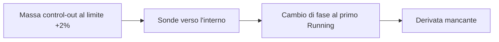

# Progetto — stato corrente e handoff

Questa pagina mantiene il checkpoint verificato e le istruzioni per riprendere
il lavoro. Il [README](../README.md) descrive il simulatore; la [roadmap](ROADMAP.md)
spiega il percorso futuro e il [changelog](../CHANGELOG.md) registra i cambiamenti.

## Stato corrente

Checkpoint dell'**11 novembre 2026**, dopo la diagnostica della valvola di regolazione.

| Ambito | Stato verificato |
| --- | --- |
| Desktop ordinario | Exact-V9; nessuna nuova attivazione termodinamica o installazione di seed. |
| Chiusura termodinamica C4 | Opzione esplicita reference-consistent; implementazione R1 e verifiche locali R2 acquisite. |
| Equilibrio integrato R3 | **RED**: nessuna radice osservata e punto fuori dall'inviluppo. |
| Miglior massimo residuo accettato | **3.334.923,856**; il criterio resta massimo assoluto dei 75 residui scalati ≤1. |
| Ultima ricerca | H9: 476 ricette, due aggiornamenti accettati, arresto al raggio minimo senza discesa ammissibile. |
| Revisione di sufficienza H | PASS offline: il massimo scalato è sceso mentre lo squilibrio fisico cresceva; il modello lineare dei soli inventari non contiene una radice. |
| Diagnostica valvola di regolazione | Eseguita e congelata, replay PASS: `CONTROL-VALVE-NOT-MATERIAL-IN-LINEAR-MODEL`. |
| M10 | **Aperto**. Nessuna ricerca o nuova prova lunga attualmente in corso. |

### Il problema da risolvere

La massa di `control-out`, coordinata 0, è al limite superiore del box +2%.
Le sonde ammesse verso l'interno, alle ampiezze 1e-7 e 1e-8, producono risposte
sane ma fanno diventare liquido l'hotwell al primo Running. La colonna richiesta
dal modello locale diventa quindi indisponibile. In questo arresto il programma
lineare non viene costruito: manca una derivata compatibile con il ramo.



La figura collega il vincolo sugli inventari alla risposta dell'intera ricetta.
Il punto finale resta miscela con un margine energetico hotwell di appena
1,766e-7 J/kg. Ridurre il raggio mantenendo le stesse sonde non ripristina la
derivata. Questo esito non dimostra l'impossibilità di una radice nel box.

Anche i bilanci chiariscono perché il punto non è stazionario: al primo Running
l'ingresso turbina accumula circa 427,8 kW e `control-out` circa 1,168 MW.
Gli accumuli coincidono con i trasferimenti registrati, con errore energetico
inferiore a 0,01 W. Questa verifica riguarda la coerenza delle registrazioni;
conservazione ed equilibrio restano condizioni distinte.

### Che cosa ha mostrato la revisione di sufficienza

La [revisione offline](../eng/contracts/r3-h-family-sufficiency-review1.md)
rilegge gli stessi residui in unità fisiche e linearizza il sistema nel punto
iniziale, senza nuove chiamate all'impianto.

| Punto | Massimo scalato | Somma assoluta dei tassi di energia a seed-step1 | Coppia netta |
| --- | --- | --- | --- |
| Vettore grezzo del modo 2 | 7,85 milioni | 2,69 MW | −0,9 N·m |
| Finale H4 | 3,67 milioni | 3,17 MW | −137 N·m |
| Finale H9 | 3,33 milioni | 12,87 MW | −166 N·m |

Le scale sono il rumore numerico di Exact-V9 e differiscono fra nodi fino a
292 volte. Lontano dalla radice il minimo del massimo scambia quindi pochi kW
sull'hotwell con MW sul drum: il massimo scalato è diminuito mentre il punto
si allontanava fisicamente. I finali H4–H9 sono fuori inviluppo al primo Running.

I due squilibri iniziali coincidono con lo spostamento di energia specifica
introdotto da C4 a parità di stato bersaglio: circa 75,5 kJ/kg per la portata
di stadio su `turbine-inlet` e 11,6 kJ/kg per la portata di circolazione su
`outlet`. Il bilancio complessivo iniziale chiude entro 0,5 kW.

La soluzione lineare non vincolata sui 75 residui richiede passi fino al 4,6%,
con sei coordinate oltre ±2%, e lascia comunque 300–460 kW sulla linea vapore.
Sono previsioni di un modello locale: non dimostrano l'assenza di una radice
non lineare, non provano un difetto dei controllori e non selezionano C o J.

### Che cosa ha mostrato la diagnostica della valvola

La [diagnostica](../eng/contracts/r3-op-control-valve-sensitivity1.md) ha
eseguito 22 ricette nel punto grezzo del modo 2: tutte valide, ripetizioni
identiche con gli hash di stato e baseline riprodotta. Le fasi restano invariate
a ogni ampiezza; da ±1e-3 l'uscita del regolatore lascia l'inviluppo.

La valvola trasferisce energia fra `stop-out` e `control-out`, circa 3,7 kW per
una frazione di 1e-4, e muove la coppia del rotore. Non agisce sui 1,157 MW di
`outlet`, il massimo del punto grezzo. La colonna a 1e-4 differisce dell'8,6%
da quella a 1e-5 ed è quindi utilizzabile.

| Modello lineare, pesi fisici | Massimo tasso di energia | Nodo | Coordinate oltre ±2% |
| --- | --- | --- | --- |
| Soli inventari | 302 kW | `stop-out` | 5 |
| Sola valvola | 1,157 MW | `outlet` | 0 |
| Inventari e valvola | 209 kW | hotwell | 7, valvola +2,9% inclusa |

Il rapporto 209/302 vale il 69%, oltre la soglia del 50%: l'esito è
**`CONTROL-VALVE-NOT-MATERIAL-IN-LINEAR-MODEL`**. La riduzione richiede di
uscire dal box anche sulla valvola; con le scale del contratto il modello
congiunto peggiora da 464 a 526 kW. Sono previsioni locali, non osservazioni.

## Handoff

La valvola di regolazione non è materiale nel modello lineare. Come previsto
dalla specifica, l'esito non materiale motiva una di due attività, da scegliere
con un protocollo distinto:

- la **stessa diagnostica sulle altre cinque grandezze** del seam del seed:
  pompe di condensato e alimento, popolazione neutronica, temperature di
  combustibile e struttura. L'esecutore e l'harness le accettano già; servono
  contratto, ricette e budget propri. Popolazione e temperature sono le sole
  candidate ad agire sui 1,157 MW di `outlet`, che nessuna sonda finora sposta;
- la **revisione della legge di energia dello stadio**, cui la revisione di
  sufficienza attribuisce lo squilibrio su `turbine-inlet` introdotto da C4.

La prima attività è economica e rende decidibile la condizione «nessuna
grandezza sposta i residui della linea vapore»; la seconda tocca la fisica e
richiede motivazione e protocollo propri.

Il replay della diagnostica della valvola si esegue sull'albero a 411 file:

```powershell
python .\eng\run-r3-op-control-valve-sensitivity1.py review
```

con esito atteso `PASS-EVIDENCE-COMPLETE` e classificazione
`CONTROL-VALVE-NOT-MATERIAL-IN-LINEAR-MODEL`. I replay di H4–H9, dei Trial e
delle revisioni restano legati all'albero a 410 file e si eseguono al commit
`72b0910`, che lo contiene; i comandi seguenti valgono su quel commit. I
pacchetti congelati non cambiano.

Il confronto fra **sonde compensate tra inventari** e **maggiore riserva
energetica interna alla miscela** resta sospeso. Sbloccherebbe la derivata
mancante, ma all'interno della famiglia che la revisione indica come insufficiente.

Per riprendere dalla radice del repository:

```powershell
python .\eng\review-r3-h-current-equilibrium.py
```

Il comando ricostruisce H9 e i suoi prerequisiti dalle evidenze congelate,
senza nuove chiamate fisiche. L'esito atteso è `PASS-CURRENT-EQUILIBRIUM-REVIEW`;
`r3_passed` e `m10_closed` devono restare `false`. Il rapporto completo è scritto
in `artifacts/r3-h-current-equilibrium-review/01-current-review.json`.
Per il solo replay H9: `python eng/run-r3-h-energy-guarded-search9.py review`.
Per la revisione di sufficienza: `python eng/review-r3-h-family-sufficiency1.py review`,
con esito atteso `PASS-FAMILY-SUFFICIENCY-REVIEW`.

1. Leggere il [risultato H9](../eng/frozen-evidence/r3-h-energy-guarded-search9/04-result.json):
   `final` contiene coordinate, residui e osservazioni esatti. Usare questi dati
   come ingresso, evitando di ricostruirli dai numeri arrotondati della guida.
2. Leggere l'[analisi di sufficienza](../eng/frozen-evidence/r3-h-family-sufficiency-review1/01-analysis.json):
   `physical_progress` e `linear_models` contengono i valori esatti delle tabelle.
3. Leggere l'[esito della valvola](../eng/frozen-evidence/r3-op-control-valve-sensitivity1/05-adjudication.json):
   `sensitivities` e `linear_models` contengono colonne e previsioni esatte.
4. Scegliere fra la diagnostica delle altre cinque grandezze e la revisione
   della legge di stadio, poi prepararne contratto, revisione statica ed esecuzione.
   Se nessuna grandezza sposta i residui della linea vapore, conservare l'esito
   e rivedere la legge di energia dello stadio prima di altre ricerche.

Per la famiglia H restano fissi 24 inventari fluidi, box ±2%, 75 residui e scale.
La diagnostica varia le condizioni non fluide soltanto come sonde di test;
guadagni, resistenze, capacità e leggi fisiche mantengono la baseline. Una colonna mancante resta
indisponibile. Cambiamenti di box, famiglia di trim o fisica richiedono una
motivazione e un protocollo distinti. Le [decisioni ingegneristiche](validation/MODEL_DECISIONS.md)
raccolgono questi vincoli durevoli.

La [sequenza verso R3 e la chiusura M10](ROADMAP.md#3-che-cosa-manca-dopo-r3-per-chiudere-m10)
mantiene revisione, conferme indipendenti di 100 passi, R3 e le verifiche successive.
Un replay PASS attesta la completezza dell'evidenza; non promuove un seed.

## Evidenze e verifiche

| Riferimento | Cosa leggere |
| --- | --- |
| [Trial 9](../eng/contracts/r3-h-multiscale-derivative-trial9.md) | Confronto su sei ampiezze; 554 ricette ripetute. |
| [Trial 10](../eng/contracts/r3-h-energy-guarded-trial10.md) | Prova energetica ripetuta; 6 ricette e una proposta favorevole. |
| [H9](../eng/contracts/r3-h-energy-guarded-search9.md) | Regole della ricerca, filtri e arresto; 476 ricette. |
| [Esito H9](../eng/frozen-evidence/r3-h-energy-guarded-search9/05-adjudication.json) e [ricevuta](../eng/r3-h-energy-guarded-search9-returned.json) | Risultato indipendente e identità del manifest congelato. |
| [Revisione energetica C4](../eng/contracts/r3-h-energy-boundary-review1.md) | Ricostruzione locale del confine e limiti di applicabilità. |
| [Revisione di sufficienza H](../eng/contracts/r3-h-family-sufficiency-review1.md) e [ricevuta](../eng/r3-h-family-sufficiency-review1-returned.json) | Scale, metrica fisica, attribuzione e modello lineare; nessuna chiamata fisica. |
| [Diagnostica valvola](../eng/contracts/r3-op-control-valve-sensitivity1.md), [esito](../eng/frozen-evidence/r3-op-control-valve-sensitivity1/05-adjudication.json) e [ricevuta](../eng/r3-op-control-valve-sensitivity1-returned.json) | 22 sonde ripetute sulla valvola di regolazione; non materiale nel modello lineare. |
| [Sintesi della validazione](validation/README.md) | Differenza fra controlli locali, evidenza e qualificazione fisica. |

I replay H sono PASS sull'albero a 410 file di test; i 962 sorgenti produttivi
sono invariati. Con i 411 file la CI ordinaria (`eng\ci-ordinary.cmd`) ha dato
PASS: compilazione Release con avvisi come errori, **1.395 superati, 165
espliciti esclusi, zero fallimenti**, baseline delle evidenze correnti PASS.
La diagnostica della valvola ha superato tre controlli preliminari, con uno
esplicito escluso, prima dell'esecuzione fisica esplicita; il suo replay è PASS.
Trial 9, Trial 10 e H9 non cambiano C#. Passano anche i casi analitici e i
replay indipendenti; la cronologia è nel [changelog](../CHANGELOG.md).

Gli input esatti storici restano in [eng/contracts/m10](../eng/contracts/m10/README.md)
e le evidenze in [eng/frozen-evidence](../eng/frozen-evidence/README.md).
Le vecchie diciture «current» o «next» descrivono i rispettivi checkpoint storici.
I seguenti marcatori conservano riferimenti delle revisioni precedenti:

NRS-MARKER:R3-H-LOCAL-MODEL-DESIGN1-CURRENT

NRS-MARKER:R3-H-NUMERICAL-STOP-REVIEW1-CURRENT
