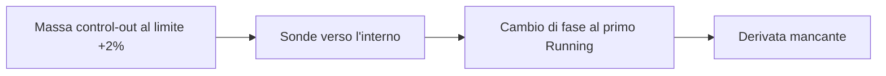

# Progetto — stato corrente e handoff

Questa pagina mantiene il checkpoint verificato e le istruzioni per riprendere
il lavoro. Il [README](../README.md) descrive il simulatore; la [roadmap](ROADMAP.md)
spiega il percorso futuro e il [changelog](../CHANGELOG.md) registra i cambiamenti.

## Stato corrente

Checkpoint dell'**11 novembre 2026**, dopo la ricostruzione della legge di energia dello stadio.

| Ambito | Stato verificato |
| --- | --- |
| Desktop ordinario | Exact-V9; nessuna nuova attivazione termodinamica o installazione di seed. |
| Chiusura termodinamica C4 | Opzione esplicita reference-consistent; implementazione R1 e verifiche locali R2 acquisite. |
| Equilibrio integrato R3 | **RED**: nessuna radice osservata e punto fuori dall'inviluppo. |
| Miglior massimo residuo accettato | **3.334.923,856**; il criterio resta massimo assoluto dei 75 residui scalati ≤1. |
| Ultima ricerca | H9: 476 ricette, due aggiornamenti accettati, arresto al raggio minimo senza discesa ammissibile. |
| Revisione di sufficienza H | PASS offline: il massimo scalato è sceso mentre lo squilibrio fisico cresceva; il modello lineare dei soli inventari non contiene una radice. |
| Diagnostica valvola di regolazione | Eseguita e congelata, replay PASS: `CONTROL-VALVE-NOT-MATERIAL-IN-LINEAR-MODEL`. |
| Altre grandezze non fluide | Eseguite e congelate, replay PASS: `NONFLUID-COMBINATION-MATERIAL-IN-LINEAR-MODEL`, artefatto di colonne collineari. |
| Revisione vincolata | Offline, congelata, replay PASS: `NO-BOUNDED-NONFLUID-COMBINATION-MATERIAL-IN-LINEAR-MODEL`. |
| Legge di energia dello stadio | Revisione 2 congelata, replay PASS: `STAGE-ADMISSION-CLOSURE-INCOHERENCE-DEMONSTRATED`; la revisione 1 non è valida. |
| M10 | **Aperto**. Nessuna ricerca o nuova prova lunga attualmente in corso. |

### Il problema da risolvere

La massa di `control-out`, coordinata 0, è al limite superiore del box +2%.
Le sonde ammesse verso l'interno, alle ampiezze 1e-7 e 1e-8, producono risposte
sane ma fanno diventare liquido l'hotwell al primo Running. La colonna richiesta
dal modello locale diventa quindi indisponibile. In questo arresto il programma
lineare non viene costruito: manca una derivata compatibile con il ramo.



La figura collega il vincolo sugli inventari alla risposta dell'intera ricetta.
Il punto finale resta miscela con un margine energetico hotwell di appena
1,766e-7 J/kg. Ridurre il raggio mantenendo le stesse sonde non ripristina la
derivata. Questo esito non dimostra l'impossibilità di una radice nel box.

Anche i bilanci chiariscono perché il punto non è stazionario: al primo Running
l'ingresso turbina accumula circa 427,8 kW e `control-out` circa 1,168 MW.
Gli accumuli coincidono con i trasferimenti registrati, con errore energetico
inferiore a 0,01 W. Questa verifica riguarda la coerenza delle registrazioni;
conservazione ed equilibrio restano condizioni distinte.

### Che cosa ha mostrato la revisione di sufficienza

La [revisione offline](../eng/contracts/r3-h-family-sufficiency-review1.md)
rilegge gli stessi residui in unità fisiche e linearizza il sistema nel punto
iniziale, senza nuove chiamate all'impianto.

| Punto | Massimo scalato | Somma assoluta dei tassi di energia a seed-step1 | Coppia netta |
| --- | --- | --- | --- |
| Vettore grezzo del modo 2 | 7,85 milioni | 2,69 MW | −0,9 N·m |
| Finale H4 | 3,67 milioni | 3,17 MW | −137 N·m |
| Finale H9 | 3,33 milioni | 12,87 MW | −166 N·m |

Le scale sono il rumore numerico di Exact-V9 e differiscono fra nodi fino a
292 volte. Lontano dalla radice il minimo del massimo scambia quindi pochi kW
sull'hotwell con MW sul drum: il massimo scalato è diminuito mentre il punto
si allontanava fisicamente. I finali H4–H9 sono fuori inviluppo al primo Running.

I due squilibri iniziali coincidono con lo spostamento di energia specifica
introdotto da C4 a parità di stato bersaglio: circa 75,5 kJ/kg per la portata
di stadio su `turbine-inlet` e 11,6 kJ/kg per la portata di circolazione su
`outlet`. Il bilancio complessivo iniziale chiude entro 0,5 kW.

La soluzione lineare non vincolata sui 75 residui richiede passi fino al 4,6%,
con sei coordinate oltre ±2%, e lascia comunque 300–460 kW sulla linea vapore.
Sono previsioni di un modello locale: non dimostrano l'assenza di una radice
non lineare, non provano un difetto dei controllori e non selezionano C o J.

### Che cosa ha mostrato la diagnostica della valvola

La [diagnostica](../eng/contracts/r3-op-control-valve-sensitivity1.md) ha
eseguito 22 ricette nel punto grezzo del modo 2: tutte valide, ripetizioni
identiche con gli hash di stato e baseline riprodotta. Le fasi restano invariate
a ogni ampiezza; da ±1e-3 l'uscita del regolatore lascia l'inviluppo.

La valvola trasferisce energia fra `stop-out` e `control-out`, circa 3,7 kW per
una frazione di 1e-4, e muove la coppia del rotore. Non agisce sui 1,157 MW di
`outlet`, il massimo del punto grezzo. La colonna a 1e-4 differisce dell'8,6%
da quella a 1e-5 ed è quindi utilizzabile.

| Modello lineare, pesi fisici | Massimo tasso di energia | Nodo | Coordinate oltre ±2% |
| --- | --- | --- | --- |
| Soli inventari | 302 kW | `stop-out` | 5 |
| Sola valvola | 1,157 MW | `outlet` | 0 |
| Inventari e valvola | 209 kW | hotwell | 7, valvola +2,9% inclusa |

Il rapporto 209/302 vale il 69%, oltre la soglia del 50%: l'esito è
**`CONTROL-VALVE-NOT-MATERIAL-IN-LINEAR-MODEL`**. La riduzione richiede di
uscire dal box anche sulla valvola; con le scale del contratto il modello
congiunto peggiora da 464 a 526 kW. Sono previsioni locali, non osservazioni.

### Che cosa hanno mostrato le altre grandezze non fluide

La [seconda diagnostica](../eng/contracts/r3-op-remaining-quantities-sensitivity1.md)
ha eseguito 102 ricette sulle cinque grandezze restanti: tutte valide e
nell'inviluppo, ripetizioni identiche, baseline uguale a quella congelata della
valvola. L'unico cambio di fase compare con la pompa di alimento a +1e-2.
Tutte le colonne primarie sono utilizzabili.

| Grandezza | Effetto dominante | Inventari e grandezza | Rapporto |
| --- | --- | --- | --- |
| Pompa di condensato | Massa fra hotwell e `feedwater-inventory` | 300 kW su `stop-out` | 99% |
| Pompa di alimento | Massa fra `feedwater-inventory` e drum | 295 kW su `stop-out` | 98% |
| Popolazione neutronica | Energia di `outlet` | 314 kW su `stop-out` | 104% |
| Temperatura del combustibile | Energia di `outlet` | 314 kW su `stop-out` | 104% |
| Temperatura della struttura | Energia di `outlet` | 314 kW su `stop-out` | 104% |

Nessuna grandezza sposta il residuo della linea vapore: con ciascuna il massimo
resta su `stop-out`. Popolazione e temperature possono annullare da sole i
1,157 MW di `outlet`, ma il massimo passa allora a `turbine-inlet` con 1,007 MW.
Le loro colonne pesate hanno coseno 1,0000: descrivono la stessa direzione,
il calore ceduto dal nocciolo.

L'esito congelato è **`NONFLUID-COMBINATION-MATERIAL-IN-LINEAR-MODEL`**: con
tutte le colonne, valvola inclusa, il modello prevede 18 kW, il 6%. La
previsione richiede però −6.077% sulla pompa di condensato, +2.136% sulla
popolazione e −613% sulla struttura: sfrutta differenze minime fra colonne
collineari ed è fuori da qualsiasi regione descritta dalle sonde. Il contratto
non vincolava il passo del modello congiunto; l'esito resta conservato com'è,
ma non motiva una famiglia. Le [decisioni](validation/MODEL_DECISIONS.md#classificare-i-modelli-lineari-entro-la-regione-delle-sonde)
registrano la correzione per i protocolli successivi.

### Che cosa ha mostrato la revisione vincolata

La [revisione offline](../eng/contracts/r3-op-bounded-combination-review1.md)
ripete il confronto con le stesse colonne, ma con limiti fissati prima del
calcolo: inventari entro ±2%, grandezze non fluide entro ±1e-2, l'ampiezza
massima sondata. Il solutore a insieme attivo certifica ogni soluzione con le
condizioni KKT; popolazione e temperature sono raggruppate in una frazione
comune e controllate anche separatamente.

| Modello | Massimo tasso di energia | `stop-out` / `control-out` | `turbine-inlet` |
| --- | --- | --- | --- |
| Soli inventari, ±2% | 335 kW | 201–224 kW | 323–335 kW |
| Con grandezze non fluide, ±1e-2 | 357 kW, il 107% | 188–213 kW | 348–357 kW |

Il modello separato e quello con le grandezze non fluide fino a ±2% danno gli
stessi valori. Entro i limiti la pompa di condensato raggiunge il proprio, le
altre grandezze restano sotto l'1%. Nessuna combinazione sposta l'accumulo di
energia lungo la linea vapore: l'esito è
**`NO-BOUNDED-NONFLUID-COMBINATION-MATERIAL-IN-LINEAR-MODEL`**. Il residuo
coincide per posizione con lo squilibrio su `turbine-inlet` che la revisione di
sufficienza attribuisce allo spostamento di energia specifica introdotto da C4.

### Che cosa ha mostrato la ricostruzione dello stadio

Con il drenaggio della condensa, `TurbineExpansionSolver` divide la portata
secondo la qualità del nodo di ingresso e assegna a vapore e condensa le
energie di `GetSaturationProperties`, che il modello semplificato calcola sempre
con le correlazioni storiche. Il separatore del drum usa invece
`PhaseTransportPropertyProvider`, che sotto C4 delega al resolver tabulato.
La [ricostruzione](../eng/contracts/r3-stage-energy-law-reconstruction2.md)
lo ha misurato nel punto grezzo del modo 2, al checkpoint 1:

| Energia specifica, entalpia | Registrata dallo stadio | Saturazione storica | Chiusura attiva C4 |
| --- | --- | --- | --- |
| Vapore | 2.726,6 kJ/kg | 2.726,6 kJ/kg, identica | 2.801,7 kJ/kg |
| Condensa | 1.044,6 kJ/kg | 1.044,6 kJ/kg, identica | 1.074,0 kJ/kg |

La miscela C4 di `turbine-inlet` vale 2.761,4 kJ/kg e coincide con le proprie
proprietà di trasporto entro 1,7 J/kg; con quelle storiche differisce di 74
kJ/kg. Lo stadio ammette quindi energia C4 e la rimuove con energie storiche.
Ricalcolando l'uscita con le energie della chiusura attiva, a parità di stato e
portate, l'accumulo su `turbine-inlet` scende da 1,007 MW a 18,8 kW, l'1,9%:
l'esito è **`STAGE-ADMISSION-CLOSURE-INCOHERENCE-DEMONSTRATED`**. I 18,8 kW
restanti corrispondono alla differenza di 1,4 kJ/kg fra `control-out` e il nodo.
Anche la condensa del condensatore usa la saturazione storica, per circa 6,3 kW.

Il controfattuale è contabile, non un'osservazione: non dice come evolverebbe
l'impianto con la legge corretta. La prima esecuzione aveva valutato i provider
sullo stato di fine passo ed è congelata come non valida.

## Handoff

La ricostruzione ha dimostrato un'incoerenza nella legge di trasporto dello
stadio sotto C4. La prossima attività è **pianificare la modifica**: con la
chiusura C4, l'ammissione con drenaggio della condensa, e da valutare la
condensa del condensatore, dovrebbero ricavare le energie di fase da
`PhaseTransportPropertyProvider`, come già il separatore del drum. È una
modifica della fisica di produzione e richiede un protocollo proprio:

- dimostrare che, con le chiusure non C4, il comportamento resta identico bit
  per bit. Il desktop usa `CorrelationConsistentInverseDomain`; lì il provider
  attivo ricade sulle correlazioni storiche ma le valuta dalla temperatura del
  nodo, mentre lo stadio usa la pressione. L'identità è verificata solo a
  temperatura di saturazione esatta, quindi la modifica va limitata a C4 o
  dimostrata identica sugli stati reali;
- test locali dello stadio e del condensatore sotto C4, suite ordinaria e
  baseline delle evidenze correnti;
- poiché cambia il campo di flussi, ripetere la misura del punto grezzo del
  modo 2 prima di qualsiasi nuova ricerca: le evidenze H, non fluide e della
  ricostruzione restano storiche e non si riusano come Jacobiani.

Nessuna modifica è autorizzata dalla sola ricostruzione.

L'albero `tests/` conta ora 412 file. I replay della ricostruzione 2 si
eseguono su questo albero; quelli delle diagnostiche non fluide e della
revisione vincolata, legati all'albero a 411 file, al commit `ed35d9e`; quello
della ricostruzione 1, non valida, al commit `804e76f`:

```powershell
python .\eng\run-r3-stage-energy-law-reconstruction2.py review
python .\eng\run-r3-op-control-valve-sensitivity1.py review
python .\eng\run-r3-op-remaining-quantities-sensitivity1.py review
python .\eng\review-r3-op-bounded-combination1.py review
```

con esiti attesi `PASS-RECONSTRUCTION-COMPLETE` e
`STAGE-ADMISSION-CLOSURE-INCOHERENCE-DEMONSTRATED`, poi
`CONTROL-VALVE-NOT-MATERIAL-IN-LINEAR-MODEL`,
`NONFLUID-COMBINATION-MATERIAL-IN-LINEAR-MODEL` e
`NO-BOUNDED-NONFLUID-COMBINATION-MATERIAL-IN-LINEAR-MODEL`. I replay di H4–H9,
dei Trial e delle revisioni restano legati all'albero a 410 file e si eseguono
al commit `72b0910`, che lo contiene; i comandi seguenti valgono su quel
commit. I pacchetti congelati non cambiano.

Il confronto fra **sonde compensate tra inventari** e **maggiore riserva
energetica interna alla miscela** resta sospeso. Sbloccherebbe la derivata
mancante, ma all'interno della famiglia che la revisione indica come insufficiente.

Per riprendere dalla radice del repository:

```powershell
python .\eng\review-r3-h-current-equilibrium.py
```

Il comando ricostruisce H9 e i suoi prerequisiti dalle evidenze congelate,
senza nuove chiamate fisiche. L'esito atteso è `PASS-CURRENT-EQUILIBRIUM-REVIEW`;
`r3_passed` e `m10_closed` devono restare `false`. Il rapporto completo è scritto
in `artifacts/r3-h-current-equilibrium-review/01-current-review.json`.
Per il solo replay H9: `python eng/run-r3-h-energy-guarded-search9.py review`.
Per la revisione di sufficienza: `python eng/review-r3-h-family-sufficiency1.py review`,
con esito atteso `PASS-FAMILY-SUFFICIENCY-REVIEW`.

1. Leggere il [risultato H9](../eng/frozen-evidence/r3-h-energy-guarded-search9/04-result.json):
   `final` contiene coordinate, residui e osservazioni esatti. Usare questi dati
   come ingresso, evitando di ricostruirli dai numeri arrotondati della guida.
2. Leggere l'[analisi di sufficienza](../eng/frozen-evidence/r3-h-family-sufficiency-review1/01-analysis.json):
   `physical_progress` e `linear_models` contengono i valori esatti delle tabelle.
3. Leggere gli esiti [della valvola](../eng/frozen-evidence/r3-op-control-valve-sensitivity1/05-adjudication.json)
   e [delle altre grandezze](../eng/frozen-evidence/r3-op-remaining-quantities-sensitivity1/05-adjudication.json):
   `sensitivities`, `linear_models`, `quantities` e `combined_model` contengono
   colonne, passi e previsioni esatte; le tracce dei batch le colonne complete.
4. Leggere l'[analisi vincolata](../eng/frozen-evidence/r3-op-bounded-combination-review1/01-analysis.json):
   `models` contiene passi, certificati e `steam_path_energy_rates_w`.
5. Leggere la [ricostruzione dello stadio](../eng/frozen-evidence/r3-stage-energy-law-reconstruction2/05-adjudication.json):
   `stage`, `turbine_inlet` e `condenser` contengono energie, provider e controfattuale.
6. Scrivere il protocollo della modifica della legge di trasporto sotto C4, con
   identità sotto la chiusura storica, test locali, suite ordinaria e nuova
   misura del punto grezzo, e farlo approvare prima di toccare `src/`.

Per la famiglia H restano fissi 24 inventari fluidi, box ±2%, 75 residui e scale.
La diagnostica varia le condizioni non fluide soltanto come sonde di test;
guadagni, resistenze, capacità e leggi fisiche mantengono la baseline. Una colonna mancante resta
indisponibile. Cambiamenti di box, famiglia di trim o fisica richiedono una
motivazione e un protocollo distinti. Le [decisioni ingegneristiche](validation/MODEL_DECISIONS.md)
raccolgono questi vincoli durevoli.

La [sequenza verso R3 e la chiusura M10](ROADMAP.md#3-che-cosa-manca-dopo-r3-per-chiudere-m10)
mantiene revisione, conferme indipendenti di 100 passi, R3 e le verifiche successive.
Un replay PASS attesta la completezza dell'evidenza; non promuove un seed.

## Evidenze e verifiche

| Riferimento | Cosa leggere |
| --- | --- |
| [Trial 9](../eng/contracts/r3-h-multiscale-derivative-trial9.md) | Confronto su sei ampiezze; 554 ricette ripetute. |
| [Trial 10](../eng/contracts/r3-h-energy-guarded-trial10.md) | Prova energetica ripetuta; 6 ricette e una proposta favorevole. |
| [H9](../eng/contracts/r3-h-energy-guarded-search9.md) | Regole della ricerca, filtri e arresto; 476 ricette. |
| [Esito H9](../eng/frozen-evidence/r3-h-energy-guarded-search9/05-adjudication.json) e [ricevuta](../eng/r3-h-energy-guarded-search9-returned.json) | Risultato indipendente e identità del manifest congelato. |
| [Revisione energetica C4](../eng/contracts/r3-h-energy-boundary-review1.md) | Ricostruzione locale del confine e limiti di applicabilità. |
| [Revisione di sufficienza H](../eng/contracts/r3-h-family-sufficiency-review1.md) e [ricevuta](../eng/r3-h-family-sufficiency-review1-returned.json) | Scale, metrica fisica, attribuzione e modello lineare; nessuna chiamata fisica. |
| [Diagnostica valvola](../eng/contracts/r3-op-control-valve-sensitivity1.md), [esito](../eng/frozen-evidence/r3-op-control-valve-sensitivity1/05-adjudication.json) e [ricevuta](../eng/r3-op-control-valve-sensitivity1-returned.json) | 22 sonde ripetute sulla valvola di regolazione; non materiale nel modello lineare. |
| [Altre grandezze non fluide](../eng/contracts/r3-op-remaining-quantities-sensitivity1.md), [esito](../eng/frozen-evidence/r3-op-remaining-quantities-sensitivity1/05-adjudication.json) e [ricevuta](../eng/r3-op-remaining-quantities-sensitivity1-returned.json) | 102 sonde ripetute su pompe, popolazione e temperature; combinazione materiale solo fuori dal box. |
| [Revisione vincolata](../eng/contracts/r3-op-bounded-combination-review1.md), [analisi](../eng/frozen-evidence/r3-op-bounded-combination-review1/01-analysis.json) e [ricevuta](../eng/r3-op-bounded-combination-review1-returned.json) | Minimi quadrati certificati entro i limiti delle sonde; nessuna chiamata fisica. |
| [Ricostruzione dello stadio](../eng/contracts/r3-stage-energy-law-reconstruction2.md), [esito](../eng/frozen-evidence/r3-stage-energy-law-reconstruction2/05-adjudication.json) e [ricevuta](../eng/r3-stage-energy-law-reconstruction2-returned.json) | Energie di vapore e condensa dello stadio contro i due provider; la [revisione 1](../eng/contracts/r3-stage-energy-law-reconstruction1.md) non è valida. |
| [Sintesi della validazione](validation/README.md) | Differenza fra controlli locali, evidenza e qualificazione fisica. |

I replay H sono PASS sull'albero a 410 file di test; i 962 sorgenti produttivi
sono invariati. Con i 412 file la CI ordinaria (`eng\ci-ordinary.cmd`) ha dato
PASS: compilazione Release con avvisi come errori, **1.397 superati, 166
espliciti esclusi, zero fallimenti**, baseline delle evidenze correnti PASS.
Le due diagnostiche non fluide hanno superato ciascuna tre controlli preliminari,
la ricostruzione dello stadio due, con un esplicito escluso, prima
dell'esecuzione esplicita; i replay sono PASS. La seconda diagnostica non
modifica C#.
Trial 9, Trial 10 e H9 non cambiano C#. Passano anche i casi analitici e i
replay indipendenti; la cronologia è nel [changelog](../CHANGELOG.md).

Gli input esatti storici restano in [eng/contracts/m10](../eng/contracts/m10/README.md)
e le evidenze in [eng/frozen-evidence](../eng/frozen-evidence/README.md).
Le vecchie diciture «current» o «next» descrivono i rispettivi checkpoint storici.
I seguenti marcatori conservano riferimenti delle revisioni precedenti:

NRS-MARKER:R3-H-LOCAL-MODEL-DESIGN1-CURRENT

NRS-MARKER:R3-H-NUMERICAL-STOP-REVIEW1-CURRENT
