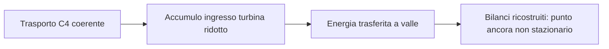
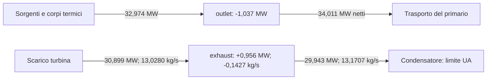
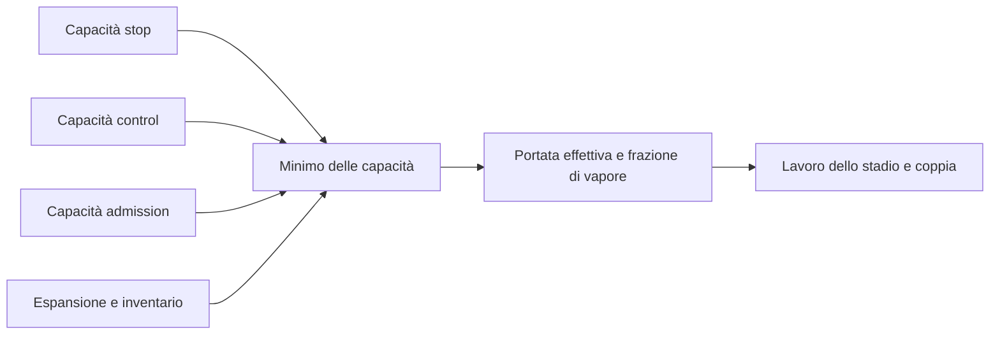

# Progetto — stato corrente e handoff

Questa pagina mantiene risultato verificato e ripresa del lavoro. Il
[README](../README.md) descrive il simulatore, la [roadmap](ROADMAP.md) pianifica
le consegne e il [changelog](../CHANGELOG.md) conserva la cronologia.

## Stato corrente

Checkpoint del **12 novembre 2026**, dopo la riparazione del trasporto di fase,
la costruzione della base direzionale, il fallimento delle prime proposte,
l'attribuzione al minimo delle capacità di portata, la sua osservazione
a tutti i checkpoint, la verifica offline di un modello che lo conserva e la
sua prima verifica prospettica.

| Ambito | Stato verificato |
| --- | --- |
| Desktop ordinario | Exact-V9 e missione v3 invariati; controlli di identità e determinismo PASS. |
| Trasporto sotto C4 | Riparazione implementata nei quattro file previsti; saturazione pubblica e payload invariati. |
| Nuova misura | Due ricette identiche, tre checkpoint sani e nell'inviluppo. Verifica della riparazione PASS con adjudication 2. |
| Diagnosi dei bilanci | Altre due ricette, sei passi totali: stati identici alla misura precedente, bilanci termici e di exhaust ricostruiti. Limite del condensatore: superficie UA. |
| Base direzionale | 30 direzioni misurate, rango numerico diagnostico 30; quattro coefficienti unilaterali e due direzioni accoppiate. |
| Prime proposte | Due passi ripetibili e nei controlli registrati, ma errore predittivo circa 15 volte la variazione prevista. Nessuna ricerca avviata. |
| Capacità di portata | Minimo delle cinque capacità riprodotto esattamente in 57 ricostruzioni su 38 ricette ripetute; proposte nel ramo admission a tutti i checkpoint. |
| Modello del minimo | Offline, senza passi runtime: errori delle proposte 1,78e-4 e 1,50e-4 contro 14,734 e 15,011 del modello affine; vincitori previsti in 16 sonde su 16. Confronto retrospettivo. |
| Proposte prospettiche | Sei previsioni congelate prima della misura, su tre rami: tutte conformi, errore massimo 4,7e-4 contro 0,10; vincitori corretti. Massimo pesato osservato da 1,157 a 1,056. Solo otto direzioni. |
| Punto grezzo riparato | Massimo assoluto dei 75 residui scalati **8.582.400,421**, contro il criterio ≤1. |
| Equilibrio R3 e M10 | **R3 RED, M10 aperto**. Nessun seed installato, nessuna attivazione produttiva C4. |

Il valore H9 di 3.334.923,856 appartiene alla legge precedente. Restano storici
quel candidato, i suoi Jacobiani e le altre sonde già congelate: non sono una
baseline di equilibrio della legge riparata.

### Il problema da risolvere

Lo stadio usava energie di vapore e condensa storiche mentre il fluido era
risolto da C4. Ora le ricava dal provider della chiusura attiva, indicizzato
dalla pressione. Le modalità storiche conservano le proprietà bit per bit;
lo stesso principio viene applicato alla condensa del condensatore.

La misura reale conferma la correzione locale. L'accumulo di turbine-inlet è
18,963 kW al primo passo preparatorio, 19,224 kW al post-seed e **19,465 kW**
al primo Running, rispetto ai precedenti 1.006,560 kW. Tutti e tre rispettano
il limite dichiarato del 10%. Le energie registrate coincidono con quelle C4.

L'energia viene trasferita a valle: al primo Running `exhaust` accumula circa
955,9 kW e `outlet` perde circa 1.037,0 kW. La nuova diagnosi ne ricostruisce
i bilanci, ma il punto resta fuori equilibrio. Tre checkpoint nell'inviluppo
non sostituiscono le conferme di 100 passi o la qualificazione R3.



La figura spiega il significato della riparazione: correggere la proprietà
del trasporto rimuove lo scarto strutturale all'ingresso, mentre gli altri
inventari devono ancora trovare un punto stazionario con la nuova legge.

### Che cosa spiega la nuova diagnosi

La console diagnostica separata ha acquisito due volte la stessa ricetta:
due passi preparatori e un Running per ripetizione, sei passi complessivi.
Gli hash dello stato completo prima e dopo Running coincidono con la misura
precedente; coincidono anche i dodici inventari e le due ripetizioni.
Nessun file produttivo o di test è cambiato durante questa diagnosi.

| Nodo | Bilancio al primo Running | Significato |
| --- | --- | --- |
| `outlet` | Calore ricevuto 32,974 MW; trasporto energetico netto uscente 34,011 MW; accumulo −1,037 MW. | Il calore comprende 6,594 MW diretti e 26,380 MW ceduti da combustibile e struttura. |
| `exhaust` | Energia entrante 30,899 MW; uscente 29,943 MW; accumulo +0,956 MW. | Lo stadio e il condensatore trasportano energie specifiche diverse. |
| `exhaust`, massa | Ingresso 13,0280 kg/s; condensazione 13,1707 kg/s; accumulo −0,1427 kg/s. | L'energia cresce mentre la massa diminuisce: entrambi i bilanci devono essere soddisfatti. |

Il calore di `outlet` è ricostruito dalle sorgenti dei canali e dagli scambi
fra corpi termici e fluido. I bilanci indipendenti di combustibile e struttura
chiudono entro 0,01 W; i loro accumuli sono circa −2,04 e −1,02 kW.
L'analisi congelata ricava il trasporto netto di `outlet` per differenza dal
suo accumulo. In questo specifico passo la correzione idraulica non è scattata:
anche il calcolo con le portate registrate, 100,0477 e 99,9646 kg/s, e le
entalpie iniziali ricostruisce lo stesso trasporto entro 0,01 W. Questo
controllo non si estende automaticamente ai passi con correzione attiva.

Sul condensatore il limite effettivo è **27,597 MW**, imposto dalla superficie
di scambio UA, mentre la capacità installata è 40 MW. I bilanci di `exhaust`
chiudono entro 1e-6 kg/s e 0,01 W. Il fluido entrante porta 2,372 MJ/kg;
il condensatore preleva dal nodo 2,273 MJ/kg. Questa differenza descrive
un nodo non stazionario e non dimostra da sola un altro difetto di modello.



Il diagramma mostra due bilanci locali, non un collegamento diretto fra
`outlet` e lo scarico turbina. Le differenze fra entrate e uscite spiegano
gli accumuli. A stato e ingresso della turbina fissi, il solo raffreddamento
non può annullare insieme i due accumuli di `exhaust`: bilanciare la massa
lascerebbe +1,280 MW, mentre bilanciare l'energia darebbe −0,563 kg/s.
Sono confronti algebrici, non nuovi punti operativi o una prova di impossibilità
nel box di ricerca. Anche aumentare soltanto la temperatura del combustibile
sposterebbe il deficit da `outlet` al corpo termico: il prossimo confronto
deve osservare insieme inventari, sorgente nucleare e scambi termici.

### La base attuale e la sua verifica

Le prove precedenti hanno distinto sorgente nucleare e trasferimenti termici,
recuperato le sensibilità di pressure ed exhaust e selezionato 19 colonne
cartesiane su 30. Il confronto dei rami ha poi eseguito 394 ricette ripetibili,
tutte sane, 384 nell'inviluppo, portando le direzioni disponibili a 28.
Altre 114 ricette ripetibili, tutte sane e 110 nell'inviluppo, hanno misurato
le direzioni accoppiate che completano la base direzionale.

| Tipo di direzione | Contenuto e vincoli |
| --- | --- |
| 24 direzioni centrali isolate | Inventari e tutte le sei grandezze non fluide, ammesse ai due segni alle scale selezionate. |
| Quattro direzioni unilaterali | Massa ed energia di hotwell e suction, nel verso positivo. I coefficienti restano non negativi. |
| Due direzioni accoppiate | Control-out con massa ed energia compensate nella pressione grezza; turbine-inlet a energia interna specifica costante. Non validano le due derivate cartesiane precedentemente mancanti. |

Il rango numerico diagnostico è 30, con soglia 1e-8 dopo normalizzazione.
Questo non dimostra fattibilità del cono, accuratezza di una somma di direzioni
o sufficienza della famiglia. La sonda nucleare-termica iniziale, conforme
entro lo 0,037%, rimane una verifica della propria direzione alla scala misurata.

### Perché non parte ancora la ricerca

La prima prova combinata ha ottimizzato il modello lineare delle 81 righe
diagnostiche entro le ampiezze campionate, mantenendo non negativi i quattro
coefficienti unilaterali. Il passo intero non è stato eseguito: si sono misurate
solo le frazioni 0,25 e 0,50, ripetute due volte, più due baseline.

Entrambe le proposte restano sane, nell'inviluppo e negli stessi regimi
registrati. **Entrambe falliscono la previsione**: errore relativo 14,734 e
15,011, contro il limite 0,10. Il denominatore è la variazione prevista di
tutte le 81 righe, non il residuo iniziale. La riduzione del massimo originale
da 8.582.400,421 a circa 8.464.496,729 nel secondo passo non qualifica una radice.

| Primo passo preparatorio | Variazione di coppia prevista | Variazione osservata |
| --- | --- | --- |
| Frazione 0,25 | −0,239 N·m | −3,397 N·m |
| Frazione 0,50 | −0,478 N·m | −6,795 N·m |

La revisione offline ricostruisce questa differenza già al primo passo.
La legge produttiva sceglie la portata minima fra le capacità di stop,
control, admission, espansione e inventario. Nella baseline vince stop,
con un margine di circa 9,65e-8 kg/s rispetto alla capacità successiva;
nelle due proposte vince admission. Le secanti usate dal modello possono
quindi attraversare vincitori diversi e la loro somma affine non conserva
la legge del minimo. Questo confine non era incluso nei regimi registrati.



Il diagramma mostra il tratto della legge che manca al modello affine:
variare un ingresso può cambiare quale capacità determina l'uscita.
La ricostruzione del minimo e della coppia riproduce le misure entro
1e-9 kg/s e 1e-6 N·m. L'attribuzione offline riguardava solo il primo passo
preparatorio; non dimostra un nuovo difetto fisico e non qualifica ancora
un modello a tratti.

### Le capacità lungo tutta la ricetta

La prova 8 ha ripetuto le 38 richieste di origine con una console che legge
dagli snapshot dello stesso passo le posizioni effettive e le portate delle
tre valvole, oltre alla portata comandata dello stadio. Resolver e rete del
vapore valutano lo stesso stato comandato. Ogni record coincide con quello
congelato, tolto il blocco aggiunto; il minimo delle cinque capacità riproduce
**esattamente** la portata comandata in tutte le 57 ricostruzioni.

| Ricetta | Primo passo | Post-seed | Primo Running |
| --- | --- | --- | --- |
| Baseline | stop, margine 9,65e-8 kg/s; quattro capacità entro 1e-6 | control, 5,93e-6 kg/s | control, 4,49e-6 kg/s |
| Proposta 0,25 | admission, 2,62e-3 kg/s | admission, 2,76e-3 kg/s | admission, 2,67e-3 kg/s |
| Proposta 0,50 | admission, 5,24e-3 kg/s | admission, 5,60e-3 kg/s | admission, 5,51e-3 kg/s |

In queste ricette la posizione effettiva della control coincide con l'uscita
del governor: il limite di corsa non interviene. Le due proposte restano in un
solo ramo, distinto da quello della baseline. Fra i due segni delle sonde
attive, cinque direzioni su otto cambiano vincitore a tutti i checkpoint, due
soltanto al primo e `outlet:energy` mai. L'inventario non vince in alcun caso.

Il bilancio di massa dei nodi intermedi spiega perché il pareggio non è
accidentale. Con il drenaggio dell'umidità lo stadio preleva da turbine-inlet
l'intera portata comandata. In un punto stazionario, senza altri flussi su
quei nodi, le tre valvole portano quindi la stessa portata dello stadio:
le loro capacità coincidono con il minimo. Una radice si troverebbe sul
pareggio. È una deduzione dalle equazioni, non una misura di una radice.

### Un modello che conserva il minimo

La revisione 9, offline e senza passi runtime, linearizza separatamente ogni
capacità ai tre checkpoint e prende il minimo in ordine dal primo passo. Ogni
riga risponde alle direzioni e alle portate comandate fino al proprio
checkpoint: la sua derivata dipende quindi dalla capacità che vince. I
coefficienti di portata si stimano dalle somme delle sonde opposte, che
contengono il salto del minimo; quelli di direzione dalla loro differenza.
Le proposte non entrano nella stima.

| Confronto | Modello affine della prova 6 | Modello del minimo |
| --- | --- | --- |
| Proposta 0,25 | Errore 14,734 | Errore 1,78e-4; ramo admission previsto a tutti i checkpoint |
| Proposta 0,50 | Errore 15,011 | Errore 1,50e-4; ramo admission previsto a tutti i checkpoint |
| 16 sonde delle direzioni attive | Secanti fra vincitori diversi | Vincitori corretti in tutte; errore massimo 1,65e-3 |
| Stima senza una direzione alla volta | — | Errore massimo sulle proposte 2,27e-4 |

La portata prevista dista al massimo 9,5e-7 kg/s da quella osservata nelle
proposte. Due controlli strutturali sono indipendenti dalla stima. Il
coefficiente fra coppia e portata coincide entro 3,3e-4 relativo con
`qualità × lavoro ideale × efficienza / ω`. La capacità di inventario risponde
alle portate precedenti con −0,5 entro 2,1e-3, come impone la legge di metà
inventario per passo. Il rapporto di cancellazione è circa 0,93: i contributi
delle direzioni quasi non si elidono.

Il risultato spiega il fallimento della prova 6 senza riscriverlo. Restano
limiti precisi:
- il confronto è retrospettivo, perché la forma del modello è stata provata
  sugli stessi record prima del contratto;
- sono modellate solo le otto direzioni attive;
- le somme di portata dei tre checkpoint sono quasi collineari (rapporto fra i
  valori singolari 0,0065), quindi i singoli coefficienti incrociati non sono
  affermazioni fisiche.

Il primo replay è fallito per le chiavi intere di un dizionario serializzato in
JSON. Quel tentativo resta congelato nel pacchetto.

### La prima verifica prospettica

La prova 10 usa il modello per scegliere proposte nuove e ne congela le
previsioni prima di misurarle. Dentro una sequenza di vincitori fissata il
modello è affine: per ciascuna delle 125 sequenze un programma lineare cerca
il passo che minimizza il massimo delle 81 righe pesate, con ogni coefficiente
entro l'ampiezza campionata e il vincitore in vantaggio di almeno 1e-3 kg/s.
Tre sequenze sono realizzabili, con vincitore costante stop, admission ed
expansion. Di ciascun passo si misurano le frazioni 0,25 e 0,50, ripetute:
14 ricette con le baseline, al massimo 44 passi runtime.

| Ramo | Frazione | Errore relativo | Massimo pesato previsto | Massimo pesato osservato |
| --- | ---: | ---: | ---: | ---: |
| stop | 0,25 | 4,2e-4 | 1,10626 | 1,10626 |
| stop | 0,50 | 3,5e-4 | 1,05590 | 1,05589 |
| admission | 0,25 | 3,6e-4 | 1,10626 | 1,10626 |
| admission | 0,50 | 4,7e-4 | 1,05590 | 1,05589 |
| expansion | 0,25 | 1,0e-4 | 1,15662 | 1,15662 |
| expansion | 0,50 | 1,1e-4 | 1,15662 | 1,15662 |

Tutte e sei le previsioni sono conformi: vincitori osservati uguali ai
previsti a ogni checkpoint, nessun cambio di fase o di regime, errore di
portata entro 1e-7 kg/s. Il criterio era severo, perché la variazione prevista
è solo l'8–13% della somma dei contributi delle singole direzioni. La baseline
coincide con il record congelato della prova 8 e le ripetizioni sono identiche.

Per la prima volta un passo previsto migliora la misura: il massimo delle
righe pesate scende da 1,157 a 1,056 nei rami stop e admission. Il massimo dei
75 residui originali resta però circa 8,56 milioni, contro 8,58: non è una
radice né un avvicinamento sufficiente. Limiti:
- otto direzioni su 30; con queste il modello prevede al più circa 0,955;
- il ramo control e le sequenze miste non hanno un passo con il margine
  richiesto e non sono verificati;
- sono misurate solo frazioni del passo, entro le ampiezze campionate.

### Conservazione, portata e revisione della verifica

Nel condensatore resta la stessa legge di limite termico, inventario e portata
massima. La portata viene ricalcolata dalle nuove energie: al primo Running
è circa 13,170705 kg/s, con limite termico attivo. Non è un invariante numerico.

Il primo protocollo di misura richiedeva erroneamente portate uguali all'ingresso
turbina. La loro differenza, 0,000172517 kg/s, coincide invece con l'accumulo
di massa. Il suo esito **non conforme resta congelato**. L'adjudication 2,
successiva alla misura e senza nuove chiamate fisiche, confronta accumulo e
trasferimenti: errore circa 3,5e-12 kg/s, entro la tolleranza originale 1e-6.
Anche i bilanci energetici rispettano 0,01 W. Il criterio di radice resta ≤1.

### Come leggere il confronto numerico precedente

I 335–357 kW della revisione vincolata erano massimi delle soluzioni ai minimi
quadrati, non limiti inferiori del massimo energetico. La nuova revisione
ottimizza direttamente quel massimo e trova 125,0 kW con i soli inventari e
74,8 kW con le sei grandezze aggiuntive, nei medesimi box. Il rapporto è 59,8%,
oltre la soglia diagnostica del 50%; i residui di massa restano importanti.
Sono previsioni lineari storiche, non ricette o prove di impossibilità fisica.
L'esito congelato precedente non viene riscritto.

## Handoff

La prossima attività è **estendere il modello del minimo alle 22 direzioni
ancora senza capacità osservate e poi dichiarare una ricerca**. La prova 10
ha verificato in modo prospettico il modello su tre rami, ma solo con le otto
direzioni attive: lì il modello prevede al più un massimo pesato di circa
0,955 contro 1,157, lontano da una radice. Non basta aumentare il budget
della ricerca o dichiarare sufficiente il rango numerico.

Dalla radice del repository:

```powershell
python .\eng\run-r3-repaired-proposal-trial6.py review
python .\eng\review-r3-repaired-flow-minimum7.py review
python .\eng\run-r3-repaired-capacity-observation8.py review
python .\eng\review-r3-repaired-capacity-minimum-model9.py review
python .\eng\run-r3-repaired-minimum-proposals10.py review
```

Gli esiti attesi sono `PASS-REPAIRED-PROPOSAL-TRIAL-EVIDENCE`,
`PASS-REPAIRED-FLOW-MINIMUM-ATTRIBUTION`,
`PASS-REPAIRED-CAPACITY-OBSERVATION-EVIDENCE`,
`PASS-REPAIRED-CAPACITY-MINIMUM-MODEL-EVIDENCE` e
`PASS-REPAIRED-MINIMUM-PROPOSAL-EVIDENCE`. Il PASS della prova 6 riguarda
la completezza dell'evidenza: **le due previsioni affini restano non conformi**.
I replay non chiamano l'impianto; R3 e M10 restano aperti.

1. Leggere l'[analisi delle proposte prospettiche](../eng/frozen-evidence/r3-repaired-minimum-proposals10/04-analysis.json)
   insieme all'[analisi del modello](../eng/frozen-evidence/r3-repaired-capacity-minimum-model9/01-analysis.json).
   Non riscrivere i risultati precedenti.
2. Osservare le capacità delle altre 22 direzioni con la console
   `R3CapacityObservation`, ripetendo le loro sonde congelate come nella
   prova 8, oppure escluderle con una motivazione. I quattro vincoli
   unilaterali restano non negativi: per quelle direzioni manca la sonda
   opposta, quindi la stima dei termini di portata va dichiarata a parte.
3. Ristimare il modello sulle direzioni osservate e ripetere una verifica
   prospettica breve prima di usarlo oltre le otto direzioni.
4. Solo allora dichiarare una ricerca. Deve:
   - trattare esplicitamente il minimo non derivabile, anche nella radice,
     che starebbe sul pareggio delle valvole;
   - procedere per rami, con margine dichiarato, e rimisurare il modello
     quando il passo esce dalle ampiezze campionate;
   - coprire il ramo control e le sequenze miste, oggi non verificati;
   - congelare budget, arresti e criteri prima della prima chiamata.

   Scale, criterio di radice e inviluppo restano invariati; nessuna modifica
   fisica o compensazione automatica degli inventari è implicata.

Una radice osservata richiede ancora revisione, conferme indipendenti di 100
passi, R3 e la [sequenza di chiusura](ROADMAP.md#3-che-cosa-manca-dopo-r3-per-chiudere-m10).
Nessuna nuova ricerca o prova lunga è attualmente in corso.

## Evidenze e verifiche

| Riferimento | Ambito |
| --- | --- |
| [Piano revisionato](../eng/contracts/r3-stage-transport-ownership-repair-planning1.md) | Quattro file produttivi, identità storiche e portata del condensatore. |
| [Misura 1](../eng/contracts/r3-stage-transport-ownership-repair1.md) e [ricevuta](../eng/r3-stage-transport-ownership-repair1-returned.json) | Due ricette, verifiche preliminari e primo esito non conforme conservato. |
| [Adjudication 2](../eng/contracts/r3-stage-transport-repair-adjudication2.md) e [ricevuta](../eng/r3-stage-transport-repair-adjudication2-returned.json) | Verifica corretta del bilancio con accumulo, senza nuove misure. |
| [Obiettivo energetico](../eng/contracts/r3-op-energy-objective-review2.md) | Confronto coerente del massimo nel modello lineare storico. |
| [Diagnosi del punto riparato](../eng/contracts/r3-repaired-raw-owner-diagnostic1.md) e [ricevuta](../eng/r3-repaired-raw-owner-diagnostic1-returned.json) | Due ripetizioni identiche, scambi termici e bilanci di exhaust; nessuna perturbazione o ricerca. |
| [Sensibilità accoppiate](../eng/contracts/r3-repaired-coupled-sensitivity1.md) e [ricevuta](../eng/r3-repaired-coupled-sensitivity1-returned.json) | 82 ricette, sei direzioni indipendenti validate e confronto della sonda combinata; nessuna proposta o ricerca. |
| [Raffinamento delle direzioni](../eng/contracts/r3-repaired-missing-directions2.md) e [ricevuta](../eng/r3-repaired-missing-directions2-returned.json) | 70 ricette; tre colonne iniziali recuperate e decomposizione della coppia. |
| [Misura delle trenta direzioni](../eng/contracts/r3-repaired-complete-basis3.md) e [ricevuta](../eng/r3-repaired-complete-basis3-returned.json) | 362 ricette; 19 colonne selezionate e rango numerico diagnostico 19. Base incompleta, nessuna proposta o ricerca. |
| [Direzioni nei rami](../eng/contracts/r3-repaired-branch-basis4.md) e [ricevuta](../eng/r3-repaired-branch-basis4-returned.json) | 394 ricette; 28 direzioni, quattro unilaterali. |
| [Direzioni vapore accoppiate](../eng/contracts/r3-repaired-steam-directions5.md) e [ricevuta](../eng/r3-repaired-steam-directions5-returned.json) | 114 ricette; base direzionale di rango numerico 30. |
| [Proposte 6](../eng/contracts/r3-repaired-proposal-trial6.md) e [ricevuta](../eng/r3-repaired-proposal-trial6-returned.json) | Sei ricette; previsioni fallite, nessuna ricerca. |
| [Attribuzione del minimo](../eng/contracts/r3-repaired-flow-minimum7.md) e [ricevuta](../eng/r3-repaired-flow-minimum7-returned.json) | Ricostruzione del primo passo senza nuove simulazioni; prima guardia errata conservata. |
| [Capacità a tutti i checkpoint](../eng/contracts/r3-repaired-capacity-observation8.md) e [ricevuta](../eng/r3-repaired-capacity-observation8-returned.json) | 38 ricette ripetute; minimo riprodotto esattamente, vincitori e margini osservati. Nessun modello o proposta. |
| [Modello del minimo](../eng/contracts/r3-repaired-capacity-minimum-model9.md) e [ricevuta](../eng/r3-repaired-capacity-minimum-model9-returned.json) | Zero passi runtime; proposte della prova 6 previste entro 1,8e-4, confronto retrospettivo. Primo replay fallito conservato. |
| [Proposte prospettiche](../eng/contracts/r3-repaired-minimum-proposals10.md) e [ricevuta](../eng/r3-repaired-minimum-proposals10-returned.json) | 14 ricette ripetute; sei previsioni su tre rami tutte conformi, errore massimo 4,7e-4. Nessuna ricerca. |
| [Sintesi](validation/README.md) e [decisioni](validation/MODEL_DECISIONS.md) | Ambito delle conclusioni e vincoli durevoli. |

Compilazione Release: **zero avvisi e zero errori**. Suite ordinaria completa:
**1.409 superati, 167 espliciti esclusi, zero fallimenti**, su 414 file di test.
PASS anche il contratto CI e le baseline correnti, incluso Exact-V9.
Il controllo ordinario del vecchio CSV C4 è stato separato dalla regressione
attiva: dati e valori attesi storici restano intatti, nessun controllo ordinario
è stato spostato fra gli espliciti.
Il pacchetto conserva i log dei fallimenti iniziali e il successivo PASS completo.
Le console separate di diagnosi e sensibilità e il runner riutilizzabile compilano senza avvisi o errori;
preflight, fixture e replay PASS. Gli alberi `src` e `tests` coincidono con
quelli della suite completa appena citata, che non è stata rieseguita per
queste sole aggiunte diagnostiche.
La revisione del minimo conserva il primo rifiuto del controllo sulle frazioni
esattamente zero. Le frazioni circa 5,55e-21 e 1,11e-20 producono invece
esattamente gli stessi ingressi in `baseline * (1 + frazione)` in binary64.
La correzione del controllo, dichiarata dopo quel rifiuto, non ha aggiunto
chiamate fisiche; codice, specifica, contratto e log originali restano congelati.
La console `R3CapacityObservation` compila senza avvisi o errori; fixture,
preflight, acquisizione e replay della prova 8 PASS, con alberi `src` e `tests`
identici a quelli della prova 6. Fixture, analisi e replay della revisione 9
PASS, senza compilazione né passi runtime; i replay 6–8 restano PASS.
Per la prova 10 la console è stata ricompilata senza avvisi o errori: gli hash
degli assembly differiscono da quelli della prova 8, ma la baseline misurata
coincide esattamente con il suo record congelato. Fixture, preflight,
acquisizione e replay PASS, con alberi `src` e `tests` invariati; i replay 6–9
restano PASS.

I vecchi replay richiedono i propri commit: H4–H9 e revisione di sufficienza
`72b0910`; diagnostiche non fluide e revisione vincolata `ed35d9e`;
ricostruzione dello stadio 2 `35acc9a`. Su questo tree valgono i nuovi comandi.
I marcatori seguenti conservano riferimenti delle revisioni precedenti:

NRS-MARKER:R3-H-LOCAL-MODEL-DESIGN1-CURRENT

NRS-MARKER:R3-H-NUMERICAL-STOP-REVIEW1-CURRENT
