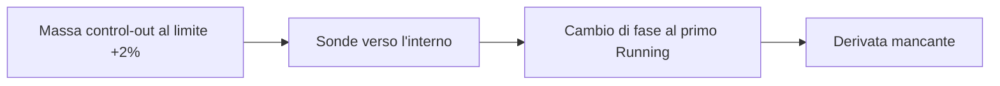

# Progetto — stato corrente e handoff

Questa pagina mantiene il checkpoint verificato e le istruzioni per riprendere
il lavoro. Il [README](../README.md) descrive il simulatore; la [roadmap](ROADMAP.md)
spiega il percorso futuro e il [changelog](../CHANGELOG.md) registra i cambiamenti.

## Stato corrente

Checkpoint dell'**11 novembre 2026**, al termine della ricerca H9.

| Ambito | Stato verificato |
| --- | --- |
| Desktop ordinario | Exact-V9; nessuna nuova attivazione termodinamica o installazione di seed. |
| Chiusura termodinamica C4 | Opzione esplicita reference-consistent; implementazione R1 e verifiche locali R2 acquisite. |
| Equilibrio integrato R3 | **RED**: nessuna radice osservata e punto fuori dall'inviluppo. |
| Miglior massimo residuo accettato | **3.334.923,856**; il criterio resta massimo assoluto dei 75 residui scalati ≤1. |
| Ultima ricerca | H9: 476 ricette, due aggiornamenti accettati, arresto al raggio minimo senza discesa ammissibile. |
| M10 | **Aperto**. Nessuna ricerca o nuova prova lunga attualmente in corso. |

### Il problema da risolvere

La massa di `control-out`, coordinata 0, è al limite superiore del box +2%.
Le sonde ammesse verso l'interno, alle ampiezze 1e-7 e 1e-8, producono risposte
sane ma fanno diventare liquido l'hotwell al primo Running. La colonna richiesta
dal modello locale diventa quindi indisponibile. In questo arresto il programma
lineare non viene costruito: manca una derivata compatibile con il ramo.



La figura collega il vincolo sugli inventari alla risposta dell'intera ricetta.
Il punto finale resta miscela con un margine energetico hotwell di appena
1,766e-7 J/kg. Ridurre il raggio mantenendo le stesse sonde non ripristina la
derivata. Questo esito non dimostra l'impossibilità di una radice nel box.

Anche i bilanci chiariscono perché il punto non è stazionario: al primo Running
l'ingresso turbina accumula circa 427,8 kW e `control-out` circa 1,168 MW.
Gli accumuli coincidono con i trasferimenti registrati, con errore energetico
inferiore a 0,01 W. Questa verifica riguarda la coerenza delle registrazioni;
conservazione ed equilibrio restano condizioni distinte.

## Handoff

La prossima attività è un confronto limitato fra **sonde compensate tra inventari**
e **maggiore riserva energetica interna alla miscela**. Una sonda compensata
varia insieme più coordinate per misurare una direzione che rimanga nel ramo;
la seconda ipotesi cerca un punto di prova abbastanza interno da consentire
le perturbazioni. Entrambe richiedono misure sull'intera ricetta.

Per riprendere dalla radice del repository:

```powershell
python .\eng\review-r3-h-current-equilibrium.py
```

Il comando ricostruisce H9 e i suoi prerequisiti dalle evidenze congelate,
senza nuove chiamate fisiche. L'esito atteso è `PASS-CURRENT-EQUILIBRIUM-REVIEW`;
`r3_passed` e `m10_closed` devono restare `false`. Il rapporto completo è scritto
in `artifacts/r3-h-current-equilibrium-review/01-current-review.json`.
Per il solo replay H9: `python eng/run-r3-h-energy-guarded-search9.py review`.

1. Leggere il [risultato H9](../eng/frozen-evidence/r3-h-energy-guarded-search9/04-result.json):
   `final` contiene coordinate, residui e osservazioni esatti. Usare questi dati
   come ingresso, evitando di ricostruirli dai numeri arrotondati della guida.
2. Definire e congelare il confronto delle due ipotesi, con budget esplicito.
   La consegna è una base di direzioni indipendenti e ammissibili, accompagnata
   da previsioni direzionali verificate a passi che distinguano discesa ed errore.
3. Verificare le proposte con ripetizioni identiche prima di un'altra ricerca.
   Se il confronto non riesce, conservare l'esito e rivedere la rappresentazione
   locale, senza estendere automaticamente il budget dello stesso algoritmo.

Restano fissi 24 inventari fluidi, box ±2%, 75 residui e scale; le condizioni
non fluide e i controllori mantengono la baseline. Una colonna mancante resta
indisponibile. Cambiamenti di box, famiglia di trim o fisica richiedono una
motivazione e un protocollo distinti. Le [decisioni ingegneristiche](validation/MODEL_DECISIONS.md)
raccolgono questi vincoli durevoli.

La [sequenza verso R3 e la chiusura M10](ROADMAP.md#3-che-cosa-manca-dopo-r3-per-chiudere-m10)
mantiene revisione, conferme indipendenti di 100 passi, R3 e le verifiche successive.
Un replay PASS attesta la completezza dell'evidenza; non promuove un seed.

## Evidenze e verifiche

| Riferimento | Cosa leggere |
| --- | --- |
| [Trial 9](../eng/contracts/r3-h-multiscale-derivative-trial9.md) | Confronto su sei ampiezze; 554 ricette ripetute. |
| [Trial 10](../eng/contracts/r3-h-energy-guarded-trial10.md) | Prova energetica ripetuta; 6 ricette e una proposta favorevole. |
| [H9](../eng/contracts/r3-h-energy-guarded-search9.md) | Regole della ricerca, filtri e arresto; 476 ricette. |
| [Esito H9](../eng/frozen-evidence/r3-h-energy-guarded-search9/05-adjudication.json) e [ricevuta](../eng/r3-h-energy-guarded-search9-returned.json) | Risultato indipendente e identità del manifest congelato. |
| [Revisione energetica C4](../eng/contracts/r3-h-energy-boundary-review1.md) | Ricostruzione locale del confine e limiti di applicabilità. |
| [Sintesi della validazione](validation/README.md) | Differenza fra controlli locali, evidenza e qualificazione fisica. |

I replay correnti sono PASS. I 962 sorgenti produttivi e i 410 file di test
mantengono la baseline delle prove. L'ultima compilazione Release con avvisi
come errori e la suite ordinaria hanno dato PASS: **1.392 superati, 164 espliciti
esclusi, zero fallimenti**. Precedono Trial 9, Trial 10 e H9, che non cambiano C#.
Ciascuno dei tre protocolli ha superato tre controlli preliminari, con uno
esplicito escluso, prima dell'esecuzione fisica esplicita. Passano anche i casi
analitici e i replay indipendenti; la cronologia è nel [changelog](../CHANGELOG.md).

Gli input esatti storici restano in [eng/contracts/m10](../eng/contracts/m10/README.md)
e le evidenze in [eng/frozen-evidence](../eng/frozen-evidence/README.md).
Le vecchie diciture «current» o «next» descrivono i rispettivi checkpoint storici.
I seguenti marcatori conservano riferimenti delle revisioni precedenti:

NRS-MARKER:R3-H-LOCAL-MODEL-DESIGN1-CURRENT

NRS-MARKER:R3-H-NUMERICAL-STOP-REVIEW1-CURRENT
