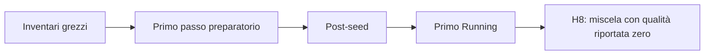

# Progetto — stato corrente e punto di ripresa

Il desktop ordinario resta Exact-V9, con sala controllo, missioni, salvataggi
e replay. La nuova chiusura termodinamica reference-consistent è un'opzione
esplicita: implementazione e verifiche locali sono acquisite, l'equilibrio
dell'impianto completo non è ancora qualificato. La [roadmap](ROADMAP.md)
mantiene il percorso fino alla chiusura M10 e alle milestone successive.

## Checkpoint di esecuzione — 11 novembre 2026

La ricerca H8, che vincola la traiettoria dell'hotwell al ramo miscela, migliora
il massimo residuo accettato da 3.537.690,124 di H6 a **3.337.270,068**, circa
il 5,67% in meno. Su 1.552 ricette e 30 iterazioni accetta 21 aggiornamenti,
16 dei quali sono passi del modello accoppiato. Si arresta al raggio minimo
senza ulteriore discesa ammessa dal protocollo.

**Nessuna radice è stata trovata: R3 resta RED e M10 rimane aperto.** Il punto
è ancora fuori dall'inviluppo e la soglia di radice resta massimo assoluto
dei 75 residui scalati ≤1. Le 24 incognite fluidodinamiche e il box ±2% sono
invariati. Non sono cambiati leggi fisiche, controllori o seed produttivo.

### Che cosa abbiamo capito e verificato

La diagnosi parte da un'apparente contraddizione di H6: il modello lineare
prevede discesa, mentre tutti i nove tentativi reali peggiorano. Ricostruendo
anche la qualità lungo la ricetta, il cambio di fase risulta già prevedibile.
Il passo minimo allora provato, 1/256 della direzione, conserva la miscela
nello stato grezzo e nel primo passo preparatorio, ma attraversa il confine
al post-seed e al primo Running. Il modello non imponeva quel vincolo.

Trial 6 verifica sia un ulteriore dimezzamento sia tre proposte vincolate:
tutte migliorano, restano miscela nei quattro checkpoint e si ripetono
identicamente. H8 usa questa informazione e ottiene una discesa reale.
La partenza liquida H7 resta un confronto storico; non aveva isolato quel ramo.



Il diagramma rappresenta i quattro stati attraversati da ogni ricetta. Il
vincolo deve essere compatibile con tutti, perché una piccola variazione
iniziale può cambiare fase soltanto negli ultimi passi. Nel punto finale H8
il resolver riporta qualità zero al primo Running: questo non equivale a uno
stato fisicamente irrisolvibile, ma invalida il vincolo di interno strettamente
positivo usato dal modello di ricerca.

Le verifiche successive distinguono il margine geometrico di volume dal
criterio energetico con cui C4 accetta una radice al confine liquido. Il solo
volume non basta: in un punto di Trial 8 è ancora ammissibile mentre il resolver
restituisce liquido. Ricostruendo il prefisso tabulato e la tolleranza energetica
già esistente, il segno del margine energetico concorda con **120 osservazioni**,
ossia quattro checkpoint per 15 punti ripetuti due volte, nei Trial 6–8.
È una verifica locale sui campioni osservati, non una prova di equivalenza
con l'intero resolver né un nuovo criterio fisico.

| Verifica recente | Esito | Limite |
| --- | --- | --- |
| Trial 6, 10 ricette | Quattro proposte migliorative, ripetizioni identiche e traiettoria miscela. | Giustifica la ricerca H8, non un seed qualificato. |
| H8, 1.552 ricette | 21 aggiornamenti, 16 passi accoppiati; massimo 3.337.270,068. | Arresto al raggio minimo; radice e inviluppo non conformi. |
| Trial 7, 8 ricette | Tre proposte basate sul margine di volume confrontate due volte. | Nessuna soddisfa insieme discesa, accordo del modello e ramo richiesto. |
| Trial 8, 12 ricette | Direzione fissa a cinque frazioni, tutte ripetute identicamente. | A 0,001 il guadagno è 0,135 ma l'errore massimo della previsione è 6,059; a 0,0001 il massimo peggiora. |
| Revisione energetica | Fasi osservate ricostruite sui 120 campioni, senza nuove chiamate fisiche. | Il vincolo energetico per un nuovo ottimizzatore non è ancora qualificato. |

La prova direzionale mostra quindi un secondo limite: restare miscela non
garantisce una derivata abbastanza accurata per decidere la discesa. Anche
Trial 7 contiene errori importanti su altri inventari. Un nuovo vincolo di
fase, da solo, non risolve l'affidabilità del modello locale.

### Che cosa dicono i bilanci

Nel punto finale H8, al primo Running, l'ingresso turbina riceve circa
35,893 MW e cede 35,465 MW: la differenza è **428,1 kW di accumulo**. La massa
è bilanciata, ma l'energia non è stazionaria. `control-out` accumula circa
1,169 MW e 0,2675 kg/s.

La revisione ricostruisce questi accumuli sia dagli inventari sia dai
trasferimenti registrati, con errore energetico inferiore a 0,01 W. Anche
il bilancio dello stadio turbina si chiude. Questa tolleranza verifica le
registrazioni: conservare l'energia non significa avere un punto stazionario.

### Prossima attività

Verificare le derivate dei residui e del margine energetico su più ampiezze
di perturbazione, partendo dal punto H8 e dalla direzione congelata di Trial 8.
Occorre confrontare differenze centrali e unilaterali ammissibili, traiettorie
di fase e previsioni lungo combinazioni di coordinate. Il criterio di uscita
è un intervallo di passi nel quale l'errore osservato permetta di distinguere
la discesa prevista dalla risposta reale.

Solo dopo questo confronto si può motivare una nuova prova ripetuta e poi
un'eventuale ricerca. Aumentare il budget dello stesso algoritmo non risolve
il limite misurato. Box, scale e criteri fisici restano fissi; altre famiglie
di trim o modifiche fisiche richiedono motivazioni e protocolli distinti.

Una radice osservata richiederebbe ancora conferme indipendenti di 100 passi
prima di R3 Requalification 3. R4, R5, R6 e la chiusura M10 conservano tutte
le dipendenze della roadmap. Nessuna ricerca è attualmente in corso.

## Controlli correnti e riferimenti

```powershell
python .\eng\review-r3-h-current-equilibrium.py
```

Il controllo legge gli archivi congelati, riproduce H8 e i Trial 6–8, verifica
la revisione energetica e ricostruisce i bilanci senza chiamare l'impianto.
Funziona anche senza gli artefatti locali delle esecuzioni precedenti.
Per la sola diagnosi energetica:
`python eng/review-r3-h-energy-boundary1.py review`.

I 962 sorgenti produttivi e i 410 file di test sono invariati rispetto alla
baseline delle nuove prove. Il batch riutilizza l'esecutore già verificato.
Ogni esperimento conserva contratto, hash ed evidenze; i vecchi gate con
baseline diverse restano riferimenti storici.

L'ultima compilazione Release con avvisi come errori e la suite ordinaria
hanno dato PASS: **1.392 superati, 164 espliciti esclusi, zero fallimenti**.
Queste verifiche precedono H8, che non cambia C#; i quattro nuovi protocolli
fisici hanno ciascuno superato i controlli preliminari dedicati, tre test
ordinari e uno esplicito escluso, prima dell'esecuzione esplicita.
I replay delle evidenze correnti passano. Exact-V9 è invariato.

| Riferimento | Contenuto |
| --- | --- |
| [H6](../eng/contracts/r3-h-secondary-minimax-search6.md) e [H7](../eng/contracts/r3-h-liquid-branch-search7.md) | Precedenti limiti numerici e confronto con la partenza liquida |
| [Trial 6](../eng/contracts/r3-h-phase-trajectory-trial6.md) e [H8](../eng/contracts/r3-h-phase-constrained-search8.md) | Traiettoria di fase e ricerca vincolata |
| [Trial 7](../eng/contracts/r3-h-c4-margin-trial7.md) e [Trial 8](../eng/contracts/r3-h-directional-derivative-trial8.md) | Confine C4 e verifica della previsione lungo una direzione |
| [Revisione energetica](../eng/contracts/r3-h-energy-boundary-review1.md) | Ricostruzione locale del criterio energetico, limiti e prossimo confronto |
| [Sintesi della validazione](validation/README.md) | Risultati acquisiti e limiti delle conclusioni |

I seguenti indicatori restano riferimenti delle revisioni numeriche precedenti.

NRS-MARKER:R3-H-LOCAL-MODEL-DESIGN1-CURRENT

NRS-MARKER:R3-H-NUMERICAL-STOP-REVIEW1-CURRENT

## Lavori di documentazione conclusi

La documentazione M10 è stata separata dagli input esatti dei validatori, raccolti
in `eng/contracts/m10`. Il README descrive il prodotto e il manuale italiano è
stato riscritto con spiegazioni dei componenti, delle interazioni e dei diagrammi.
I controlli testuali storici del manuale leggono la loro copia congelata.

Questi interventi non promuovono R3 o M10. I checkpoint precedenti restano
consultabili nel [registro degli archivi](history/archives/README.md#snapshot-docs-project-md).
