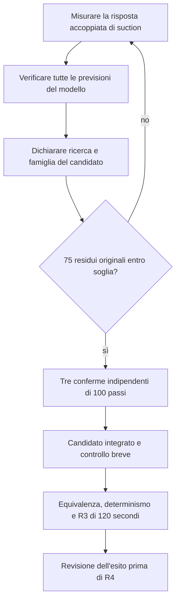
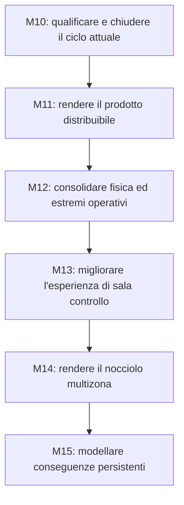

# Roadmap del progetto

Questa pagina spiega la direzione del lavoro e le condizioni per avanzare. Lo stato
verificato, le evidenze e i comandi correnti sono mantenuti in [PROJECT.md](PROJECT.md).
I piani di dettaglio restano riferimenti per i rispettivi ambiti; le loro vecchie
diciture «current» o «next» non sostituiscono il checkpoint attuale.

## 1. Quale obiettivo stiamo perseguendo

Il percorso verso la chiusura M10 richiede di qualificare l'integrazione di una
chiusura termodinamica più coerente con il riferimento indipendente acqua-vapore.
Le attività successive prepareranno distribuzione, ampliamento della fisica e
nuove superfici operative.

La «chiusura termodinamica» è il calcolo che ricava pressione, temperatura e fase
del fluido da massa, energia e volume. Se quel calcolo cambia, il vecchio insieme
di inventari può non produrre più pressioni e portate compatibili fra loro.

L'integrazione della nuova chiusura richiede che massa, energia, pressioni,
portate e controlli descrivano un punto iniziale compatibile. Le verifiche locali
della funzione non sostituiscono la verifica integrata breve R3. Giri e potenza
elettrica quasi costanti non dimostrano che tutti gli inventari siano in equilibrio.

Il [checkpoint e l'handoff](PROJECT.md) mantengono risultati, blocco osservato
e comandi di ripresa. La [sintesi della validazione](validation/README.md) spiega
il significato delle verifiche; questa roadmap definisce le consegne future.

## 2. La prossima finestra di lavoro

NRS-MARKER:R3-H-BOUNDED-SCALED-LOCAL-MODEL-DESIGN1-NEXT

La priorità è chiudere il divario fra una riduzione misurata dei residui e
un candidato di equilibrio qualificabile. La prova 23 riduce il massimo
originale del 5,35% con tutti i controlli conformi; la prova 25 misura
−21,36%, ma manca la soglia di previsione della portata. Non sono percentuali
di completamento di R3: i residui restano nell'ordine dei milioni contro ≤1.
La cronologia delle prove e i loro rifiuti restano nel
[checkpoint](PROJECT.md#il-problema-da-risolvere), senza duplicarli qui.

| Ordine | Consegna da ottenere | Condizione per avanzare |
| --- | --- | --- |
| Adesso | Misurare isolatamente la coppia massa/energia iniziali di suction e confrontarla con la somma delle colonne separate. | Modello ristimato dove giustificato, nuove previsioni conformi anche sui valori operativi, senza rilassare soglie. |
| Poi | Dichiarare la famiglia e la ricerca a più passi, con dominio, budget, arresti e rimisura. | Ambito delle variazioni motivato; le vecchie famiglie H/C/J o le eccezioni diagnostiche non vengono estese implicitamente. |
| Obiettivo numerico | Trovare una radice dei 75 residui originali, con vincoli termici e capacità osservati separatamente. | Massimo assoluto ≤1, criteri e scale invariati, ricetta congelata. Una previsione lineare o un residuo ridotto non bastano. |
| Conferma | Ripetere tre ricette fresche e verificare 100 passi Running per ciascuna. | Stessa ricetta e traiettoria, residui e inviluppo conformi; niente assestamento aggiunto o reintegri durante il runtime. |
| Integrazione | Comporre un candidato interno esplicito e verificarne inizializzazione e regressioni. | Contratto coerente con la nuova famiglia; identità Exact-V9 conservata, due passi preparatori invariati e controllo breve conforme. |
| R3 completo | Eseguire equivalenza della baseline, determinismo e prova integrata di 120 s / 12.000 passi. | Controlli ereditati conformi e revisione delle evidenze restituite: solo un PASS R3 revisionato consente R4. |

Il diagramma separa la validità di una previsione, l'esistenza di una radice
e la qualifica del runtime composto. Una riserva iniziale può mantenere
una fase nella ricetta breve, ma questo non dimostra permanenza su 100
passi né sulla prova di 120 secondi. Se una misura manca i controlli, si
torna a un modello giustificato dai dati, conservando l'esito negativo.

La definizione del candidato è una consegna tecnica ancora aperta. Il vecchio
piano d'integrazione manteneva fisse le condizioni non fluide di Exact-V9;
i punti diagnostici correnti variano anche popolazione neutronica,
temperature e bias. Occorre rendere coerenti famiglia, baseline di confronto
e contratto d'integrazione prima di comporre il candidato. Il dettaglio dei
[passaggi mancanti per R3](PROJECT.md#che-cosa-manca-per-chiudere-r3) è mantenuto
nel checkpoint. Non è ancora giustificata una data di chiusura.

## 3. Che cosa manca dopo R3 per chiudere M10

R3 non è la chiusura finale del progetto né della campagna M10. La catena seguente
mantiene distinti i controlli con scopi diversi, così «abbiamo passato un test»
non diventa «abbiamo qualificato tutto».

| Fase | Domanda alla quale deve rispondere | Uscita necessaria |
| --- | --- | --- |
| R4 | La nuova composizione regge il ricontrollo lungo di materialità equivalente a P1B? | Confronto lungo completo e revisionato. Non è ancora la campagna finale di chiusura. |
| R5 | Il candidato soddisfa il rientro nella valutazione fisica acqua-vapore VR2? | Risultato non bloccante nel dominio e nei criteri dichiarati. |
| R6 | È giustificato attivare una nuova versione produttiva? | Decisione esplicita; Exact-V9 e vecchi archivi mantengono il proprio significato. |
| VR3–VR5 | Quali conclusioni sono sostenute dai riferimenti di xeno, calore di decadimento e dalla valutazione consolidata? | Benchmark e applicabilità espliciti; non introduzione automatica di nuovi modelli nel desktop. |
| P3-R1/P3-R2 e P4 | Quali componenti richiedono interventi e il ciclo sostiene la manovra breve 5→10→5? | Localizzazione dei responsabili, decisione di riparazione e verifica breve qualificata, prima di una nuova campagna lunga. |
| P5 | Il candidato supera la campagna lunga finale sul carico congelato? | Baseline della prova, artefatti completi e risultati conformi. |
| P6 | Tutte le evidenze richieste consentono di chiudere M10? | Chiusura esplicita, matrice di verifica aggiornata e accettazione HMI applicabile. |

Questa sequenza deriva dal
[percorso di riparazione e qualifica](../eng/contracts/m10/M10_FINAL_VR2_ENGINEERING_REPAIR_PLANNING1.md)
e dal [piano di chiusura](../eng/contracts/m10/M10_FINAL_CLOSURE_AND_M11_BOOTSTRAP_PLAN.md).
Ogni fase richiede il proprio piano aggiornato al risultato precedente; i documenti
storici conservano la sequenza e i vincoli, non una nuova autorizzazione di esecuzione.

## 4. La direzione successiva: M11–M15

L'ordine di fondo resta quello già pianificato. Cambia la natura della consegna:
prima un prodotto distribuibile, poi basi fisiche più estese, quindi nuove superfici
operative e modelli spaziali e di conseguenza.

Le frecce indicano prerequisiti di implementazione. Possiamo chiarire prima una
scelta o migliorare una guida, ma questo non promuove una milestone successiva.
La parte di danno richiede in particolare sia basi fisiche adeguate sia uno stato
spaziale che sostenga le conseguenze locali rappresentate.

| Milestone | Risultato concreto da ottenere | Prime attività e criterio di uscita |
| --- | --- | --- |
| [M11 — Preparazione della release](milestones/M11.md) | Un pacchetto riproducibile, supportato e utilizzabile su una macchina pulita. | Decidere piattaforme e formato; verificare vecchie sessioni, prestazioni, memoria, avvio e salvataggi. Chiusura con prove sul pacchetto effettivamente distribuito. M11 resta senza nuove funzioni di prodotto. |
| [M12 — Fondamenti fisici](milestones/M12.md) | Equilibri e limiti operativi classificati, flussi e bilanci più completi, basi esplicite del raffreddamento dopo uno scatto. | Partire dall'ispezione dell'equilibrio; poi direzionalità, condizioni estreme, energia delle pompe, calore residuo e integrità. Nessun correttore nascosto dello stato. |
| [M13 — Sala controllo](milestones/M13.md) | Comandi e procedure più chiari, accesso agli esercizi e modalità istruttore distinguibile. | Bersagli stabili, selettori, mimic navigabile, procedure, scelta di scenari/missioni e guasti supportati. Verificare anche qualità dei segnali e trasparenza dell'automazione. |
| [M14 — Reattore spaziale](milestones/M14.md) | Un nocciolo educativo con più zone realmente appartenenti al modello. | Definire zone, gruppi di canali e barre; poi mappa 2D e approfondimenti. Chiusura su coerenza delle somme, determinismo, replay e costo di calcolo. |
| [M15 — Evoluzione degli incidenti](milestones/M15.md) | Degrado, perdite e danni con cause fisiche e memoria persistente. | Introdurre un meccanismo alla volta con bilanci e transizioni verificabili. Un allarme o il nome di uno scenario non creano da soli un danno. |

M12.0, l'ispezione generale dell'equilibrio, resta lavoro successivo a M11: la ricerca
H attuale non diventa per estensione un correttore automatico utilizzabile durante
qualsiasi simulazione. Riutilizzeremo soltanto strumenti e risultati che abbiano
superato una verifica adatta al nuovo scopo.

## 5. Ulteriori passi che rendono il percorso più utile

Tre esigenze emerse dalla revisione del manuale vengono rese esplicite nei piani,
senza anticipare l'implementazione delle milestone successive.

**Accesso agli esercizi.** In M13.8 pianifichiamo un ingresso grafico agli scenari e
alle missioni supportati: descrizione dell'obiettivo, condizioni iniziali, scelta
esplicita e passaggio controllato alla nuova sessione. La normale scelta di un
esercizio rimane distinta dall'autorità dell'istruttore che inietta guasti.

**Documentazione verificabile.** In M11.5 colleghiamo manuale, etichette, incrementi
dei comandi e identità produttive alla release effettiva. I vecchi controlli
continuano a leggere i propri input storici; la guida attuale viene verificata
per il comportamento attuale e per i collegamenti ai contenuti supportati.

**Dimostrazioni ripetibili.** Prepariamo pochi percorsi rappresentativi per
accettazione e didattica: lettura del punto iniziale, manovra di carico nel dominio
qualificato, arresto normale, lettura di un intervento e ripristino di una sessione.
Saranno verificati sulla versione e sul pacchetto scelti; non daremo per sostenibile
una manovra soltanto perché è descritta dal manuale o richiesta da una missione.

### Proposte nate dalle schede tecniche dei componenti

Scrivere le schede del capitolo 5 del manuale ha fatto emergere sei comportamenti
del profilo Exact-V9. Sono tutti coerenti con il modello e già documentati per
l'operatore; alcuni meritano un miglioramento. Le proposte non sono impegni e non
entrano nel lavoro di R3 o di M10. Ognuna che tocchi protezioni, allarmi o stato
iniziale richiederà una nuova identità versionata, con la rivalidazione prevista
dalla [politica di impatto delle modifiche](CHANGE_IMPACT_REVALIDATION_POLICY.md).

| Comportamento osservato | Proposta | Utilità | Collocazione possibile |
| --- | --- | --- | --- |
| Senza pompa di circolazione nessuna protezione interviene: lo SCRAM spetta all'operatore. | Protezione di bassa portata principale, con consenso che la escluda a reattore spento e durante l'avviamento a pompe ferme. | Alta: chiude la lacuna più rilevante e insegna il legame fra produzione e rimozione del calore. | M12, insieme agli stati estremi di M12.3 |
| Regolatore di livello e protezione di livello molto basso leggono lo stesso canale `level`: un guasto della misura li inganna entrambi. | Canale di misura separato per la protezione, con guasti indipendenti; in seguito eventuale voto fra più canali. | Alta per la didattica: mostra perché protezione e controllo vanno separati. Nessuna pretesa di ridondanza qualificata. | M13.9 o successivo, con DIC-B04 |
| Senza alimentazione il livello passa dal 50% allo scatto in circa 225 s, e lo squilibrio non ha un annuncio proprio. | Allarme di squilibrio fra portata di vapore esportata e portata di alimentazione, con un ritardo. | Media-alta: anticipa di minuti la diagnosi; costo contenuto. | M13 |
| Lo scarico in atmosfera porta acqua fuori dal ciclo e non esiste un reintegro. | Reintegro verso la vasca del condensato, regolato sulla massa; almeno un annuncio di inventario totale in calo. | Media: rende sostenibili sessioni lunghe dopo un intervento dello scarico. | M12, con l'inventario dei percorsi di M12.1 |
| Dopo una perdita del carico il rotore raggiunge 3300 giri/min in circa 2 s senza regolatore; la valvola CONTROL chiude in circa 0,6 s. | Prima una prova ripetibile di rigetto del carico. Se lo scatto per sovravelocità non viene evitato, valutare una chiusura rapida anticipata delle valvole. | Media: oggi il margine è dedotto dai parametri, non osservato. | Prova in M12.3; eventuale funzione in M12 |
| L'alimentazione arriva a circa 47 °C: circa 14 MW del nocciolo servono solo a riscaldarla (rendimento del ciclo circa 15%). | Preriscaldo rigenerativo con uno spillamento equivalente dalla turbina. | Bassa nel breve periodo: cambia tutto il bilancio e il punto di riferimento. Da valutare dopo M12.0. | Dopo M12.0, solo con un nuovo punto qualificato |

L'ordine della tabella è anche l'ordine di priorità suggerito. Le prime due
proposte migliorano la sicurezza didattica dell'impianto con modifiche locali. La
terza e la quarta rendono più leggibili e sostenibili i transitori lunghi. Le ultime
due vanno precedute da prove o da un nuovo equilibrio qualificato.

## 6. Come tenere il piano leggibile

Per ciascun intervento registriamo domanda, ingresso, consegna, prova di uscita ed
esito se la prova non riesce. Aggiorniamo il checkpoint e questa roadmap, mantenendo
i dettagli eseguibili con i contratti di ingegneria. Non serve una nuova catena di
documenti di stato per ogni tentativo.

Non fissiamo ora date per i rami ancora dipendenti dalla ricerca di equilibrio.
Le priorità e le condizioni di avanzamento sono definite; il calendario potrà
essere stimato quando il percorso fisico sarà sufficientemente prevedibile.
