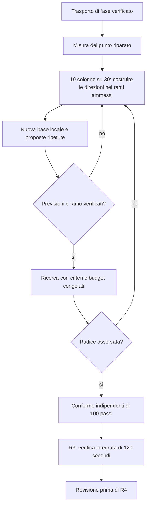
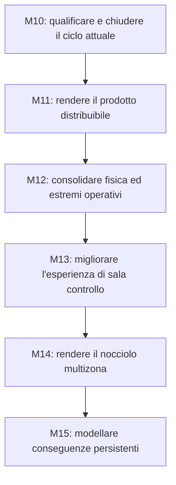

# Roadmap del progetto

Questa pagina spiega la direzione del lavoro e le condizioni per avanzare. Lo stato
verificato, le evidenze e i comandi correnti sono mantenuti in [PROJECT.md](PROJECT.md).
I piani di dettaglio restano riferimenti per i rispettivi ambiti; le loro vecchie
diciture «current» o «next» non sostituiscono il checkpoint attuale.

## 1. Quale obiettivo stiamo perseguendo

Il percorso verso la chiusura M10 richiede di qualificare l'integrazione di una
chiusura termodinamica più coerente con il riferimento indipendente acqua-vapore.
Le attività successive prepareranno distribuzione, ampliamento della fisica e
nuove superfici operative.

La «chiusura termodinamica» è il calcolo che ricava pressione, temperatura e fase
del fluido da massa, energia e volume. Se quel calcolo cambia, il vecchio insieme
di inventari può non produrre più pressioni e portate compatibili fra loro.

L'integrazione della nuova chiusura richiede che massa, energia, pressioni,
portate e controlli descrivano un punto iniziale compatibile. Le verifiche locali
della funzione non sostituiscono la verifica integrata breve R3. Giri e potenza
elettrica quasi costanti non dimostrano che tutti gli inventari siano in equilibrio.

Il [checkpoint e l'handoff](PROJECT.md) mantengono risultati, blocco osservato
e comandi di ripresa. La [sintesi della validazione](validation/README.md) spiega
il significato delle verifiche; questa roadmap definisce le consegne future.

## 2. La prossima finestra di lavoro

NRS-MARKER:R3-H-BOUNDED-SCALED-LOCAL-MODEL-DESIGN1-NEXT

Il lavoro parte dal campo di flussi della legge riparata. Il
[checkpoint](PROJECT.md#il-problema-da-risolvere) spiega gli accumuli e collega
le nuove misure. Le tre direzioni inizialmente mancanti sono state raffinate:
`pressure` richiede sonde più piccole, l'energia di `exhaust` un confronto
locale fra ampiezze dichiarate. La successiva misura di tutto il ciclo
seleziona **19 colonne su 30**, con tutte le sei grandezze non fluide.

Restano undici coordinate: sette incontrano cambi di fase o non hanno una
seconda scala ammessa; quattro non concordano fra ampiezze. Il prossimo
confronto deve quindi costruire direzioni compatibili con questi rami,
mantenendo i controlli su tutti i nodi e lungo tutta la preparazione.

| Passo | Consegna prevista | Condizione per avanzare |
| --- | --- | --- |
| Diagnosi iniziale completata | Due ricette identiche; scambi termici e bilanci di exhaust ricostruiti. | PASS della diagnosi; nessuna radice o ricerca. Singole portate corrette non osservate. |
| Raffinamento iniziale completato | 70 ricette ripetibili; recuperate le tre colonne mancanti e verificati i bilanci di coppia. | PASS dell'evidenza; accordo locale, nessuna estrapolazione. |
| Misura estesa completata | 362 ricette ripetibili, 334 nell'inviluppo; selezionate 19 colonne su 30. | Rango numerico diagnostico 19; disponibilità incompleta e nessuna sufficienza dimostrata. |
| Costruire le direzioni nei rami ammessi | Trattare separatamente confini di fase, assenza di una seconda scala e disaccordo delle colonne di control-out e turbine-inlet. | Sonde compensate, unilaterali o più piccole dichiarate prima delle misure; previsioni e vincoli del verso verificati. |
| Scegliere la famiglia | Motivare H, C o J e fissarne incognite, box e budget. | Misure nuove e distinzione fra riduzione e trasferimento degli accumuli; le vecchie derivate restano storiche. |
| Verificare la base locale | Misurare direzioni indipendenti compatibili con tutta la ricetta. | Disponibilità delle derivate e previsioni verificate a una scala utile. |
| Provare proposte e ricerca | Confrontare proposte ripetute, poi congelare algoritmo e arresti. | Accordo misurato prima della ricerca; radice osservata prima della conferma. |
| Confermare e integrare | Revisionare la radice e comporre il candidato di prova. | Residui conformi e inviluppo invariato di 100 passi indipendenti. |
| R3 Requalification 3 | Verifica integrata di 120 secondi, 12.000 passi da 10 ms. | Solo un R3 PASS restituito e revisionato permette la pianificazione di R4. |

Il diagramma rende espliciti riparazione e nuova misura come prerequisiti.
Una correzione del trasporto può ridurre l'accumulo in un nodo e trasferire
energia ad altri: il risultato locale non seleziona automaticamente un seed
o una famiglia. Un esito negativo riporta alla diagnosi, conservando l'evidenza.
Il confronto algebrico sul raffreddamento mostra perché il solo bilancio
energetico di exhaust non basta: annullarlo a stato fisso peggiorerebbe la massa.
Non è una prova di impossibilità della famiglia o una proposta di modifica a UA.
Il successo della sonda nucleare-termica vale soltanto alle ampiezze misurate:
non autorizza di colpo il passo necessario a compensare un deficit di circa 1 MW.

Le famiglie C/J, gli allargamenti dei limiti e altre modifiche fisiche richiedono
motivazioni e protocolli distinti. Il calendario potrà essere stimato quando
il percorso verso l'equilibrio qualificabile sarà sufficientemente prevedibile.

## 3. Che cosa manca dopo R3 per chiudere M10

R3 non è la chiusura finale del progetto né della campagna M10. La catena seguente
mantiene distinti i controlli con scopi diversi, così «abbiamo passato un test»
non diventa «abbiamo qualificato tutto».

| Fase | Domanda alla quale deve rispondere | Uscita necessaria |
| --- | --- | --- |
| R4 | La nuova composizione regge il ricontrollo lungo di materialità equivalente a P1B? | Confronto lungo completo e revisionato. Non è ancora la campagna finale di chiusura. |
| R5 | Il candidato soddisfa il rientro nella valutazione fisica acqua-vapore VR2? | Risultato non bloccante nel dominio e nei criteri dichiarati. |
| R6 | È giustificato attivare una nuova versione produttiva? | Decisione esplicita; Exact-V9 e vecchi archivi mantengono il proprio significato. |
| VR3–VR5 | Quali conclusioni sono sostenute dai riferimenti di xeno, calore di decadimento e dalla valutazione consolidata? | Benchmark e applicabilità espliciti; non introduzione automatica di nuovi modelli nel desktop. |
| P3-R1/P3-R2 e P4 | Quali componenti richiedono interventi e il ciclo sostiene la manovra breve 5→10→5? | Localizzazione dei responsabili, decisione di riparazione e verifica breve qualificata, prima di una nuova campagna lunga. |
| P5 | Il candidato supera la campagna lunga finale sul carico congelato? | Baseline della prova, artefatti completi e risultati conformi. |
| P6 | Tutte le evidenze richieste consentono di chiudere M10? | Chiusura esplicita, matrice di verifica aggiornata e accettazione HMI applicabile. |

Questa sequenza deriva dal
[percorso di riparazione e qualifica](../eng/contracts/m10/M10_FINAL_VR2_ENGINEERING_REPAIR_PLANNING1.md)
e dal [piano di chiusura](../eng/contracts/m10/M10_FINAL_CLOSURE_AND_M11_BOOTSTRAP_PLAN.md).
Ogni fase richiede il proprio piano aggiornato al risultato precedente; i documenti
storici conservano la sequenza e i vincoli, non una nuova autorizzazione di esecuzione.

## 4. La direzione successiva: M11–M15

L'ordine di fondo resta quello già pianificato. Cambia la natura della consegna:
prima un prodotto distribuibile, poi basi fisiche più estese, quindi nuove superfici
operative e modelli spaziali e di conseguenza.

Le frecce indicano prerequisiti di implementazione. Possiamo chiarire prima una
scelta o migliorare una guida, ma questo non promuove una milestone successiva.
La parte di danno richiede in particolare sia basi fisiche adeguate sia uno stato
spaziale che sostenga le conseguenze locali rappresentate.

| Milestone | Risultato concreto da ottenere | Prime attività e criterio di uscita |
| --- | --- | --- |
| [M11 — Preparazione della release](milestones/M11.md) | Un pacchetto riproducibile, supportato e utilizzabile su una macchina pulita. | Decidere piattaforme e formato; verificare vecchie sessioni, prestazioni, memoria, avvio e salvataggi. Chiusura con prove sul pacchetto effettivamente distribuito. M11 resta senza nuove funzioni di prodotto. |
| [M12 — Fondamenti fisici](milestones/M12.md) | Equilibri e limiti operativi classificati, flussi e bilanci più completi, basi esplicite del raffreddamento dopo uno scatto. | Partire dall'ispezione dell'equilibrio; poi direzionalità, condizioni estreme, energia delle pompe, calore residuo e integrità. Nessun correttore nascosto dello stato. |
| [M13 — Sala controllo](milestones/M13.md) | Comandi e procedure più chiari, accesso agli esercizi e modalità istruttore distinguibile. | Bersagli stabili, selettori, mimic navigabile, procedure, scelta di scenari/missioni e guasti supportati. Verificare anche qualità dei segnali e trasparenza dell'automazione. |
| [M14 — Reattore spaziale](milestones/M14.md) | Un nocciolo educativo con più zone realmente appartenenti al modello. | Definire zone, gruppi di canali e barre; poi mappa 2D e approfondimenti. Chiusura su coerenza delle somme, determinismo, replay e costo di calcolo. |
| [M15 — Evoluzione degli incidenti](milestones/M15.md) | Degrado, perdite e danni con cause fisiche e memoria persistente. | Introdurre un meccanismo alla volta con bilanci e transizioni verificabili. Un allarme o il nome di uno scenario non creano da soli un danno. |

M12.0, l'ispezione generale dell'equilibrio, resta lavoro successivo a M11: la ricerca
H attuale non diventa per estensione un correttore automatico utilizzabile durante
qualsiasi simulazione. Riutilizzeremo soltanto strumenti e risultati che abbiano
superato una verifica adatta al nuovo scopo.

## 5. Ulteriori passi che rendono il percorso più utile

Tre esigenze emerse dalla revisione del manuale vengono rese esplicite nei piani,
senza anticipare l'implementazione delle milestone successive.

**Accesso agli esercizi.** In M13.8 pianifichiamo un ingresso grafico agli scenari e
alle missioni supportati: descrizione dell'obiettivo, condizioni iniziali, scelta
esplicita e passaggio controllato alla nuova sessione. La normale scelta di un
esercizio rimane distinta dall'autorità dell'istruttore che inietta guasti.

**Documentazione verificabile.** In M11.5 colleghiamo manuale, etichette, incrementi
dei comandi e identità produttive alla release effettiva. I vecchi controlli
continuano a leggere i propri input storici; la guida attuale viene verificata
per il comportamento attuale e per i collegamenti ai contenuti supportati.

**Dimostrazioni ripetibili.** Prepariamo pochi percorsi rappresentativi per
accettazione e didattica: lettura del punto iniziale, manovra di carico nel dominio
qualificato, arresto normale, lettura di un intervento e ripristino di una sessione.
Saranno verificati sulla versione e sul pacchetto scelti; non daremo per sostenibile
una manovra soltanto perché è descritta dal manuale o richiesta da una missione.

## 6. Come tenere il piano leggibile

Per ciascun intervento registriamo domanda, ingresso, consegna, prova di uscita ed
esito se la prova non riesce. Aggiorniamo il checkpoint e questa roadmap, mantenendo
i dettagli eseguibili con i contratti di ingegneria. Non serve una nuova catena di
documenti di stato per ogni tentativo.

Non fissiamo ora date per i rami ancora dipendenti dalla ricerca di equilibrio.
Le priorità e le condizioni di avanzamento sono definite; il calendario potrà
essere stimato quando il percorso fisico sarà sufficientemente prevedibile.
