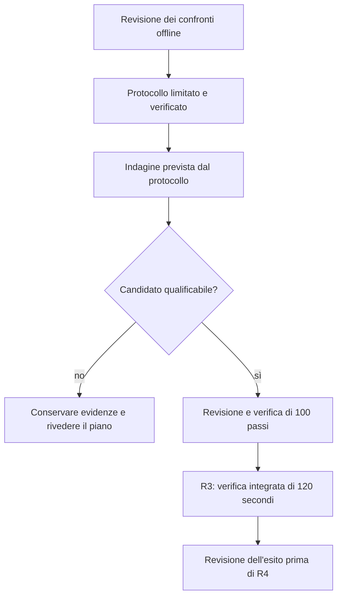
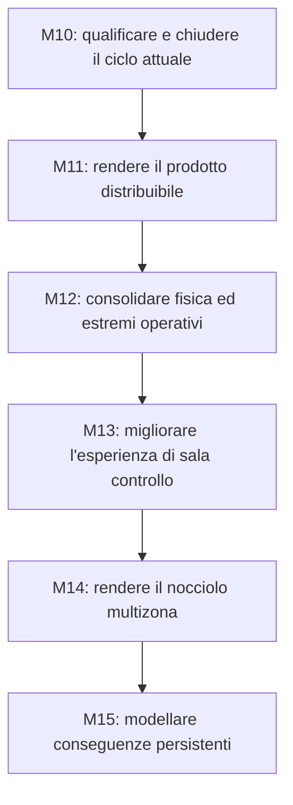

# Roadmap del progetto

Questa pagina spiega la direzione del lavoro e le condizioni per avanzare. Lo stato
verificato, le evidenze e i comandi correnti sono mantenuti in [PROJECT.md](PROJECT.md).
I piani di dettaglio restano riferimenti per i rispettivi ambiti; le loro vecchie
diciture «current» o «next» non sostituiscono il checkpoint attuale.

## 1. Quale obiettivo stiamo perseguendo

Il simulatore dispone già di una sala controllo, regolazione e protezioni, missioni,
salvataggi e replay. Il desktop ordinario usa la propria configurazione Exact-V9.
Il lavoro fisico immediato riguarda invece l'integrazione di una chiusura
termodinamica più coerente con il riferimento indipendente acqua-vapore.

La «chiusura termodinamica» è il calcolo che ricava pressione, temperatura e fase
del fluido da massa, energia e volume. Se quel calcolo cambia, il vecchio insieme
di inventari può non produrre più pressioni e portate compatibili fra loro.

La nuova chiusura è implementata come opzione esplicita e ha superato le verifiche
locali. Quando la si collega all'impianto completo, però, non basta sostituire una
funzione: occorre che massa, energia, pressioni, portate e controlli descrivano un
punto iniziale compatibile. È questo il problema ancora aperto in R3, la verifica
integrata breve. Giri e potenza elettrica quasi costanti non dimostrano che tutti
gli inventari siano in equilibrio.

La pulizia della documentazione e la riscrittura del
[manuale italiano](usermanual/MANUALE_UTENTE_NUCLEAR_REACTOR_SIMULATOR.md) sono
concluse. Migliorano comprensione e manutenzione; non costituiscono una nuova
qualificazione della fisica. Il [riepilogo della validazione](validation/README.md)
separa i risultati già acquisiti dal problema di integrazione ancora aperto.

## 2. La prossima finestra di lavoro

NRS-MARKER:R3-H-BOUNDED-SCALED-LOCAL-MODEL-DESIGN1-NEXT

La priorità è chiudere una decisione numerica circoscritta, prima di aggiungere
nuove funzioni. La ricerca H ha variato soltanto gli inventari fluidi autorizzati:
non ha trovato un equilibrio qualificato. Il confronto offline successivo predice
un miglioramento, ma non ha ancora valutato quei nuovi punti nel modello fisico.
H identifica questo tentativo limitato di correggere masse ed energie iniziali,
senza cambiare le leggi fisiche o tarare i controllori.

| Passo | Lavoro previsto | Consegna verificabile | Condizione per avanzare |
| --- | --- | --- | --- |
| A. Revisione offline | Confrontare le sei direzioni già calcolate: scalatura, smorzamento, frazione ammessa dai limiti e cambi di fase nelle derivate. | Una decisione motivata sull'affidabilità e sull'uso del modello locale. | Evidenze autentiche e limiti dell'approssimazione espliciti; nessun punto fisico dichiarato qualificato. |
| B. Protocollo della prossima indagine | Definire selezione deterministica, budget, osservazioni, conferme e arresti prima dell'esecuzione. | Un contratto limitato ai test, con criteri congelati e confronto fra previsione e risposta reale. | Revisione del passo A completata e protocollo verificato. |
| C. Indagine limitata | Eseguire soltanto quanto previsto dal nuovo protocollo, registrando tentativi validi, rifiuti e stato di fase. | Un esito riproducibile: candidato ammissibile oppure risultato inconclusivo motivato. | Il candidato soddisfa i criteri già congelati e le conferme richieste; nessuna promozione basata sulla sola discesa del residuo. |
| D. Integrazione del candidato | Dopo revisione indipendente, pianificare e integrare il solo stato iniziale qualificato nella composizione di prova. | Riproduzione dello stato e superamento dell'inviluppo invariato di 100 passi. | Nessuna modifica implicita di controllori, guadagni, proprietà o identità storiche. |
| E. R3 Requalification 3 | Eseguire la verifica integrata di 120 secondi, cioè 12.000 passi da 10 ms. | Evidenze complete e giudizio indipendente sull'esito R3. | Solo un R3 PASS restituito e revisionato permette la pianificazione di R4. |

La figura rappresenta questi passaggi e il punto in cui ci si ferma se l'indagine
non produce un candidato. Le frecce sono dipendenze del lavoro, non automatismi
che autorizzano un'altra ricerca quando quella precedente è inconclusiva.

Il miglioramento previsto da un modello lineare serve a progettare la prova,
non sostituisce la prova. I cambi di fase osservati nelle derivate rendono questa
distinzione particolarmente importante. Per il passo B occorre quindi dichiarare
come riconoscere una previsione non affidabile e quando interrompere l'indagine.

Restano fissi residui, scale, incognite e limiti del percorso H finché un distinto
piano verificato non motivi diversamente. L'esaurimento del budget non autorizza
un ampliamento dei limiti, una taratura dei controllori o il passaggio automatico
alle altre famiglie di intervento. L'esito inconclusivo è un punto di decisione.

**Le prime tre consegne da completare sono A, B e C.** D ed E dipendono da ciò che
emerge: non sono date per acquisite e non hanno ancora una data di completamento
attendibile. Questa revisione della roadmap non avvia una nuova ricerca fisica.

## 3. Che cosa manca dopo R3 per chiudere M10

R3 non è la chiusura finale del progetto né della campagna M10. La catena seguente
mantiene distinti i controlli con scopi diversi, così «abbiamo passato un test»
non diventa «abbiamo qualificato tutto».

| Fase | Domanda alla quale deve rispondere | Uscita necessaria |
| --- | --- | --- |
| R4 | La nuova composizione regge il ricontrollo lungo di materialità equivalente a P1B? | Confronto lungo completo e revisionato. Non è ancora la campagna finale di chiusura. |
| R5 | Il candidato soddisfa il rientro nella valutazione fisica acqua-vapore VR2? | Risultato non bloccante nel dominio e nei criteri dichiarati. |
| R6 | È giustificato attivare una nuova versione produttiva? | Decisione esplicita; Exact-V9 e vecchi archivi mantengono il proprio significato. |
| Valutazioni rimanenti | Quali conclusioni sono sostenute dai riferimenti di xeno, calore di decadimento e dalla valutazione consolidata? | Benchmark e applicabilità espliciti; non introduzione automatica di nuovi modelli nel desktop. |
| Decisione integrata e P4 | Restano interventi necessari e il ciclo sostiene la manovra breve 5→10→5? | Decisione motivata e verifica breve qualificata, prima di una nuova campagna lunga. |
| P5 | Il candidato supera la campagna lunga finale sul carico congelato? | Baseline della prova, artefatti completi e risultati conformi. |
| P6 | Tutte le evidenze richieste consentono di chiudere M10? | Chiusura esplicita, matrice di verifica aggiornata e accettazione HMI applicabile. |

Questa sequenza deriva dal
[percorso di riparazione e qualifica](../eng/contracts/m10/M10_FINAL_VR2_ENGINEERING_REPAIR_PLANNING1.md)
e dal [piano di chiusura](../eng/contracts/m10/M10_FINAL_CLOSURE_AND_M11_BOOTSTRAP_PLAN.md).
Ogni fase richiede il proprio piano aggiornato al risultato precedente; i documenti
storici conservano la sequenza e i vincoli, non una nuova autorizzazione di esecuzione.

## 4. La direzione successiva: M11–M15

L'ordine di fondo resta quello già pianificato. Cambia la natura della consegna:
prima un prodotto distribuibile, poi basi fisiche più estese, quindi nuove superfici
operative e modelli spaziali e di conseguenza.

Le frecce indicano prerequisiti di implementazione. Possiamo chiarire prima una
scelta o migliorare una guida, ma questo non promuove una milestone successiva.
La parte di danno richiede in particolare sia basi fisiche adeguate sia uno stato
spaziale che sostenga le conseguenze locali rappresentate.

| Milestone | Risultato concreto da ottenere | Prime attività e criterio di uscita |
| --- | --- | --- |
| [M11 — Preparazione della release](milestones/M11.md) | Un pacchetto riproducibile, supportato e utilizzabile su una macchina pulita. | Decidere piattaforme e formato; verificare vecchie sessioni, prestazioni, memoria, avvio e salvataggi. Chiusura con prove sul pacchetto effettivamente distribuito. M11 resta senza nuove funzioni di prodotto. |
| [M12 — Fondamenti fisici](milestones/M12.md) | Equilibri e limiti operativi classificati, flussi e bilanci più completi, basi esplicite del raffreddamento dopo uno scatto. | Partire dall'ispezione dell'equilibrio; poi direzionalità, condizioni estreme, energia delle pompe, calore residuo e integrità. Nessun correttore nascosto dello stato. |
| [M13 — Sala controllo](milestones/M13.md) | Comandi e procedure più chiari, accesso agli esercizi e modalità istruttore distinguibile. | Bersagli stabili, selettori, mimic navigabile, procedure, scelta di scenari/missioni e guasti supportati. Verificare anche qualità dei segnali e trasparenza dell'automazione. |
| [M14 — Reattore spaziale](milestones/M14.md) | Un nocciolo educativo con più zone realmente appartenenti al modello. | Definire zone, gruppi di canali e barre; poi mappa 2D e approfondimenti. Chiusura su coerenza delle somme, determinismo, replay e costo di calcolo. |
| [M15 — Evoluzione degli incidenti](milestones/M15.md) | Degrado, perdite e danni con cause fisiche e memoria persistente. | Introdurre un meccanismo alla volta con bilanci e transizioni verificabili. Un allarme o il nome di uno scenario non creano da soli un danno. |

M12.0, l'ispezione generale dell'equilibrio, resta lavoro successivo a M11: la ricerca
H attuale non diventa per estensione un correttore automatico utilizzabile durante
qualsiasi simulazione. Riutilizzeremo soltanto strumenti e risultati che abbiano
superato una verifica adatta al nuovo scopo.

## 5. Ulteriori passi che rendono il percorso più utile

Tre esigenze emerse dalla revisione del manuale vengono rese esplicite nei piani,
senza anticipare l'implementazione delle milestone successive.

**Accesso agli esercizi.** In M13.8 pianifichiamo un ingresso grafico agli scenari e
alle missioni supportati: descrizione dell'obiettivo, condizioni iniziali, scelta
esplicita e passaggio controllato alla nuova sessione. La normale scelta di un
esercizio rimane distinta dall'autorità dell'istruttore che inietta guasti.

**Documentazione verificabile.** In M11.5 colleghiamo manuale, etichette, incrementi
dei comandi e identità produttive alla release effettiva. I vecchi controlli
continuano a leggere i propri input storici; la guida attuale viene verificata
per il comportamento attuale e per i collegamenti ai contenuti supportati.

**Dimostrazioni ripetibili.** Prepariamo pochi percorsi rappresentativi per
accettazione e didattica: lettura del punto iniziale, manovra di carico nel dominio
qualificato, arresto normale, lettura di un intervento e ripristino di una sessione.
Saranno verificati sulla versione e sul pacchetto scelti; non daremo per sostenibile
una manovra soltanto perché è descritta dal manuale o richiesta da una missione.

## 6. Come tenere il piano leggibile

Per ciascun intervento registriamo domanda, ingresso, consegna, prova di uscita ed
esito se la prova non riesce. Aggiorniamo il checkpoint e questa roadmap, mantenendo
i dettagli eseguibili con i contratti di ingegneria. Non serve una nuova catena di
documenti di stato per ogni tentativo.

Non fissiamo ora date per i rami ancora dipendenti dalla ricerca di equilibrio.
Le priorità e le condizioni di avanzamento sono definite; il calendario potrà
essere stimato quando il percorso fisico sarà sufficientemente prevedibile.
