# Nuclear Reactor Simulator — Manuale utente educativo e operativo

Questo manuale accompagna la lettura e l'uso di un impianto nucleare simulato: spiega da dove arriva l'energia, come attraversa i componenti, perché una manovra produce conseguenze anche lontano dal punto in cui viene eseguita e quali indicazioni permettono di riconoscere uno squilibrio. L'obiettivo è arrivare a comprendere la sala controllo, non soltanto imparare una sequenza di pulsanti.

La descrizione è riferita al codice del progetto verificato l'11 novembre 2026. L'avvio desktop ordinario usa il profilo `integrated-operations-desktop-stable@9`, già predisposto per la generazione a basso carico. Il percorso da arresto a freddo appartiene invece a scenari dedicati: non è la condizione iniziale di ogni sessione. Quando una funzione o un valore dipendono dalla configurazione, il testo lo indica esplicitamente.

Il simulatore è educativo e usa modelli fisici ridotti. Non riproduce le procedure di una centrale specifica e non costituisce una guida per condurre, progettare o valutare la sicurezza di un impianto reale. Le istruzioni operative che seguono riguardano esclusivamente il software.

## Lingua, etichette e diagrammi

Le spiegazioni sono in italiano; i nomi tra apici inversi, come `CONTROL AUTO`, riprendono le diciture dell'interfaccia. Dopo la prima definizione, useremo **corpo cilindrico** per il separatore acqua-vapore, **collettore** per una condotta comune e **vasca del condensato** per l'hotwell. Sono componenti diversi: chiamarli tutti «serbatoi» farebbe perdere proprio le relazioni che occorre capire.

I diagrammi sono schemi funzionali, non disegni costruttivi. Ogni figura specifica se le frecce rappresentano un trasferimento di materia, di energia o di informazione. I percorsi principali sono verticali, con etichette leggibili; i collegamenti tratteggiati indicano segnali o influenze, quando la spiegazione della figura li definisce in questo modo.

## Percorso di lettura

Per costruire la visione d'insieme conviene leggere i capitoli 1–4 e poi seguire il viaggio del fluido nel capitolo 5. I capitoli 6–8 collegano quei concetti a valori, protezioni e manovre. I capitoli 9–13 spiegano l'interfaccia, l'assistenza, le missioni e le sessioni registrate. Diagnosi, glossario, limiti e schede di consultazione completano il percorso.

| Capitolo | Argomento |
| --- | --- |
| [1](#capitolo-1) | Come leggere e usare il simulatore |
| [2](#capitolo-2) | L'impianto nel suo complesso |
| [3](#capitolo-3) | La fisica necessaria per interpretarlo |
| [4](#capitolo-4) | Le interazioni fra i sottosistemi |
| [5](#capitolo-5) | I componenti, uno per uno |
| [6](#capitolo-6) | Valori, scale, riferimenti e margini |
| [7](#capitolo-7) | Allarmi, interblocchi e protezioni |
| [8](#capitolo-8) | Le operazioni spiegate attraverso i bilanci |
| [9](#capitolo-9) | La sala controllo e le sue aree di lavoro |
| [10](#capitolo-10) | Il computer operatore, da F1 a F8 |
| [11](#capitolo-11) | Assistenza e autorità di controllo |
| [12](#capitolo-12) | Addestramento, missioni e punteggi |
| [13](#capitolo-13) | Registrazione, checkpoint, replay e archivi |
| [14](#capitolo-14) | Un metodo per la diagnosi |
| [15](#capitolo-15) | Glossario ragionato |
| [16](#capitolo-16) | Che cosa il modello rappresenta e che cosa lascia aperto |
| [17](#capitolo-17) | Schede rapide per la consultazione |

<a id="capitolo-1"></a>

# 1. Come leggere e usare il simulatore

## 1.1 Prima il sistema, poi il comando

Quando apri una sala controllo è naturale cercare il pulsante che cambia il numero che ti interessa. In questo simulatore è più utile compiere prima un'altra operazione: individuare il percorso che alimenta quel numero. La potenza elettrica, per esempio, dipende dal generatore, ma il generatore riceve lavoro dall'albero; l'albero riceve lavoro dalla turbina; la turbina riceve vapore; e la disponibilità del vapore dipende da calore, pressione, inventari e circolazione.

Il comando diventa comprensibile quando è collocato lungo quel percorso. Estrarre una barra modifica una causa neutronica; aprire una valvola modifica una resistenza; aumentare il carico richiesto modifica la richiesta al gruppo elettrico e il suo accoppiamento con la regolazione della turbina. Nessuna di queste azioni equivale a impostare direttamente tutta la centrale sul risultato desiderato.

Un buon esercizio iniziale consiste nel lasciare invariati i comandi e osservare come si tengono insieme potenza del reattore, portata principale, pressione del corpo cilindrico, potenza all'albero e scambio con la rete. Solo dopo conviene cambiare una richiesta e cercare la prima grandezza che risponde. In questo modo il diagramma dell'impianto comincia a diventare una catena di cause riconoscibili.

## 1.2 Lo stato iniziale conta

Il desktop ordinario si apre con un impianto caldo, il gruppo prossimo a 3000 giri/min e il generatore già collegato alla rete, con una richiesta iniziale di 5 MWe. Non devi quindi cercare di ripetere una sincronizzazione già avvenuta. La prima domanda è quale esercizio stia usando la sessione, non quale sia la prima fase astratta della vita di una centrale.

Il progetto contiene anche scenari di preparazione, prima criticità, riscaldamento, sincronizzazione e guasto. Ognuno possiede condizioni iniziali e azioni consentite proprie. La presenza di uno scenario nel progetto non implica che esista un pulsante grafico generale per lanciarlo: il desktop espone una composizione ordinaria e l'associazione esplicita dei pacchetti missione descritta nel capitolo 12.

Le identità esatte, come il suffisso `@9`, servono a conservare il significato di una sessione. Un archivio nato con una versione precedente non viene trasformato automaticamente nella versione più recente. Questo è particolarmente importante quando confronti due prove: una differenza può derivare dall'impianto iniziale, non dalla tua manovra.

## 1.3 Tempo della simulazione e tempo di lettura

La simulazione fisica avanza con passi logici di 10 millisecondi. Cento passi corrispondono quindi a un secondo simulato. Il tempo necessario al computer per calcolarli e disegnare la schermata può essere diverso: una macchina lenta non deve diventare un reattore con una fisica diversa.

`RUN` lascia procedere il calcolo; `PAUSE` ferma l'avanzamento e ti permette di leggere; `SINGLE STEP` consente di esaminare un passo alla volta. La pausa non raffredda il reattore e non arresta una pompa: interrompe il tempo del modello. Quando riprendi, il processo continua dalla stessa condizione, con le richieste e le memorie che erano presenti.

Anche un comando ha una propria sequenza. L'interfaccia invia una richiesta; il sistema verifica se può applicarla; il suo effetto diventa leggibile nello stato confermato e nella risposta fisica successiva. Un clic, il messaggio «accettato», il bersaglio di un attuatore e la sua posizione effettiva sono informazioni collegate, ma non intercambiabili. Durante una pausa, avanzare un passo è spesso il modo più chiaro per capire che cosa sia stato realmente applicato.

## 1.4 Un ciclo di apprendimento ripetibile

La sequenza utile è osservare, formulare un'ipotesi, impartire una sola richiesta e confrontare la risposta con l'ipotesi. Se aumenti contemporaneamente reattività, carico e apertura manuale di una valvola, potrai anche raggiungere un risultato, ma sarà difficile capire quale azione lo abbia prodotto.

Prima di una prova importante puoi avviare una sessione registrata e creare un checkpoint. La registrazione riparte dallo stato iniziale esatto, quindi va attivata prima dell'esperimento, non dopo. Il replay permette poi di ritrovare la sequenza che ha portato a un allarme o a uno scatto. Le schede rapide finali aiutano durante l'uso; le spiegazioni dei capitoli precedenti servono a capire perché quelle verifiche siano necessarie.

<a id="capitolo-2"></a>

# 2. L'impianto nel suo complesso

## 2.1 Due percorsi da seguire insieme

L'impianto compie due operazioni simultanee. Fa circolare acqua che può diventare vapore e poi tornare liquida; nello stesso tempo trasferisce energia dal combustibile alla rete e all'ambiente. La materia compie prevalentemente un ciclo, mentre l'energia entra da una sorgente ed esce attraverso più destinazioni. Confondere i due percorsi rende difficile capire il ruolo del condensatore.

La prima figura segue l'energia. Le frecce continue rappresentano trasferimenti energetici; la diramazione verso il condensatore mostra che solo una parte dell'energia del vapore diventa lavoro utile.

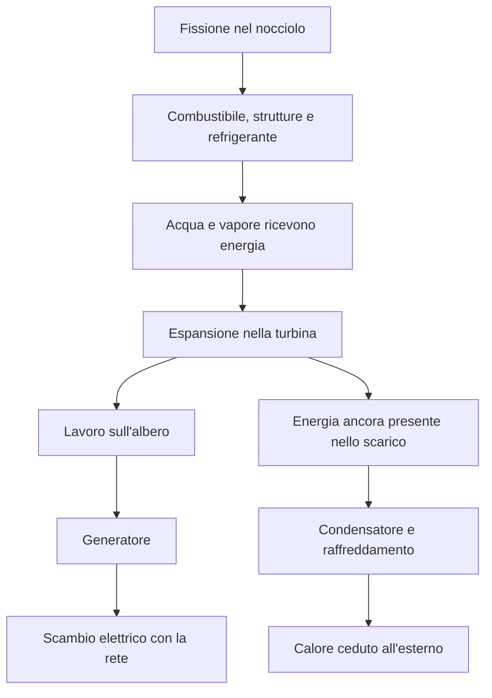

La rete non è un passaggio intermedio verso il condensatore. L'elettricità esportata lascia il sistema elettrico; il calore rimosso dal condensatore proviene invece dal fluido che ha attraversato la turbina o gli altri percorsi di scarico. Anche le perdite meccaniche ed elettriche e le variazioni di energia immagazzinata partecipano al bilancio, pur non essendo disegnate come componenti separati.

Il condensatore è perciò parte essenziale della conversione. Rimuove l'energia che il ciclo non ha trasformato in lavoro, permette al vapore di tornare liquido e mantiene una pressione di scarico favorevole all'espansione. Un reattore che produce calore e una turbina con valvole aperte non bastano, se a valle manca la capacità di ricevere e raffreddare quel vapore.

## 2.2 Un ciclo a produzione diretta di vapore

La configurazione è ispirata a un reattore a canali con ricircolo e separazione acqua-vapore. Il fluido riscaldato nei canali raggiunge il corpo cilindrico, dove la parte liquida e quella destinata alla linea vapore seguono percorsi diversi. Non c'è un generatore di vapore interposto che separi due circuiti di processo come in un impianto ad acqua pressurizzata.

Per orientarsi nell'interfaccia, il software usa comunque i nomi «primario» e «ciclo secondario». Qui identificano zone funzionali del modello: da una parte nocciolo e ricircolo, dall'altra linea vapore, turbina, condensatore e alimentazione. Non implicano che quelle zone contengano due acque di processo indipendenti. L'acqua di raffreddamento del condensatore, invece, è rappresentata come una sorgente esterna di capacità termica e non viene mescolata al condensato.

Il fatto che l'impianto sia ispirato a caratteristiche RBMK non lo rende una riproduzione geometrica o dinamica di un RBMK reale. Nel modello educativo molti canali, zone e apparecchiature sono aggregati. Il suo valore didattico è mostrare gli accoppiamenti, con i limiti illustrati nel capitolo 16.

## 2.3 I punti in cui il sistema accumula qualcosa

L'acqua che circola non attraversa solo collegamenti: incontra inventari. Il combustibile accumula energia termica; il corpo cilindrico contiene massa ed energia in una condizione bifase; la vasca del condensato raccoglie acqua; il volume di alimentazione fa da riserva intermedia; il rotore conserva energia cinetica. Questi accumuli spiegano perché una conseguenza possa comparire con ritardo.

Se il corpo cilindrico riceve più acqua di quanta massa perda complessivamente, il suo inventario cambia. Se il combustibile riceve più calore dalla fissione di quanto ne ceda al fluido, la sua temperatura cresce. Se la turbina fornisce più coppia di quanta il generatore e le perdite ne assorbano, il rotore accelera. Sono tre manifestazioni dello stesso principio: la differenza fra ingresso e uscita modifica ciò che è immagazzinato.

Un valore apparentemente fermo non dimostra quindi che tutto il sistema sia in equilibrio. Puoi avere quasi 3000 giri/min mentre un volume d'acqua si svuota lentamente. Per valutare la stabilità devi osservare almeno una grandezza lungo ogni parte del ciclo, soprattutto le tendenze degli inventari.

## 2.4 Che cosa significa chiedere più potenza

`LOAD RAISE` modifica la richiesta elettrica. Con il generatore in parallelo, quella richiesta interviene sul carico elettromagnetico e sul riferimento effettivo usato dal regolatore della turbina. La risposta dipende da quanta energia il ciclo riesca a trasferire: un numero richiesto più alto non costituisce una sorgente di energia.

La figura seguente è una catena causale, non una procedura garantita. Le frecce indicano influenze successive; l'ultimo nodo ricorda ciò che l'operatore deve verificare prima di proseguire.

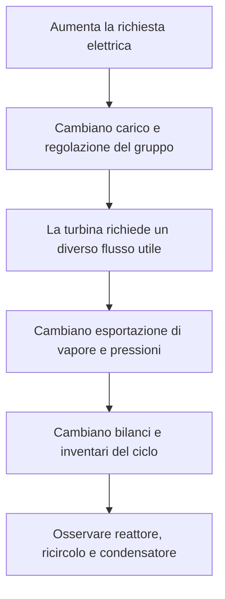

La catena non dice che il reattore seguirà da solo ogni richiesta della rete. Le retroazioni fisiche e i controlli attivi determinano ciò che succede davvero. Quando la risposta non sostiene il carico, la richiesta può restare alta mentre potenza, velocità o pressioni si allontanano dall'obiettivo. È proprio questa separazione fra intenzione e risultato che il simulatore permette di studiare.

<a id="capitolo-3"></a>

# 3. La fisica necessaria per interpretare l'impianto

## 3.1 Dalla fissione al riscaldamento

La fissione divide un nucleo e libera energia e neutroni. Una parte dei nuovi neutroni può produrre altre fissioni: nasce così una reazione a catena. Nel simulatore la dinamica neutronica determina una potenza di fissione che viene collegata ai modelli termici del nocciolo.

È utile distinguere la velocità di produzione dell'energia dalla temperatura dei materiali. La potenza si esprime in watt; la temperatura descrive una condizione del materiale. Un combustibile molto caldo può continuare a trasferire calore al refrigerante anche se la potenza di fissione è già diminuita, perché sta cedendo energia accumulata prima della manovra.

La parola «potenza del reattore» va quindi letta nel contesto dell'indicatore. La misura pubblicata dal modello non equivale automaticamente al calore che nello stesso istante arriva alla turbina. Fra i due esistono capacità termiche, scambi e inventari che introducono una dinamica propria.

## 3.2 Criticità, reattività e posizione delle barre

La criticità riguarda il bilancio neutronico, non una particolare percentuale di potenza. In condizioni stazionarie, un reattore critico sostiene la propria popolazione neutronica senza crescita o diminuzione sistematica. Può farlo a livelli di potenza differenti. «Critico» non significa quindi «alla massima potenza» né indica, da solo, un incidente.

La reattività esprime lo scostamento da quel bilancio. Un contributo positivo favorisce la crescita della popolazione; un contributo negativo la riduce. La risposta temporale dipende anche dai precursori dei neutroni ritardati: portare la reattività istantanea vicino a zero non annulla magicamente la storia precedente.

Le barre modificano l'assorbimento neutronico. La convenzione dell'interfaccia è **0% estratto per una barra completamente inserita** e **100% estratto per una barra completamente fuori**. `WITHDRAW` comanda l'estrazione, `INSERT` l'inserzione e `HOLD` ferma il movimento. Il comando di movimento persiste fino a una nuova richiesta, a un limite di corsa o all'intervento di una logica superiore.

Fermare le barre non ferma necessariamente la variazione di potenza: temperature, vapore e altri contributi possono continuare a cambiare. Per questo la lettura della posizione deve essere accompagnata dalla reattività totale e dalla tendenza della potenza.

## 3.3 Neutroni ritardati e periodo del reattore

Una frazione dei neutroni compare attraverso il decadimento di precursori, anziché immediatamente nella fissione. Il modello conserva questa dinamica e la sua memoria. È una delle ragioni per cui lo stesso piccolo movimento delle barre non produce sempre la stessa curva di potenza.

Il periodo del reattore riassume il ritmo relativo di variazione della popolazione neutronica. Quando la crescita è approssimativamente esponenziale, un periodo positivo breve significa una crescita rapida; un periodo positivo lungo indica una crescita più lenta. Un periodo negativo descrive una diminuzione. Vicino a una variazione nulla il valore può diventare molto grande o non essere rappresentabile in modo utile.

`REACTOR PERIOD · MODEL` è una diagnostica del modello: non è un cronometro che annunci quando scatterà una protezione. Va interpretato insieme a reattività, potenza e movimento delle barre. Se il periodo si accorcia mentre stai ancora estraendo, continuare senza una pausa di osservazione sovrappone la manovra alla risposta già in corso.

## 3.4 Calore immagazzinato e calore residuo

Dopo una riduzione di reattività la fissione può diminuire rapidamente, mentre combustibile e strutture rimangono caldi. Il refrigerante deve ancora raccogliere quell'energia e il ciclo deve trovare una destinazione alla quale cederla. Arrestare la reazione e rimuovere il calore sono quindi due problemi distinti.

Nel mondo fisico si aggiunge il calore di decadimento dei prodotti radioattivi. Il progetto possiede modelli dedicati, ma la loro effettiva composizione dipende dallo scenario. Nel percorso desktop di riferimento il contributo di potenza di decadimento del circuito è impostato a zero: non viene composta una curva completa di calore residuo. Il calore già accumulato nei materiali rimane invece presente e rende scorretto equiparare «reattore arrestato» a «impianto freddo».

La conseguenza pratica è leggere l'arresto attraverso temperature, circolazione e rimozione di calore. Il numero della potenza neutronica è una parte della diagnosi, non il suo punto finale.

## 3.5 Temperatura, pressione, massa ed energia

La temperatura indica lo stato termico; la pressione partecipa sia all'equilibrio di fase sia alla spinta idraulica; massa ed energia descrivono quanto materiale e quanta energia siano presenti. Nel modello di un volume fluido queste grandezze devono essere coerenti con il suo volume geometrico e con la relazione termodinamica scelta.

Non è possibile interpretare ogni salita di pressione come semplice aumento di temperatura. Possono cambiare anche densità, inventario e distribuzione fra liquido e vapore. Allo stesso modo, due nodi alla stessa temperatura possono avere pressioni e fasi differenti. Quando una lettura sembra strana, bisogna cercare quale combinazione di massa, energia e volume la stia determinando.

Uno scambio termico trasferisce energia fra corpi che hanno temperature diverse. La sua intensità dipende dalla conduttanza disponibile e dalla differenza di temperatura, oltre agli eventuali limiti del componente. Non basta che esista acqua di raffreddamento: occorre che il modello possa effettivamente trasferire verso di essa la potenza richiesta.

## 3.6 Ebollizione, titolo e frazione di vuoto

Il fluido può essere liquido sottoraffreddato, miscela liquido-vapore o vapore surriscaldato. Durante un cambiamento di fase, l'aggiunta di energia può far aumentare la quantità di vapore senza produrre un corrispondente aumento della temperatura. Nella regione di saturazione pressione e temperatura sono collegate; non costituiscono due regolazioni indipendenti.

Il **titolo**, o qualità del vapore, è la frazione di massa che si trova nella fase vapore. La **frazione di vuoto** è invece la frazione di volume occupata dal vapore. Poiché il vapore è molto meno denso del liquido, una piccola quota di massa può occupare una grande quota di volume. Un titolo del 10% non autorizza quindi a leggere una frazione di vuoto del 10%.

Il diagramma mostra due strade energetiche della stessa sostanza. Le frecce superiori indicano aggiunta di energia; quelle inferiori la sua rimozione. È uno schema concettuale a condizioni compatibili con il cambiamento di fase, non una tabella numerica valida a qualunque pressione.

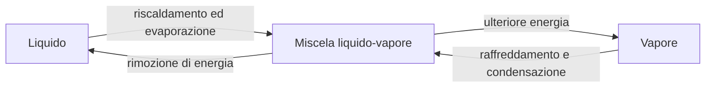

Il corpo cilindrico sfrutta la presenza delle due fasi per separare i percorsi. Il condensatore compie l'operazione opposta dal punto di vista del ciclo: sottrae energia al vapore e restituisce liquido al ritorno. La pressione assoluta molto bassa del condensatore viene spesso chiamata «vuoto», ma quel termine non indica la frazione di bolle nel refrigerante del nocciolo.

## 3.7 Portata, resistenza e prevalenza

La portata massica misura quanta massa attraversa un collegamento in un secondo. Dipende dalla differenza di pressione disponibile e dalla resistenza del percorso, con leggi ridotte proprie del componente. Una pompa aggiunge una spinta di pressione; una valvola cambia la facilità con cui il fluido passa. La pompa non impone sempre la propria portata nominale e la valvola aperta non garantisce sempre un flusso.

Se la pressione a valle contrasta la spinta disponibile, una pompa in marcia può trasferire meno acqua del previsto. Se un ritegno impedisce il flusso inverso, il risultato può essere portata nulla senza che il comando `RUN` sia stato ignorato. Per comprendere il fenomeno occorre leggere insieme stato operativo, pressione di aspirazione, pressione di mandata e disponibilità del fluido.

Il modello usa resistenze e dinamiche semplificate. Non bisogna dedurre da un'oscillazione qualsiasi la presenza di colpo d'ariete o di cavitazione fisica: questi fenomeni richiedono rappresentazioni specifiche che il solo bilancio di pressione non contiene.

## 3.8 Coppia, velocità e potenza meccanica

La coppia è l'azione che tende a far ruotare l'albero; la potenza meccanica è il prodotto della coppia per la velocità angolare. Il rotore ha inerzia, quindi può accelerare o rallentare quando le coppie non si bilanciano. In quel transitorio una parte dell'energia entra o esce dalla riserva cinetica del gruppo.

La turbina fornisce coppia motrice; il generatore, durante l'esportazione elettrica, oppone una coppia resistente. Si aggiungono le perdite meccaniche modellate. Se viene aperto l'interruttore e scompare il carico elettrico mentre l'ammissione resta significativa, può comparire un eccesso di coppia che accelera il gruppo.

La decelerazione con vapore ridotto non è istantanea. Le perdite passive permettono al rotore disconnesso di rallentare; un eventuale scatto memorizzato, invece, richiede anche le condizioni e il comando di reset. La meccanica può essere tornata accettabile mentre la memoria della protezione è ancora attiva.

## 3.9 Frequenza, fase e sincronizzazione

La frequenza elettrica del generatore è legata alla velocità del rotore e al numero di coppie polari. Nel gruppo di riferimento, a una coppia polare, 3000 giri/min corrispondono a 50 Hz. Questo spiega il numero che cerchi sul tachimetro prima del parallelo, ma non esaurisce le condizioni per collegare il generatore.

Occorre anche che tensione e fase siano compatibili con quelle della rete. La fase descrive la posizione relativa delle onde elettriche: due macchine possono avere quasi la stessa frequenza e, in quell'istante, una differenza di fase ancora troppo grande. Una piccola differenza di frequenza fa inoltre scorrere la fase nel tempo.

L'indicazione `SYNC READY` riassume i consensi previsti. Dopo `CLOSE BREAKER` devi verificare lo stato effettivo dell'interruttore, senza dedurre il parallelo dal solo comando inviato. Il capitolo 6 raccoglie le finestre numeriche della configurazione descritta.

## 3.10 Retroazioni di temperatura, vapore e xeno

La reattività non dipende soltanto dalle barre. Quando il combustibile e il refrigerante cambiano temperatura, o cambia la presenza di vapore, il modello può aggiungere contributi di retroazione. Il segno e l'intensità dipendono dai coefficienti e dalla composizione dello scenario: il nome «RBMK-like» non autorizza a supporre che qualsiasi aumento di vuoto produca sempre la stessa risposta in ogni configurazione.

I modelli di iodio e xeno introducono una memoria più lenta della storia di potenza. Lo xeno assorbe neutroni; la sua produzione, il suo decadimento e il consumo neutronico non seguono tutti la stessa scala temporale. Dopo una riduzione di potenza, il contributo può quindi evolvere anche senza ulteriori movimenti delle barre.

La figura rappresenta un anello di retroazione. Le frecce indicano influenze fisiche, non tubazioni; il ramo dello xeno vale quando quel modello è effettivamente composto nello scenario.

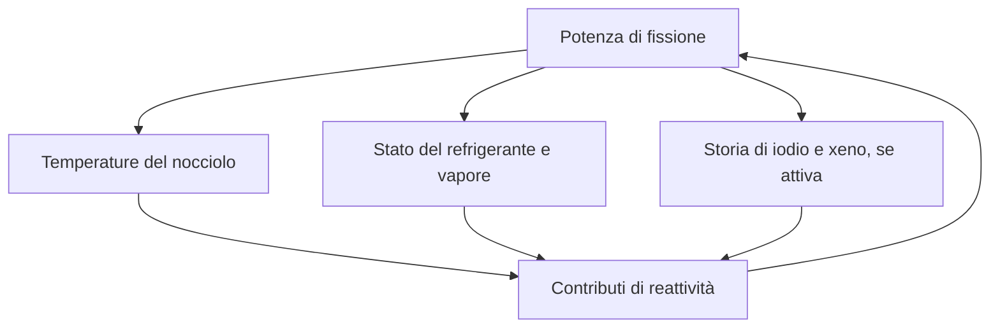

Il ritorno verso la potenza è il motivo per cui una conseguenza termica può diventare una nuova causa neutronica. Per interpretare correttamente la figura devi però distinguere il fenomeno generale dai segnali realmente disponibili. Se l'interfaccia riporta `UNAVAILABLE`, non sta misurando un contributo nullo: sta dicendo che quel dato non è disponibile nel percorso corrente.

## 3.11 Conservazione e lavoro di flusso

Per un volume di controllo, la variazione di massa dipende dalla massa che entra e da quella che esce. La variazione di energia interna dipende invece dagli scambi energetici dovuti a flussi, calore e lavoro. Questo permette di spiegare un transitorio senza immaginare che il software «aggiusti» un livello per renderlo piacevole da osservare.

Nei percorsi del desktop descritti in questo manuale, il trasporto energetico usa la convenzione entalpica, già implementata. L'entalpia specifica è `h = u + p/ρ`: comprende l'energia interna specifica e il lavoro necessario a spingere il fluido attraverso la frontiera. Il nodo continua a conservare massa ed energia interna; l'entalpia descrive ciò che il flusso trasporta. Calore e lavoro d'albero restano contributi da contabilizzare secondo il proprio componente.

Un esempio chiarisce la distinzione. Una turbina riceve fluido energetico, trasferisce lavoro all'albero e scarica fluido che conserva ancora energia. Il modello deve tenere insieme questi tre fatti; non può assegnare tutto il contenuto energetico al generatore e poi far condensare gratis lo scarico. Un residuo di conservazione molto piccolo indica che il conto si chiude numericamente, ma non dimostra da solo che tutte le correlazioni rappresentino accuratamente un impianto reale.

<a id="capitolo-4"></a>

# 4. Le interazioni fra i sottosistemi

## 4.1 Il ricircolo: portare calore fuori dai canali

Il ricircolo liquido collega corpo cilindrico, aspirazione delle pompe, mandata e canali riscaldati. Il suo compito non è rifornire da solo il ciclo di tutta l'acqua persa con il vapore: una grande parte della massa torna ripetutamente a percorrere i canali, mentre l'alimentazione reintegra il bilancio con il resto del ciclo.

Nella figura le frecce sono portate di fluido. La diramazione verso la linea vapore è disegnata soltanto per mostrare dove una parte della massa lascia il ricircolo.

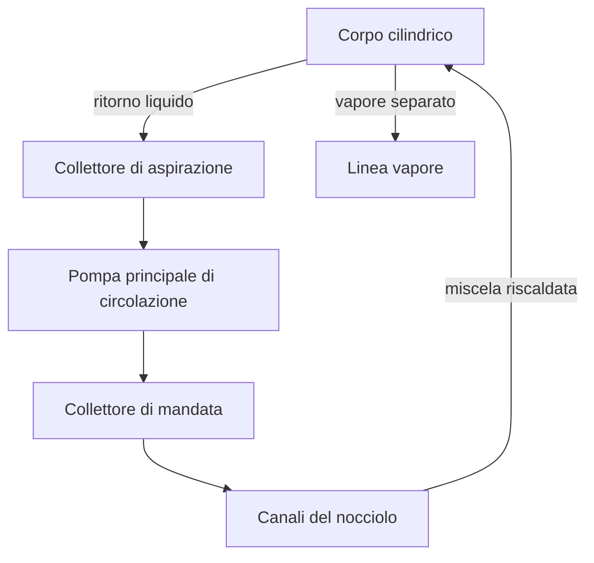

Seguendo l'anello si vede perché la portata principale riguarda prima di tutto il trasporto del calore e le condizioni del refrigerante. Il ramo verso il vapore spiega invece perché il bilancio del corpo cilindrico debba considerare anche il ciclo esterno. Fermare una pompa non equivale semplicemente a chiudere una fornitura d'acqua: modifica il percorso che accoppia raffreddamento, temperature e fase nei canali.

## 4.2 Il viaggio del vapore e il ritorno dell'acqua

Dal corpo cilindrico il vapore raggiunge la linea principale e il collettore, attraversa il treno di valvole e alimenta la turbina. Lo scarico arriva nello spazio vapore del condensatore; dopo la condensazione, la massa liquida viene raccolta nella vasca. La pompa del condensato la trasferisce al volume intermedio di alimentazione; una seconda pompa la riporta verso il corpo cilindrico vincendone la pressione.

La figura rappresenta questo percorso materiale. Il corpo cilindrico compare in alto come origine e in basso come destinazione del ritorno: le due etichette indicano lo stesso componente, ripetuto per evitare un arco che attraversi l'intera pagina.

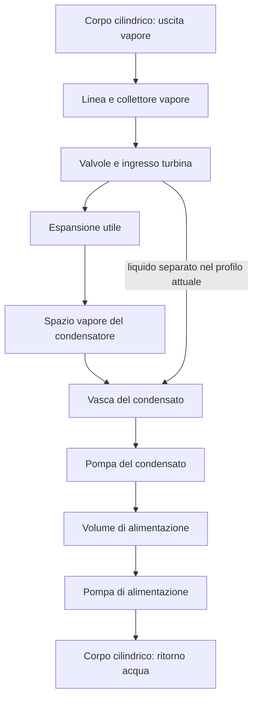

Il collegamento laterale è importante: il profilo desktop attuale assegna un percorso esplicito all'umidità separata prima dell'espansione, verso la vasca del condensato. Non tutta la massa che raggiunge l'ingresso della turbina deve quindi essere trattata come vapore che attraversa gli stadi. Questo evita di confondere portata totale di ammissione, portata di vapore utile e portata di scarico.

Il ciclo è prevalentemente chiuso, ma non bisogna dichiararlo chiuso in ogni circostanza. Esistono scarichi di confine, come lo sfioro verso il ricevitore atmosferico modellato, e scenari con perdite. Se una massa lascia il circuito principale, il suo effetto sugli inventari rimane parte della diagnosi.

## 4.3 I percorsi che aggirano la turbina

La linea principale possiede percorsi automatici distinti. Il bypass manda vapore verso il condensatore senza ricavarne il normale lavoro di espansione. Lo scarico di sovrapressione conduce invece verso un ricevitore atmosferico modellato. Entrambi rispondono alla pressione secondo le proprie leggi, ma hanno destinazioni e conseguenze differenti.

La figura usa frecce materiali. Il ramo centrale è la produzione normale; gli altri mostrano le due alternative automatiche, non tre valvole da comandare liberamente nella sala controllo.

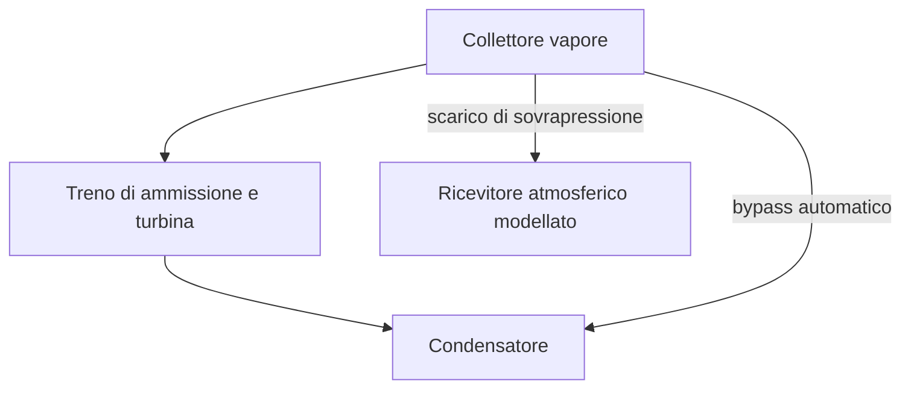

Deviare vapore può alleggerire la pressione a monte, ma il bypass porta al condensatore energia che la turbina non ha trasformato in lavoro. Per questo un condensatore già in difficoltà resta un vincolo anche quando il percorso di bypass è disponibile. Lo scarico atmosferico, invece, trasferisce massa fuori dal normale anello di recupero. La sua presenza non garantisce una capacità illimitata di smaltimento.

## 4.4 Dall'albero alla rete, e dalla rete all'albero

Quando il generatore è scollegato, la turbina accelera il rotore e alimenta le perdite meccaniche. Quando il generatore è collegato, compare anche lo scambio con la rete. Nel modello attuale lo scambio può avere entrambi i segni: la generazione esporta potenza, la motorizzazione ne importa e può esercitare coppia motrice sull'albero.

La rete è rappresentata con frequenza e tensione di riferimento, non come un sistema elettrico nazionale completo. Il gruppo simulato conserva comunque la propria dinamica di fase e velocità; il collegamento non impone una velocità perfettamente bloccata a 3000 giri/min in ogni istante. Una richiesta non sostenuta può quindi produrre scorrimento, inversione di potenza o intervento delle protezioni.

La regolazione in parallelo usa un riferimento legato al carico, spesso chiamato statismo o droop. Nel profilo attuale l'azione integrale della regolazione ha un riferimento distinto, legato alla velocità sincrona, per non cancellare lo scostamento intenzionale usato dall'altra parte del regolatore. Per l'operatore il punto essenziale è che `SPEED REFERENCE`, richiesta di carico e velocità misurata restano grandezze diverse.

## 4.5 Il circuito delle informazioni

L'impianto fisico produce grandezze che la strumentazione trasforma in segnali. I regolatori leggono quei segnali e richiedono azioni agli attuatori; le protezioni sorvegliano condizioni e consensi; l'operatore legge l'interfaccia e formula le proprie richieste. Questo è un percorso distinto da acqua, vapore ed elettricità.

Nel diagramma le frecce continue indicano il normale percorso di misura e regolazione. I collegamenti tratteggiati rappresentano richieste dell'operatore e interventi prioritari della protezione.

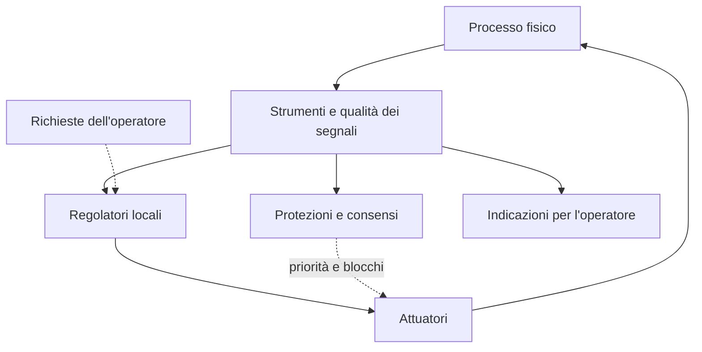

Una misura non valida è quindi un problema operativo anche se il simulatore conserva internamente uno stato fisico. Il controllo non dovrebbe usare quel valore interno come scorciatoia nascosta per sostituire un sensore indisponibile. Allo stesso modo, un comando manuale non acquisisce autorità superiore a una protezione soltanto perché viene impartito dal pannello.

Il capitolo 11 spiega chi può regolare che cosa. Per ora basta tenere separati tre livelli: l'intenzione, l'azione effettiva sul componente e la risposta del processo. Molti apparenti «comandi ignorati» si chiariscono ricostruendo proprio questi tre passaggi.

<a id="capitolo-5"></a>

# 5. I componenti, uno per uno

Questo capitolo segue l'impianto dal nocciolo fino al ritorno dell'acqua, poi introduce gli strumenti che ne governano il comportamento. Per ogni componente cerca tre collegamenti: che cosa riceve, che cosa restituisce e quale effetto può produrre sugli altri. I valori numerici sono raccolti nel capitolo 6, così la spiegazione del funzionamento non diventa una sequenza di targhe.

## 5.1 Nocciolo e zone del core

Il nocciolo è la zona in cui il modello deposita la potenza di fissione e la distribuisce ai materiali e al refrigerante. Le zone mostrate nell'interfaccia servono a distinguere temperature, quote di potenza e condizioni del fluido. Il loro numero e il loro significato dipendono dalla definizione del core: una mappa a zone non è automaticamente una simulazione neutronica tridimensionale.

Nel riferimento aggregato si usa un gruppo equivalente di 100 canali. La calibrazione neutronica associa 100 MWth alla popolazione relativa unitaria; quel numero è un fattore di conversione del modello, non l'ordine di portare il desktop a 100 MWth. Il punto iniziale attuale di generazione si trova su una potenza termica diversa, dell'ordine di alcune decine di megawatt.

Il collegamento da osservare è quello fra produzione e rimozione del calore. Se la potenza cresce ma la circolazione non sostiene il trasferimento, cambiano le temperature dei materiali e del refrigerante. Quelle variazioni possono a loro volta influenzare la reattività, quando i relativi contributi sono composti nello scenario. La lettura del nocciolo deve quindi coinvolgere anche il circuito primario.

## 5.2 Barre di controllo

Le barre sono attuatori della reattività. Il comando decide la direzione del movimento, mentre la posizione raggiunta e la curva di efficacia determinano il contributo neutronico. Il gruppo equivalente del modello non va immaginato come una ricostruzione completa di tutte le barre di una macchina reale.

Quando premi `WITHDRAW`, osserva prima lo stato di movimento confermato e poi il cambiamento della reattività. Premi `HOLD` per interrompere il movimento normale: la barra rimane alla posizione raggiunta, ma il resto del reattore continua a evolvere. `INSERT` avvia l'inserzione. Agli estremi della corsa non può comparire uno spostamento ulteriore soltanto perché il comando è rimasto selezionato.

Nel gruppo di riferimento il movimento normale procede a circa 10 punti percentuali di corsa al secondo. Il punto iniziale caldo usa una posizione intorno al 50% estratto; quel valore appartiene alla curva e alla composizione adottate e non rappresenta una posizione di criticità universale.

La protezione può impedire l'estrazione o imporre l'inserzione di arresto. Se il pannello mostra `MIXED`, un gruppo può contenere elementi con stati diversi; la media della posizione non descrive da sola ogni elemento. Un pulsante evidenziato rappresenta lo stato confermato del comando di movimento e va letto insieme agli eventuali interblocchi.

## 5.3 Cinetica neutronica

La cinetica è il collegamento fra reattività e andamento della popolazione neutronica. Conserva anche lo stato dei precursori ritardati: non è una tabella che converte istantaneamente una posizione delle barre in megawatt.

Il riferimento desktop è ridotto e aggregato. Può fornire una risposta temporale deterministica e utile allo studio, senza risolvere tutti i dettagli spaziali del trasporto neutronico. Il periodo del reattore e la potenza di fissione sono modi diversi di leggere quella risposta: il primo ne descrive il ritmo relativo, la seconda la scala energetica.

Una manovra delle barre va pertanto valutata dopo aver lasciato emergere la sua conseguenza. Se continui a modificare l'ingresso prima di aver osservato la risposta, diventa difficile distinguere la memoria della cinetica dall'effetto dell'ultimo movimento.

## 5.4 Iodio e xeno

La catena iodio-xeno descrive un assorbitore neutronico che dipende dalla storia di funzionamento. Il suo interesse didattico è mostrare che il reattore ricorda anche ciò che è accaduto prima della schermata che stai guardando.

Non esiste un comando che «tolga lo xeno». Negli scenari che compongono questo modello, la concentrazione evolve attraverso produzione, decadimento e assorbimento neutronico. La risposta può quindi continuare a cambiare dopo una manovra già conclusa, rendendo differente una successiva risalita di potenza.

La disponibilità dei valori va controllata nell'interfaccia. Se `XENON REACTIVITY` o gli inventari sono `UNAVAILABLE`, non devi interpretarli come zero né ricostruirli da una temperatura. Nel normale esercizio desktop la diagnostica quantitativa dello xeno rimane esplicitamente non disponibile; gli scenari specifici di xeno hanno una composizione propria.

## 5.5 Canali di combustibile e materiali termici

I canali collegano il lato nucleare a quello idraulico. Ricevono il fluido dalla mandata, lo espongono ai trasferimenti di calore del core e lo restituiscono verso il separatore in una condizione energetica e di fase diversa. L'uscita può contenere una miscela, non soltanto acqua più calda.

Combustibile e strutture hanno capacità termica. Una parte dell'energia può essere temporaneamente immagazzinata nei solidi e rilasciata dopo una variazione della fissione. Questo ritardo è fisicamente diverso dal tempo che la pompa impiega a far cambiare una portata o dal tempo di risposta di un sensore.

Nel pannello `REACTOR` cerca una relazione fra temperatura del combustibile, temperatura del refrigerante e potenza; nel pannello `PRIMARY` completa la lettura con la portata. Una temperatura crescente con portata in calo racconta una situazione diversa da una temperatura crescente durante un riscaldamento deliberato. I limiti del modello non permettono di trasformare automaticamente queste osservazioni in una diagnosi di ebollizione critica o danno al combustibile reale.

## 5.6 Collettore di aspirazione

Il collettore di aspirazione raccoglie il ritorno liquido e alimenta le pompe principali. È un punto di collegamento comune fra disponibilità di fluido, pressione a monte delle pompe e chiusura del ricircolo.

Una pressione o una condizione di fase sfavorevole in questo punto può cambiare ciò che la pompa riesce a trasferire. Se stai indagando una riduzione di circolazione, osserva l'aspirazione prima di attribuire tutto al comando della pompa. La presenza di una pressione bassa, però, non dimostra che il software stia simulando una cavitazione dettagliata: NPSH e cavitazione non hanno ancora una rappresentazione completa.

## 5.7 Pompe principali di circolazione — MCP

Le pompe principali forniscono la spinta che sostiene il ricircolo attraverso i canali. Ricevono fluido dall'aspirazione e lo inviano al collettore di mandata, aggiungendo la pressione prevista dalla loro caratteristica e dal loro stato operativo.

`START / RUN` e `STOP` sono richieste alla pompa selezionata. Dopo averle impartite, verifica lo stato effettivo e `TOTAL MCP FLOW`. Una pompa può risultare in marcia mentre la portata differisce da quella desiderata: contropressione, resistenza del circuito, disponibilità di inventario e logiche di controllo restano parte del problema.

Il calore rimosso dal nocciolo dipende dal fluido che circola e dallo scambio, quindi la pompa influenza indirettamente temperature, produzione di vapore e retroazioni. Aumentarne l'azione non equivale a «raffreddare sempre di più» in modo indipendente dal resto del sistema. Cambia il percorso dei bilanci e può modificare anche le condizioni a cui il separatore riceve il fluido.

Nel profilo operativo attuale la portata di riferimento è vicina a 100 kg/s. È un riferimento di quella composizione, non una portata universale per tutti gli scenari e tanto meno per un impianto RBMK reale.

## 5.8 Collettore di mandata

La mandata distribuisce il fluido proveniente dalle pompe ai canali del nocciolo. La differenza di pressione fra mandata e aspirazione contribuisce a spiegare la circolazione, ma il valore deve essere letto con le resistenze e con gli altri percorsi della rete.

Se una pompa aumenta la propria spinta mentre il circuito non riesce a far passare la massa corrispondente, pressione e portata possono rispondere in modo diverso. Per questo `HEADER ΔP` e `TOTAL MCP FLOW` sono complementari: il primo descrive una differenza di pressione, il secondo il trasferimento di massa che ne risulta nel sistema modellato.

## 5.9 Linee di ritorno

Le linee di ritorno riportano verso il corpo cilindrico il fluido che ha raccolto calore nei canali. Partecipano al ricircolo con la loro resistenza e con i bilanci di massa ed energia. Un collegamento che sembra soltanto «un tubo» può quindi influire su pressioni e distribuzione delle portate.

Durante una variazione di potenza, la risposta del ritorno va confrontata con ciò che succede nel nocciolo e nel separatore. Un segnale di livello cambiato a valle può essere la conseguenza di condizioni di fase e inventario maturate lungo questo percorso, non di un singolo errore del regolatore di alimentazione.

## 5.10 Corpo cilindrico di separazione acqua-vapore

Il corpo cilindrico riceve la miscela del ricircolo, rende disponibile un ritorno liquido verso l'aspirazione ed esporta vapore verso il ciclo turbina. Nel modello la separazione è idealizzata: non viene riprodotto ogni dettaglio di gocce trascinate, separatori industriali o oscillazioni della superficie libera.

La figura mostra i collegamenti materiali che devi tenere presenti quando leggi il livello. La portata di alimentazione arriva dal ciclo del condensato; quella di ricircolo ritorna verso il nocciolo. Sono due ingressi o uscite con funzioni differenti.

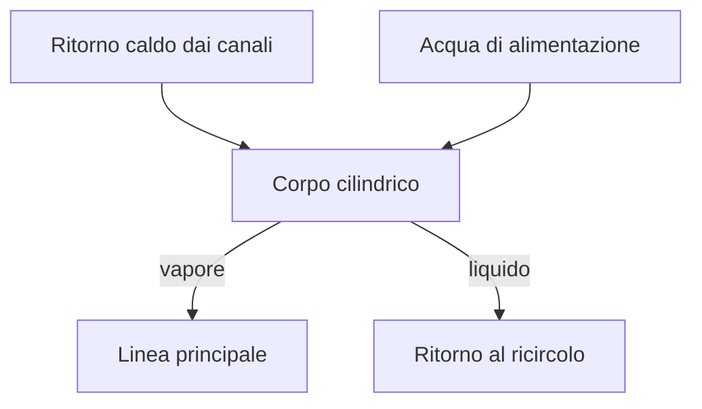

Il livello deriva dallo stato e dall'inventario liquido del volume aggregato. Non è un righello che misuri tutta la geometria di un recipiente reale e non coincide semplicemente con la percentuale della massa totale presente nel circuito. Una variazione di fase può cambiare il rapporto fra volumi liquido e vapore anche mentre la massa complessiva cambia poco.

La pressione racconta un altro aspetto dello stesso volume. Aumentare il calore in ingresso, ridurre l'esportazione di vapore o cambiare l'acqua di alimentazione modifica combinazioni diverse di energia e massa. Perciò pressione e livello devono essere letti insieme a `STEAM EXPORT TOTAL`, ricircolo e alimentazione.

Il regolatore di livello agisce sulla pompa di alimentazione. Non può creare acqua né correggere istantaneamente uno squilibrio di tutto il ciclo. Il basso livello è annunciato separatamente dal livello molto basso, che nel profilo attuale provoca uno scatto coordinato di reattore, turbina e generatore.

## 5.11 Linea e collettore principale del vapore

La linea vapore trasferisce massa ed energia dal separatore al treno di ammissione. Ha resistenza e inventari propri, quindi non trasporta una pressione identica e immutabile da un'estremità all'altra. La graduazione delle pressioni permette di sostenere la portata attraverso le diverse restrizioni.

Un collo di bottiglia a monte può limitare la risposta anche con la valvola di regolazione abbastanza aperta. In quel caso, continuare ad aprire una valvola a valle non garantisce un aumento proporzionale del vapore utile. Devi confrontare pressione a monte, pressione all'ingresso della turbina e portata effettiva.

Dal collettore partono anche il bypass e lo scarico di sovrapressione spiegati nel capitolo 4. Nel profilo descritto sono percorsi automatici: il manuale non presuppone l'esistenza di un comando grafico dedicato a ogni componente che compare nel modello fisico. La loro attivazione deve essere interpretata come una modifica ai bilanci di scarico, non come energia che scompare.

## 5.12 Il treno di valvole: intercettazione, regolazione e ammissione

La valvola di intercettazione, `STOP`, consente di isolare il percorso della turbina ed è coinvolta nello scatto. La valvola `CONTROL` è il principale bersaglio della regolazione della velocità e dell'azione legata al carico. La valvola `ADMISSION` completa il percorso e partecipa al controllo di pressione previsto dalla composizione. Le tre posizioni appartengono alla stessa catena e la più restrittiva può limitare la capacità del treno.

Nella stazione valvole puoi confrontare posizione reale e `TARGET`. `STOP OPEN` o `STOP CLOSE` cambiano una richiesta persistente; `ADMISSION OPEN` e `ADMISSION CLOSE` fanno lo stesso per la relativa valvola. La corsa richiede tempo: nei componenti secondari descritti il limite è di circa 50 punti percentuali al secondo. Una richiesta al 100% non equivale quindi a una posizione al 100% nello stesso istante.

`CONTROL AUTO` restituisce la regolazione al governor. `CONTROL MANUAL` abilita la richiesta manuale della valvola di regolazione. Il cursore prepara il valore e `APPLY` lo invia: trascinare il cursore senza applicarlo non deve essere interpretato come una manovra già eseguita sul fluido.

Durante uno scatto può rimanere leggibile la richiesta normale dell'operatore mentre la protezione impone una posizione effettiva diversa. Questa separazione permette di capire perché la turbina non riceva il vapore richiesto. Prima di ripetere il comando, leggi l'autorità attiva e l'eventuale apertura inibita.

## 5.13 Turbina, vapore utile e drenaggio dell'umidità

La turbina ricava lavoro dal fluido che si espande verso una pressione più bassa. Nel modello la potenza dipende dalla portata effettiva, dalle condizioni d'ingresso, dalla contropressione, dall'efficienza e dai limiti energetici della rappresentazione ridotta. Una valvola aperta, da sola, non garantisce una determinata potenza all'albero.

Il profilo attuale distingue la massa di vapore utile dalla parte liquida presente all'ingresso. La frazione di vapore limita la portata che attraversa gli stadi; il liquido separato ha un percorso esplicito verso la vasca del condensato. Questa è una regola di modello: non riproduce in dettaglio l'erosione delle palette, la separazione delle gocce o l'intera termodinamica di una turbina industriale.

Il diagramma rende visibile la separazione. Le frecce continue trasportano materia; quella tratteggiata rappresenta il lavoro trasferito all'albero. Il vapore che esce dagli stadi conserva energia e prosegue verso il condensatore.

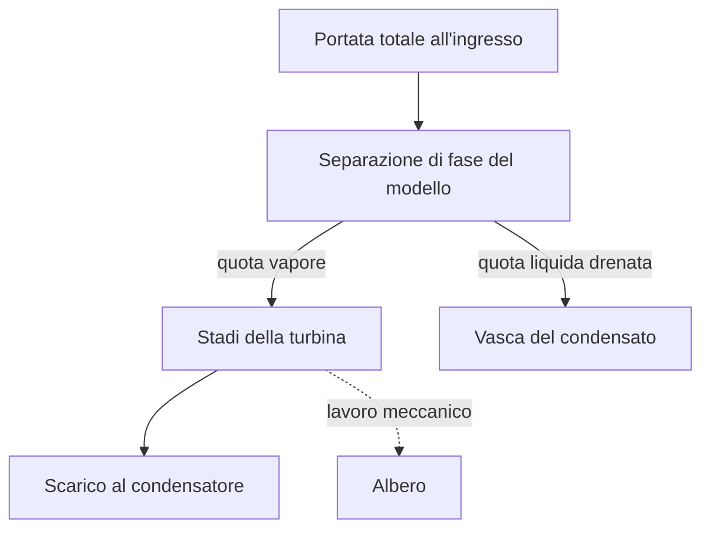

Non devi sommare indiscriminatamente tutte le portate visibili. `ADMISSION FLOW`, la portata dello stadio e il drenaggio possono riferirsi a confini diversi dello stesso processo. Nel riferimento iniziale Exact-V9 l'ammissione totale è circa 13,34 kg/s, mentre circa 0,31 kg/s seguono il drenaggio; sono osservazioni del punto iniziale, non valori da imporre manualmente a ogni prova.

Se la pressione del condensatore aumenta, il salto utile di espansione si riduce. Può quindi scendere la potenza pur senza una chiusura comandata della valvola. Questo è uno degli esempi più chiari di componente «vittima» di un problema nato altrove.

## 5.14 Rotore e albero

Il rotore collega la turbina al generatore e conserva energia cinetica. La sua velocità cambia in risposta alla coppia netta, cioè al risultato della coppia motrice, del carico elettrico e delle perdite. `NET TORQUE` aiuta a leggere la direzione del cambiamento prima che lo spostamento dei giri diventi grande.

Nel modello di riferimento il momento d'inerzia è 1000 kg·m² e la velocità nominale 3000 giri/min. Questi numeri appartengono alla macchina educativa e non costituiscono una legge di scala di un gruppo RBMK reale. Le perdite meccaniche sono esplicite; alla velocità nominale il riferimento di perdita è 0,5 MW.

Quando apri l'interruttore, controlla ciò che rimane della coppia turbina. Quando riduci il vapore, osserva la decelerazione senza aspettarti un arresto istantaneo. La sovravelocità può provocare scatti memorizzati che richiedono un reset separato anche dopo il rientro dei giri.

## 5.15 Condensatore

Il condensatore riceve lo scarico della turbina e gli eventuali flussi di bypass. Trasferendo calore al sistema di raffreddamento esterno, rende possibile il passaggio di massa dallo spazio vapore alla vasca del condensato. La bassa pressione allo scarico è un risultato di questo processo e dei suoi bilanci, non un comando che il software mantiene gratuitamente.

La quantità condensata in un passo dipende da più limiti. Deve esistere vapore disponibile; la portata massima del componente non deve essere superata; e deve esserci abbastanza capacità termica per rimuovere l'energia necessaria al cambiamento di fase. La capacità effettiva di trasferimento del calore è a sua volta limitata dalla potenza installata, da quella disponibile e dalla legge di superficie `UA × ΔT`.

Nel profilo descritto la capacità installata è 40 MW, la conduttanza è 1,225 MW/K e la portata massima di condensazione è 20 kg/s. Queste tre quantità hanno unità e ruoli diversi. I 40 MW non significano che il condensatore stia rimuovendo sempre 40 MW; i 20 kg/s non garantiscono di condensare quella massa se il salto termico disponibile non basta.

Il condensato viene caratterizzato con lo stato di liquido saturo alla pressione dello spazio vapore. La sua energia d'ingresso nella vasca può quindi essere diversa da quella dell'acqua che la vasca già contiene. Nei percorsi attuali il bilancio del trasferimento tiene conto della convenzione entalpica; la differenza energetica fra ciò che lascia lo spazio vapore e ciò che entra nella vasca è collegata al calore rigettato.

Per leggere il componente confronta pressione assoluta, portata condensata e potenza termica rimossa. Le diagnostiche come `CONDENSATE ENERGY · MODEL`, `PHASE-CHANGE Δu · MODEL` e `ACTIVE CONDENSATION LIMIT · MODEL` spiegano il meccanismo scelto dal modello. Il nome di una diagnostica non sostituisce la lettura della convenzione energetica attiva e non introduce un nuovo attuatore.

## 5.16 Vasca del condensato — hotwell

La vasca raccoglie la massa condensata e, nel profilo attuale, anche il drenaggio liquido separato all'ingresso della turbina. Da essa aspira la pompa del condensato. È quindi una riserva materiale ed energetica, non soltanto una casella con un livello da mantenere verde.

La sua massa cresce quando gli ingressi superano ciò che la pompa estrae, e diminuisce nella situazione opposta. Anche la temperatura può cambiare perché gli ingressi portano energia propria. Un buon andamento della pressione del condensatore non garantisce da solo un inventario sano nella vasca: sono due parti collegate del componente, con bilanci distinti.

`HOTWELL MASS · MEASURED` è l'indicatore operativo principale. Va letto insieme alla portata della pompa e alla condensazione, soprattutto quando il ciclo cambia carico o riceve bypass.

## 5.17 Pompa del condensato

La pompa del condensato trasferisce acqua dalla vasca al volume intermedio di alimentazione. La sua regolazione risponde all'inventario della vasca: l'obiettivo è evitare che si riempia o si svuoti sistematicamente mentre il ciclo continua a funzionare.

Nel modello di riferimento la spinta nominale semplificata è circa 1 MPa e il percorso possiede un ritegno allo scarico. La portata dipende comunque dalle condizioni a monte e a valle. I suoi attuatori secondari hanno una corsa finita, dell'ordine di 25 punti percentuali al secondo nel profilo descritto.

La schermata standard non offre necessariamente un comando diretto per ogni parametro della pompa. Il componente rimane osservabile attraverso il treno condensato-alimentazione e i suoi controlli locali. È importante non inventare una manovra da un parametro che compare soltanto nella definizione tecnica.

## 5.18 Volume intermedio dell'acqua di alimentazione

Questo inventario si trova fra la pompa del condensato e la pompa di alimentazione. Riceve la prima portata e fornisce la seconda: una differenza persistente fra le due si manifesta come accumulo o svuotamento.

La sua presenza impedisce di trattare le due pompe come se dovessero trasferire esattamente la stessa massa a ogni singolo istante. Un transitorio può essere assorbito temporaneamente dal volume intermedio. Se però lo squilibrio non rientra, la riserva si sposta e alla fine cambia ciò che il resto del ciclo può sostenere.

Quando il corpo cilindrico riceve poca acqua, controllare solo il suo regolatore può essere insufficiente. Devi verificare anche da dove la pompa di alimentazione dovrebbe prendere la massa e che cosa stia succedendo alla vasca del condensato.

## 5.19 Pompa di alimentazione

La pompa di alimentazione riporta l'acqua verso il corpo cilindrico e deve sostenere una pressione adeguata al ritorno nel ciclo caldo. Nel riferimento del modello la spinta nominale semplificata è circa 7 MPa, ma la portata effettiva deriva dal percorso idraulico completo.

Il regolatore di livello ne modifica la richiesta. Se il livello del corpo cilindrico scende, aumentare l'azione della pompa ha senso soltanto quando esistono acqua disponibile e margine di pressione. Una richiesta elevata con portata insufficiente è un'informazione diagnostica: non va confusa con l'assenza di qualunque tentativo di regolazione.

L'acqua introdotta modifica anche il bilancio energetico. Portare più massa nel separatore non è un'azione neutra dal punto di vista termico: si mescola con uno stato già caldo e può cambiare produzione di vapore, pressioni e risposta del controllo. Per questo alimentazione e potenza non sono due manopole indipendenti.

## 5.20 Generatore sincrono

Il generatore converte lavoro meccanico in scambio elettrico. Il modello attuale considera il segno di quello scambio: positivo quando esporta verso la rete, negativo quando importa e motorizza il gruppo. La richiesta normale dell'operatore rimane non negativa; una potenza misurata negativa nasce dalla dinamica del gruppo collegato.

La targa elettrica del riferimento attuale è 10 MWe e l'efficienza semplificata è 98%. Il punto di avvio ordinario richiede 5 MWe. La calibrazione neutronica da 100 MWth del nocciolo e la targa elettrica da 10 MWe sono due definizioni diverse: confrontarle senza passare dai bilanci del ciclo non fornisce un rendimento della centrale.

`REQUESTED LOAD · MODEL` mostra l'intenzione di carico; `GRID EXCHANGE · MEASURED` mostra lo scambio calcolato. Se si allontanano, cerca il motivo nel bilancio di potenza, nella velocità, nella fase o nello stato dell'interruttore. Il carico richiesto non permette di esportare indefinitamente energia che la turbina non fornisce: può comparire una risposta transitoria del rotore e delle protezioni.

## 5.21 Interruttore di gruppo e rete

L'interruttore collega elettricamente generatore e rete. `CLOSE BREAKER` richiede il parallelo; `OPEN BREAKER` richiede la separazione. Il consenso alla chiusura è una condizione elettrica effettiva, non una semplice abilitazione del pulsante da parte dello scenario.

Prima del collegamento il sistema confronta frequenza, fase e tensione. Dopo il collegamento lo scambio dipende anche dalla dinamica del rotore e dalle correzioni del modello di accoppiamento. Leggere «interruttore chiuso» non significa dunque che qualunque transitorio successivo sia automaticamente equilibrato.

L'apertura elimina il percorso normale di scambio con la rete e cambia il carico visto dall'albero. Per una manovra deliberata occorre coordinare questo effetto con l'ammissione vapore. Uno scatto del generatore usa il percorso di protezione e conserva una memoria; una normale apertura e uno scatto non hanno quindi lo stesso significato procedurale.

## 5.22 Strumenti, misure e diagnostiche

La strumentazione rende disponibili ai controlli e all'operatore grandezze del processo, con validità e qualità proprie. La dicitura `MEASURED` indica quel percorso nel simulatore: non si riferisce a un sensore esterno collegato a un impianto reale. I guasti configurati possono degradare una misura e rendere necessario cambiare il modo di interpretarla.

`MODEL` segnala invece una diagnostica derivata, utile a capire il modello; `STATE` uno stato discreto, come la posizione logica dell'interruttore. `UNAVAILABLE` descrive un'informazione non disponibile. Non sostituire quest'ultima con zero: farlo cambierebbe il significato della condizione.

Un'indicazione filtrata può rispondere più lentamente di una diagnostica grezza, senza che vi siano due impianti diversi. Per esempio, alcune presentazioni operative della portata hanno un ritardo di visualizzazione distinto dal calcolo del flusso. Confrontare segnali con ruoli e filtri diversi richiede quindi attenzione alla loro provenienza.

## 5.23 Regolatori e attuatori

Un regolatore confronta la misura con un riferimento e produce una richiesta. L'attuatore converte quella richiesta nell'azione sul componente, rispettando eventuali limiti di corsa e di autorità. La separazione spiega perché possano essere diversi valore desiderato, uscita del controllo, posizione reale e variabile di processo.

Nel riferimento composto esistono collegamenti fra potenza e barre, portata principale e pompa di circolazione, velocità e valvola di regolazione, pressione e ammissione, livello del corpo cilindrico e pompa di alimentazione, massa della vasca e pompa del condensato. La tabella del capitolo 11 collega queste azioni alle modalità di autorità.

In automatico il regolatore corregge lo scostamento nel tempo; un integratore può conservare memoria delle correzioni precedenti. In manuale l'uscita segue la richiesta prevista dal relativo comando. Cambiare modalità non dovrebbe introdurre un salto artificiale di richiesta, ma non cancella l'inerzia fisica né garantisce che ogni transitorio scompaia.

## 5.24 Protezioni e interblocchi

Le protezioni possono imporre arresti quando sono soddisfatte le condizioni definite. L'interblocco può invece impedire una richiesta, per esempio un'estrazione o un'apertura, senza che debba necessariamente esserci già uno scatto memorizzato.

Entrambi partecipano all'autorità effettiva sul componente. Un operatore o un supervisore automatico può continuare a mostrare la propria richiesta normale mentre la protezione ne impedisce l'esecuzione. Leggere questa differenza è parte dell'uso corretto della sala controllo, non un dettaglio riservato agli sviluppatori.

Il capitolo 7 spiega soglie, temporizzazioni e condizioni di reset. Qui occorre trattenere il collegamento con il processo: l'intervento cambia una configurazione e produce nuove conseguenze sul resto del ciclo, che devono essere osservate.

## 5.25 Allarmi e annunciatori

L'allarme porta una condizione all'attenzione dell'operatore e può conservarne la memoria. Non è necessariamente il comando che ha arrestato il componente. Una protezione può generare un allarme di scatto; un avvertimento può invece comparire senza imporre alcuna azione fisica.

Il primo evento, `FIRST-OUT`, aiuta a riconoscere l'inizio di una catena. Se una perdita di raffreddamento fa aumentare la pressione del condensatore e poi intervengono turbina e generatore, gli ultimi annunci possono riguardare componenti che non sono l'origine del problema.

`ACKNOWLEDGE` registra che l'allarme è stato visto. Il reset della memoria segue regole diverse e richiede le condizioni previste. La lettura congiunta di annunciatori, valori fisici e sequenza temporale è molto più informativa della sola ricerca di una schermata senza luci accese.

<a id="capitolo-6"></a>

# 6. Valori, scale, riferimenti e margini

## 6.1 Quattro significati diversi dello stesso numero

Il fondo scala di uno strumento stabilisce come disegnare una misura. Il riferimento di un regolatore indica ciò che il controllo cerca di ottenere. Una banda operativa descrive una condizione utile per un esercizio o una manovra. La soglia di protezione determina invece quando una funzione può intervenire. Questi significati possono apparire sulla stessa schermata, ma non sono equivalenti.

Un esempio è la velocità del rotore. La scala del tachimetro può comprendere valori superiori a quelli desiderati; il riferimento nominale è circa 3000 giri/min; la chiusura dell'interruttore richiede una finestra elettrica; la sovravelocità ha una propria soglia di scatto. Essere ancora dentro il quadrante non autorizza a considerare il gruppo pronto per il parallelo.

Un margine è utile soltanto quando lo leggi insieme alla tendenza. Una pressione del condensatore di 18 kPa che sta scendendo racconta un recupero; lo stesso valore in salita rapida può annunciare una perdita di margine. Il dato istantaneo va quindi accompagnato dalla direzione, dal ritmo del cambiamento e dal bilancio che lo produce.

## 6.2 Il riferimento desktop attuale

I valori seguenti appartengono alla configurazione educativa descritta. Quelli indicati come «iniziali» servono a riconoscere il punto di partenza, non sono soglie né prescrizioni da imporre a ogni scenario.

| Grandezza | Riferimento | Come interpretarlo |
| --- | ---: | --- |
| Passo logico | 10 ms | Tempo fisico di un passo del runtime ordinario |
| Velocità nominale del gruppo | 3000 giri/min | Riferimento sincrono con una coppia polare e rete a 50 Hz |
| Frequenza della rete | 50 Hz | Frequenza di riferimento del modello elettrico |
| Tensione di riferimento | 400 kV | Grandezza modellata per generatore e rete, senza ricostruzione completa dei trasformatori |
| Targa del generatore | 10 MWe | Limite di scala del componente attuale |
| Richiesta elettrica iniziale | 5 MWe | Partenza del desktop ordinario in parallelo |
| Efficienza semplificata del generatore | 98% | Conversione del modello, distinta dal rendimento dell'intero ciclo |
| Portata principale iniziale | circa 100 kg/s | Riferimento del ricircolo del profilo Exact-V9 |
| Pressioni iniziali del circuito caldo | circa 6,4–6,7 MPa | Valori di nodi diversi, non una pressione unica imposta ovunque |
| Pressione iniziale dello scarico | circa 8,4 kPa assoluti | Punto di partenza del volume di scarico/condensazione |
| Livello iniziale del corpo cilindrico | circa 50% | Indicatore normalizzato del modello aggregato |
| Calibrazione neutronica | 100 MWth a popolazione relativa 1 | Fattore di conversione; non è la potenza iniziale del desktop |
| Inerzia del rotore | 1000 kg·m² | Proprietà della macchina educativa |
| Capacità installata di raffreddamento | 40 MW | Tetto disponibile nella definizione, non potenza sempre rimossa |
| Conduttanza del condensatore | 1,225 MW/K | Coefficiente della legge `UA × ΔT` |
| Portata massima di condensazione | 20 kg/s | Limite distinto dalla capacità termica |

Nota la differenza fra MPa e kPa. Un megapascal contiene mille kilopascal: 6,4 MPa non è vicino a 6,4 kPa. Le pressioni di condensazione riportate qui sono assolute. Un «vuoto maggiore» significa una pressione assoluta minore, mentre una maggiore frazione di vuoto nel nocciolo significa più volume occupato da vapore.

## 6.3 Consensi e protezioni principali

La tabella raccoglie i valori definiti per il profilo dotato delle protezioni secondarie ed elettriche descritte. Le condizioni di rientro sono parti del consenso al reset: non cancellano automaticamente la memoria dello scatto.

| Condizione | Soglia o finestra | Rientro usato per il reset |
| --- | --- | --- |
| Alta pressione del corpo cilindrico | Avvertimento a 20 MPa | L'allarme segue la propria logica |
| Pressione molto alta del corpo cilindrico | SCRAM da 25 MPa | Pressione non superiore a 24 MPa |
| Livello basso del corpo cilindrico | Avvertimento alla soglia del 25% | Verificare livello e tendenza |
| Livello molto basso | Scatto coordinato al 10% o meno | Livello almeno al 20% |
| Alta contropressione del condensatore | Avvertimento a 20 kPa assoluti | L'allarme segue la propria logica |
| Contropressione molto alta | Scatto turbina e generatore da 30 kPa assoluti | Pressione non superiore a 20 kPa |
| Sovravelocità del rotore | Scatto turbina e generatore da 3300 giri/min | Velocità non superiore a 3150 giri/min |
| Sovrafrequenza del generatore | Scatto generatore da 53 Hz | Frequenza non superiore a 51,5 Hz |
| Sincronizzazione: frequenza | Scarto non superiore a 0,2 Hz | Consenso alla chiusura, non soglia di reset |
| Sincronizzazione: fase | Scarto non superiore a 10° | Consenso alla chiusura |
| Sincronizzazione: tensione | Scarto non superiore a 10 kV | Consenso alla chiusura |

Le soglie elevate di pressione del corpo cilindrico non descrivono la pressione normale del ciclo, che parte attorno ai valori della tabella precedente. I percorsi automatici del collettore hanno inoltre soglie proprie: il bypass inizia ad aprire sopra 6,4 MPa e raggiunge l'apertura completa a 6,5 MPa; lo scarico verso il ricevitore atmosferico inizia sopra 6,5 MPa e raggiunge la piena apertura a 6,7 MPa. Sono condizioni di apertura, non garanzie che la pressione non possa salire ulteriormente.

Le protezioni elettriche temporizzate sono illustrate nel capitolo 7. La loro abilitazione dipende dall'interruttore chiuso, quindi non vanno applicate mentalmente come soglie sempre attive anche durante un avviamento disconnesso.

## 6.4 Quanto cambia una pressione del pulsante

La politica ordinaria dei comandi aumenta o riduce il riferimento di velocità di **10 giri/min per richiesta accettata**. Il carico elettrico richiesto cambia invece di **5 MWe per richiesta accettata**, entro i limiti consentiti. Per una macchina con targa da 10 MWe è una variazione importante: il passaggio da 5 a 10 MWe raddoppia la richiesta iniziale.

Per questo, nelle istruzioni che seguono, «una richiesta alla volta» non significa «una variazione fisica piccola». Prima di premere devi conoscere sia l'incremento sia il margine dell'impianto. La possibilità di inviare una richiesta di 10 MWe non dimostra che quel punto sia sostenibile per tutta la durata desiderata o che ogni rampa sia già qualificata.

<a id="capitolo-7"></a>

# 7. Allarmi, interblocchi e protezioni

## 7.1 Tre risposte diverse a una condizione

Un avvertimento richiama l'attenzione; un interblocco impedisce una richiesta; una protezione può cambiare la configurazione fisica, imponendo un arresto o un isolamento. Nella stessa catena possono comparire tutti e tre, ma non è corretto considerarli tre nomi della stessa cosa.

La figura mostra questa distinzione. Le frecce rappresentano relazioni logiche: una condizione può produrre un'indicazione e, se la relativa funzione è presente, anche un intervento.

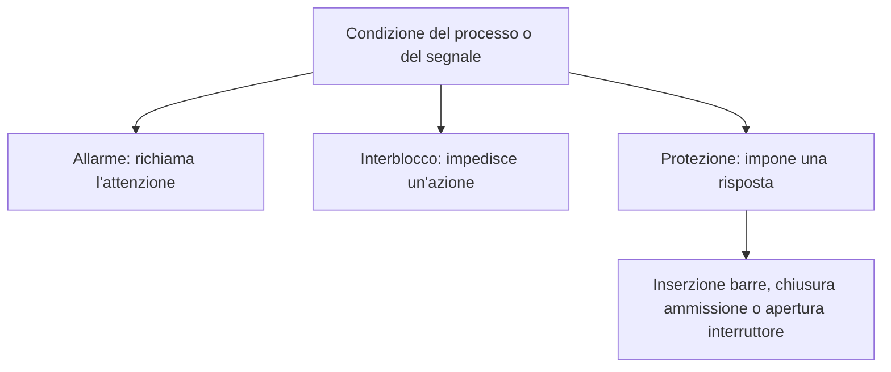

Riconoscere un allarme modifica la sua presentazione, non il processo. Un comando rifiutato non significa necessariamente che sia avvenuto uno scatto. Dopo una protezione, infine, bisogna osservare il nuovo impianto: l'apertura del generatore o la chiusura dell'ammissione possono generare conseguenze a monte e a valle.

## 7.2 Riconoscimento, memoria e reset

`ACKNOWLEDGE` conferma che hai visto un allarme. `ACK ALL` compie il riconoscimento per gli allarmi eleggibili. Un allarme non memorizzato può rientrare quando scompare la sua condizione; un allarme memorizzato conserva invece una traccia che richiede anche le condizioni e il reset previsti.

`RESET` e `RESET ALL` riguardano la memoria degli allarmi. `PROTECTION RESET`, o la dicitura equivalente `RESET PROTECTION` nel pannello interessato, richiede il ripristino delle protezioni. Non è sufficiente che una sola misura sia rientrata: il sistema valuta le condizioni complessive, i consensi e l'assenza di richieste di scatto incompatibili.

Il diagramma è una guida alla diagnosi del reset. Non impone che ogni allarme abbia identica memoria; mostra perché la correzione della causa viene prima del tentativo di cancellare una condizione memorizzata.

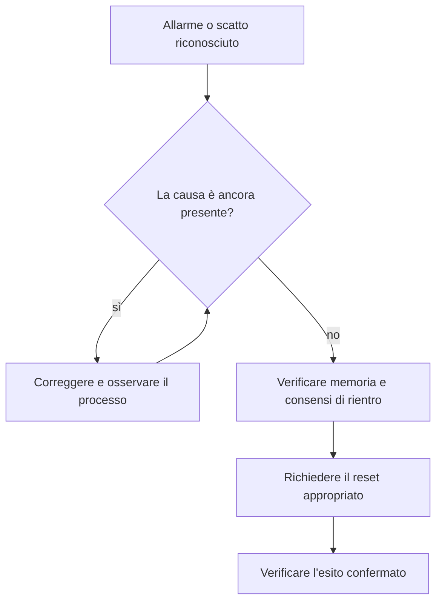

Un reset accettato rimuove una memoria eleggibile, ma non ricrea la condizione precedente allo scatto. Le barre possono trovarsi inserite, il rotore può aver rallentato e i percorsi di vapore possono essere diversi. Prima di riprendere l'esercizio occorre riconoscere quello stato effettivo.

## 7.3 Pressione alta nel corpo cilindrico

Una salita di pressione suggerisce di cercare uno squilibrio fra ciò che il volume riceve e ciò che riesce a trasferire. L'energia dal nocciolo, la massa di alimentazione, la separazione, il vapore esportato e il ricircolo partecipano tutti alla condizione. Guardare soltanto la posizione di una valvola può nascondere il vero limite del percorso.

Parti dalla tendenza della pressione e confrontala con potenza del reattore ed esportazione di vapore. Poi segui la catena verso ammissione e condensatore. Se a valle il ciclo riceve meno vapore di quanto il lato caldo renda disponibile, un ulteriore aumento di potenza può peggiorare la situazione anziché aiutare la generazione.

Lo SCRAM per pressione molto alta è una funzione distinta dall'avvertimento di alta pressione. Riduce la sorgente neutronica attraverso l'inserzione delle barre, ma lascia da gestire il calore e gli inventari già presenti. L'intervento non sostituisce la lettura dei successivi bilanci termici.

## 7.4 Livello basso e livello molto basso

Il basso livello del corpo cilindrico appartiene alla composizione operativa descritta e non va più presentato come una funzione soltanto candidata. L'avvertimento usa la soglia normalizzata del 25%; al 10% o meno la funzione di livello molto basso impone SCRAM del reattore, scatto della turbina e scatto del generatore. Per il relativo rientro occorre almeno il 20%, insieme agli altri consensi.

La domanda diagnostica è quale bilancio stia consumando la riserva liquida. L'alimentazione potrebbe non sostenere l'esportazione; il volume intermedio potrebbe essere in deriva; la distribuzione di fase potrebbe cambiare. Il livello misurato va distinto dalle diagnostiche di inventario liquido separabile e dall'eventuale indicazione `LIQUID INVENTORY LIMITED`.

Aumentare ripetutamente il carico mentre il livello continua a scendere somma una richiesta al sistema già sbilanciato. Prima occorre comprendere disponibilità d'acqua, pompe e portate effettive. Il rientro del livello, quando avviene, non autorizza da solo a ignorare la memoria dello scatto coordinato.

## 7.5 Contropressione del condensatore

Quando entra più energia di quanta il condensatore riesca a rimuovere nelle condizioni presenti, il suo stato evolve e la pressione può crescere. Anche una riduzione della capacità di raffreddamento può produrre questa situazione senza che l'operatore abbia aumentato il carico.

Confronta vapore in ingresso, condensazione e calore rigettato. Cerca quale limite stia governando la condensazione: capacità termica, trasferimento di superficie, inventario disponibile o portata massima. Il bypass, se attivo, è un ulteriore ingresso al condensatore e può mantenerne impegnata la capacità anche quando la turbina produce meno lavoro.

La soglia di avvertimento è 20 kPa assoluti; da 30 kPa intervengono turbina e generatore nella configurazione descritta. Il rientro a 20 kPa o meno contribuisce ai consensi di reset. Il primo allarme della sequenza aiuta a distinguere la difficoltà del condensatore dagli scatti che ne sono una conseguenza.

## 7.6 Sovravelocità e apertura del generatore

La sovravelocità nasce da un bilancio di coppia positivo. Una situazione didatticamente importante è la perdita del carico elettrico mentre alla turbina arriva ancora vapore. Osserva quindi lo stato dell'interruttore, il carico richiesto, la potenza all'albero e la coppia netta prima di considerare il tachimetro come un problema isolato.

Da 3300 giri/min la protezione descritta provoca scatto di turbina e generatore. Per il rientro della funzione di sovravelocità la velocità deve scendere a 3150 giri/min o meno. L'attesa e le perdite passive possono far diminuire i giri; il reset della memoria resta un'operazione distinta.

La chiusura fuori sincronismo non è un mezzo per frenare il gruppo: il modello elettrico richiede la propria finestra di chiusura. Se il consenso manca, occorre ricostruire una condizione di ammissione e velocità compatibile, secondo lo scenario e l'autorità di controllo attivi.

## 7.7 Protezioni elettriche temporizzate

Oltre alla sovrafrequenza da 53 Hz, il profilo operativo comprende funzioni che richiedono una condizione persistente per un intervallo di tempo logico. La supervisione le rende eleggibili con interruttore chiuso. Aprendo l'interruttore cambia quindi anche la loro condizione di abilitazione; non devono provocare scatti di avviamento soltanto perché un gruppo scollegato non è ancora vicino a 50 Hz.

| Funzione | Condizione di intervento con interruttore chiuso | Durata richiesta | Rientro di riferimento quando la funzione è sorvegliata |
| --- | --- | ---: | --- |
| Potenza inversa | Scambio elettrico ≤ −0,30 MWe | 2,0 s | Scambio ≥ −0,10 MWe |
| Sottofrequenza | Frequenza ≤ 48,8 Hz | 1,0 s | Frequenza ≥ 49,5 Hz |
| Perdita di sincronismo | Scarto assoluto rispetto alla rete ≥ 1,5 Hz | 0,5 s | Scarto ≤ 0,5 Hz |

La durata è misurata nel tempo del simulatore. Mettere in pausa non continua a far maturare il timer usando l'orologio del computer. Un superamento breve e uno persistente possono quindi avere esiti diversi anche quando il valore massimo osservato è simile.

La potenza negativa merita attenzione perché indica importazione, non una richiesta manuale di carico negativo. La funzione di potenza inversa interviene se quella condizione raggiunge soglia e durata previste. Dopo lo scatto, l'apertura dell'interruttore rimuove la supervisione di queste funzioni, ma il reset globale deve comunque soddisfare tutte le altre condizioni applicabili.

## 7.8 Segnali degradati e comandi bloccati

Un segnale `INVALID` o `SUSPECT` richiede di capire quale informazione non sia più affidabile e quale funzione ne dipenda. Le politiche di uso dei segnali sono definite dai controlli e dalle protezioni interessati: non è corretto supporre che ogni dato sospetto venga trattato nello stesso modo da ogni funzione.

La supervisione automatica può sospendere la propria azione o degradare verso un'autorità inferiore quando mancano le condizioni richieste. Una richiesta `SUPERVISORY` può rimanere visibile mentre l'autorità effettiva risulta `ASSISTED`. Questo è un esito esplicito da leggere, non una ragione per considerare affidabile un indicatore indisponibile.

Quando un comando viene rifiutato, leggi `LAST COMMAND FEEDBACK`, verifica il bersaglio e confronta consensi, interblocchi e memorie di protezione. Ripetere il clic senza cambiare le condizioni non produce un nuovo principio fisico né un'autorità aggiuntiva.

<a id="capitolo-8"></a>

# 8. Le operazioni spiegate attraverso i bilanci

Questo capitolo descrive la logica delle manovre nel simulatore. Ogni scenario può partire da un punto differente e consentire solo una parte delle azioni: usa la guida operativa della sessione e lo stato effettivo come riferimento. Il percorso da freddo al parallelo non è una procedura universale da eseguire sul desktop già in generazione.

## 8.1 Prima di ogni manovra

Individua la grandezza che vuoi cambiare e formula una previsione sulla sua causa. Se vuoi più scambio elettrico, chiediti quali portate e quale potenza meccanica dovrebbero sostenerlo. Se vuoi fermare il reattore, chiediti dove andrà il calore già presente. La previsione può essere semplice, ma deve riguardare anche almeno un sottosistema vicino.

La figura riassume un metodo di lavoro. Le frecce sono passaggi del ragionamento dell'operatore; «attendere» significa osservare tempo simulato e risposta, non lasciare aperta una schermata in pausa.

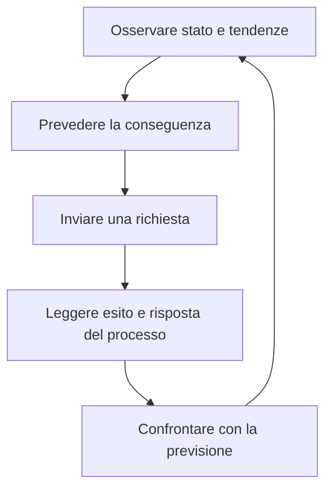

Quando il risultato è diverso da ciò che ti aspettavi, fermare la sequenza di nuovi comandi rende la diagnosi più semplice. Potrebbe esserci un consenso mancante, una corsa ancora in atto, un regolatore che mantiene un'altra richiesta o un limite fisico a monte. Tutti questi casi richiedono letture diverse.

## 8.2 Preparazione da arresto a freddo

Negli scenari dedicati, l'impianto freddo parte con una produzione trascurabile, le barre inserite, il gruppo elettrico scollegato e una configurazione da preparare. Prima di cercare criticità occorre riconoscere inventari, percorsi disponibili e stato delle protezioni.

La circolazione deve essere verificata attraverso una portata effettiva. Seleziona la pompa prevista, richiedi `START / RUN` e osserva lo stato confermato insieme a portata e differenza di pressione. Il solo pulsante selezionato non dimostra che il circuito possa rimuovere il calore che stai per introdurre.

Questo ordine ha un significato energetico: prepara il percorso che riceverà il calore dei materiali prima di aumentare la sorgente. La configurazione specifica e i relativi consensi rimangono quelli dello scenario; il software non espone una ricostruzione completa di tutte le verifiche ausiliarie di una centrale reale.

## 8.3 Prima criticità e bassa potenza

Lo scenario di prima criticità dispone di una piccola popolazione neutronica iniziale e di un riferimento didattico. Non devi interpretare quella scelta come la descrizione completa di una sorgente neutronica reale o degli strumenti di avviamento industriali.

Con circolazione e condizioni iniziali comprese, un movimento di estrazione modifica il contributo delle barre. Alterna la richiesta con `HOLD` e osserva reattività, potenza e periodo. Stai cercando di capire quando la popolazione tende a mantenersi e quando sta ancora accelerando; non stai cercando una percentuale di estrazione valida per tutte le condizioni.

La banda didattica di bassa potenza dello scenario è 0,01–5 MWth. È un criterio di quell'esercizio, distinto dai megawatt elettrici del generatore. La stessa cifra «5» nei due contesti non indica la stessa grandezza né la stessa fase operativa.

## 8.4 Riscaldamento e produzione di vapore

Quando aumenti l'energia prodotta dal nocciolo, una parte riscalda i materiali e una parte viene trasferita al fluido. Le temperature e le condizioni di fase devono evolvere prima che il vapore utile possa sostenere un carico significativo.

Leggi insieme potenza, temperature, pressione del corpo cilindrico, livello ed esportazione di vapore. Un aumento della sola temperatura del combustibile con scarsa circolazione non equivale a un avviamento ben sostenuto del ciclo. Anche la disponibilità a valle conta: una linea chiusa o un condensatore incapace di ricevere il vapore cambia la risposta a monte.

Nella fase di riscaldamento non usare i valori del seed caldo come bersagli da raggiungere con clic rapidi. Le condizioni del percorso devono essere coerenti fra loro; il loro valore didattico è nella relazione, non nella copia di un numero iniziale di un altro scenario.

## 8.5 Avviamento della turbina

Con generatore scollegato, il vapore fornisce coppia per accelerare il rotore e sostenere le perdite. La capacità della turbina dipende dalla condizione del fluido e dal salto di pressione, quindi una grande apertura senza vapore utile può avere un effetto molto diverso da quello immaginato.

Verifica prima il percorso di scarico e il condensatore, poi il treno di valvole e l'autorità della regolazione. In automatico, il riferimento di velocità guida l'azione del governor; in manuale, l'operatore assume la richiesta prevista per la valvola senza eliminare protezioni e dinamica della macchina.

Ogni `SPEED RAISE` accettato varia il riferimento di 10 giri/min. Confrontalo con la velocità misurata e con la tendenza: il riferimento può essere già cambiato mentre la macchina sta ancora accelerando. Avvicinandoti alla sincronizzazione, considera anche la fase elettrica e non soltanto il tachimetro.

## 8.6 Sincronizzazione e chiusura dell'interruttore

Per il parallelo devi avere un gruppo in condizioni compatibili con la rete, un percorso di potenza meccanica disponibile e nessun blocco applicabile. Frequenza, fase e tensione devono rientrare nelle finestre del capitolo 6.

Il diagramma rappresenta una verifica di consenso. La diramazione «no» indica che devi correggere la condizione prima della chiusura; il pulsante non è un modo per saltare quel controllo.

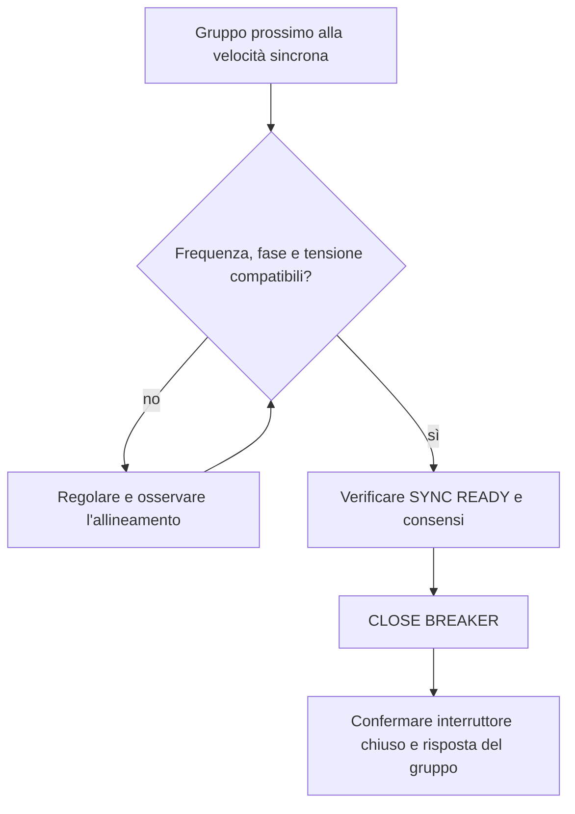

Dopo la chiusura osserva subito lo scambio elettrico e la coppia. L'allineamento ha consentito il collegamento, ma la successiva stabilità dipende dal bilancio fra turbina, richiesta elettrica e regolazione. Un generatore in parallelo può ancora trovarsi in una condizione di importazione o in un transitorio da comprendere.

## 8.7 Aumento del carico

Il desktop ordinario parte già in questa parte del percorso, con richiesta di 5 MWe. Un solo `LOAD RAISE` può portarla a 10 MWe: devi prevedere una variazione significativa del carico, non un'aggiustatina di pochi punti percentuali.

Prima del comando osserva la tendenza della pressione e del livello del corpo cilindrico, il margine del condensatore e la potenza meccanica disponibile. Dopo il comando confronta `REQUESTED LOAD` con lo scambio misurato e cerca la risposta di velocità e ammissione. Se il ciclo non sostiene la nuova richiesta, continuare a insistere sul carico non aumenta la sorgente termica.

La presenza di un esercizio 5→10→5 indica un profilo di domanda e un contenuto addestrativo. Non autorizza a considerare già dimostrata qualsiasi permanenza a 10 MWe, in ogni modalità fisica e per ogni durata. I limiti di qualifica del modello restano espliciti e l'eventuale automazione del reattore dipende dall'autorità attiva.

## 8.8 Riduzione del carico

Ridurre la richiesta elettrica modifica ciò che il generatore assorbe dall'albero e il riferimento della regolazione in parallelo. Se il vapore non diminuisce in modo coerente, può comparire una tendenza all'accelerazione; se viene ridotta troppo rapidamente la sorgente mentre il carico resta elevato, può emergere lo squilibrio opposto.

Esegui una richiesta e osserva come cambiano coppia, velocità, apertura effettiva e scambio. La riduzione non va giudicata soltanto dal numero di `REQUESTED LOAD`: la macchina e gli inventari conservano la propria dinamica. Un carico richiesto nullo non dimostra ancora uno scambio esattamente nullo in ogni istante.

## 8.9 Apertura dell'interruttore di gruppo

In un distacco normale si cerca una condizione di scarico coerente prima dell'apertura, secondo lo scenario. `OPEN BREAKER` separa il generatore dalla rete; la turbina e il rotore restano però presenti e possono ancora ricevere energia dal vapore.

Verifica l'apertura effettiva e osserva la velocità. Se la coppia motrice rimane importante, il gruppo può accelerare proprio dopo aver perso il carico elettrico. La manovra è quindi legata alla regolazione della turbina e non va interpretata come un interruttore che spenga l'intera centrale.

Il comando di apertura normale è inoltre distinto da `GENERATOR TRIP`. Il secondo appartiene al percorso di scatto e alla sua memoria, con conseguenze anche sul significato procedurale e sul punteggio dell'esercizio.

## 8.10 Arresto normale del reattore

La logica del normale esercizio di arresto consiste nel ridurre il carico, separare il generatore nella condizione prevista, inserire le barre e continuare a seguire raffreddamento e inventari. La sequenza didattica valuta anche l'ordine delle azioni accettate; osservare un valore basso finale non dimostra da solo che tutti i passaggi siano stati corretti.

Durante l'inserzione confronta movimento, reattività e diminuzione della potenza. Poi continua a leggere temperature e circolazione. Il calore dei materiali non scompare quando la fissione scende, e la chiusura del percorso elettrico non costituisce una capacità di raffreddamento.

Per una procedura normale, lo SCRAM non sostituisce automaticamente la competenza che l'esercizio vuole osservare. Rimane un comando di arresto rapido disponibile secondo il suo ruolo. La scelta e il giudizio del simulatore dipendono anche dal fatto che tu stia eseguendo un normale arresto o un esercizio specifico di risposta protettiva.

## 8.11 Dopo uno scatto

Il primo compito è riconoscere la configurazione prodotta dall'intervento. Controlla quali azioni siano memorizzate, quale evento sia arrivato per primo e come stiano cambiando le grandezze fisiche. Evita di trasformare il recupero in una serie di reset e riaperture che nasconda la causa.

Se il problema nasce dal condensatore, il solo reset del generatore non ripristina il raffreddamento. Se nasce dalla sovravelocità, il rotore deve rientrare nella condizione appropriata. Se riguarda un segnale, occorre comprendere anche quale autorità di controllo sia effettivamente disponibile.

Quando causa e consensi sono coerenti, richiedi il reset appropriato e verifica l'esito. Ricostruisci poi il percorso di avviamento pertinente allo stato raggiunto, invece di assumere che l'impianto sia tornato identico a quello precedente allo scatto. Una registrazione consente di studiare questo passaggio senza affidarsi soltanto alla memoria dei clic.

<a id="capitolo-9"></a>

# 9. La sala controllo

## 9.1 Come orientarsi nella schermata

La sala controllo riunisce una navigazione per sistemi, una zona centrale dedicata al sistema scelto e un pannello di contesto. Gli indicatori generali restano un riferimento mentre cambi area di lavoro; il computer operatore offre un'altra lettura degli stessi proprietari di stato, senza creare una centrale parallela.

La figura descrive un percorso di consultazione, non il circuito fisico. Puoi partire dalla vista complessiva, selezionare un componente, approfondire il sottosistema e tornare alla diagnosi generale.

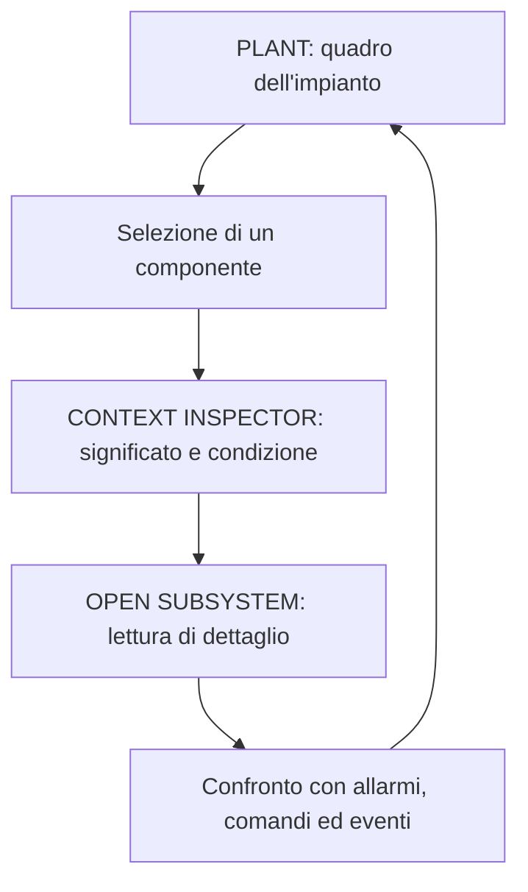

Il vantaggio di questo percorso è mantenere il legame fra il numero locale e il resto del ciclo. Se selezioni il condensatore perché la sua pressione cresce, la vista dettagliata deve aiutarti a capire portate e calore, non soltanto a ingrandire il valore della pressione.

## 9.2 Comandi globali e stato del runtime

`RUN`, `PAUSE` e `SINGLE STEP` governano l'avanzamento della simulazione. `RESET SESSION` ricrea la sessione iniziale prevista dalla composizione corrente: equivale a ricominciare l'esercizio, non al reset di una protezione. Prima di usarlo per confrontare due tentativi, conserva la registrazione che vuoi analizzare.

L'indicatore superiore `RUNTIME` mostra lo **stato di esecuzione**, per esempio `RUNNING` o `PAUSED`. Non è il tempo trascorso: il manuale precedente attribuiva a questa etichetta un significato improprio. Il numero del passo logico e il tempo simulato, dove esposti, descrivono invece quanto il processo sia avanzato.

Se il runtime segnala un errore di avanzamento, cerca l'esito del passo e la diagnostica disponibile prima di impartire altre manovre. La simulazione usa un confine di conferma dello stato: un passo rifiutato non deve essere interpretato come una manovra fisica interamente riuscita con una schermata semplicemente in ritardo.

## 9.3 Indicatori generali

`GROSS OUTPUT` riassume l'uscita o lo scambio elettrico esposto dalla presentazione corrente. `TRAINING SCORE` riguarda la valutazione addestrativa disponibile; non è una misura di rendimento della macchina. `UNACK ALARMS` conta gli allarmi non ancora riconosciuti. `PROTECTION` richiama lo stato delle protezioni, mentre `ASSISTANCE` e `CONTROL AUTHORITY` indicano due dimensioni diverse dell'interazione.

Leggili come un quadro di orientamento. Un punteggio buono non rende trascurabile una protezione; un basso numero di allarmi non dimostra che una tendenza lenta sia già stabilizzata. Quando una sintesi sembra incoerente con la tua aspettativa, apri la vista che mostra i segnali e la sequenza che l'hanno prodotta.

## 9.4 Aree di lavoro

Le aree separano i punti di osservazione, non i bilanci dell'impianto. Questa tabella serve a scegliere dove approfondire; i paragrafi successivi spiegano come leggere ciascuna vista.

| Area | Domanda alla quale aiuta a rispondere |
| --- | --- |
| `PLANT` | Come si collegano in questo momento i grandi sistemi? |
| `REACTOR` | Come cambiano fissione, reattività, barre e condizioni del nocciolo? |
| `PRIMARY` | Il ricircolo e il separatore sostengono il trasporto di massa ed energia? |
| `TURBINE` | Quanto vapore utile arriva al gruppo e come viene chiuso il ciclo termico? |
| `GRID` | Il generatore è collegato e quale scambio elettrico sta realmente avvenendo? |
| `ALARMS` | Quali condizioni sono presenti e quale sequenza le ha prodotte? |
| `COMPUTER` | Quale guida, comando, modalità o evidenza di sessione devo consultare? |
| `MISSION` | Qual è l'obiettivo associato e come viene valutato ciò che sta accadendo? |

## 9.5 Colori e simboli

Un colore può descrivere il mezzo rappresentato oppure lo stato operativo. Il colore del percorso del vapore o dell'albero serve a seguirne la funzione; una lampada d'allarme usa invece una semantica di attenzione o intervento. Un albero colorato in ambra non deve essere considerato in avaria soltanto perché quel colore compare anche in una segnalazione.

Per gli stati, il verde indica in genere una condizione confermata disponibile o sana, l'ambra una situazione da osservare o una transizione e il rosso una condizione critica o protettiva. La legenda e il testo vicino al simbolo permettono di distinguere i casi. Un elemento disabilitato o non disponibile non autorizza a dedurre uno stato che il modello non espone.

## 9.6 Strumenti, bande e tendenze

Un indicatore può mostrare misura, riferimento, banda utile, soglia e tendenza. Prima di leggere una lancetta come «corretta» cerca quale di questi elementi stai usando come termine di confronto. Le unità rimangono parte del significato: MWth, MWe e kg/s non sono modi diversi di scrivere la stessa quantità.

Le frecce di tendenza aiutano a capire come il valore sta cambiando fra osservazioni del processo. Non sono una previsione affidabile di tutta la traiettoria futura. Se cambia una portata, una protezione o l'autorità di regolazione, può cambiare anche la tendenza. Usale per formulare un'ipotesi e poi confrontala con le letture successive.

## 9.7 Il pannello di contesto

`CURRENT CONDITION` riassume la condizione del componente o del sistema selezionato. `SYSTEM CONTEXT` lo collega al resto dell'impianto. `READING THE HMI` aiuta a interpretare gli indicatori. Queste tre parti sono particolarmente utili quando un valore ti sembra isolato e vuoi ritrovare il suo significato nel ciclo.

`NEXT CANONICAL ACTION` presenta una prossima azione coerente quando la guida ne dispone. È un suggerimento, non una conferma che la manovra sia già avvenuta. `LAST COMMAND FEEDBACK` racconta invece l'esito della richiesta inviata: accettazione, rifiuto o altra condizione esplicitamente riportata.

Un uso efficace consiste nel confrontare prima e dopo questi due testi. La guida ti dice che cosa tentare; il riscontro ti dice che cosa il sistema ha accettato. Gli strumenti e lo stato effettivo ti dicono quale conseguenza sia seguita.

## 9.8 `PLANT` — visione d'insieme

Il mimic complessivo permette di seguire la connessione fra nocciolo, ricircolo, vapore, turbina, condensatore e generatore. Parti da qui quando non sai ancora quale sottosistema stia limitando l'esercizio.

Selezionare un'apparecchiatura aggiorna il contesto. `OPEN SUBSYSTEM` apre la vista pertinente e non invia una richiesta fisica al componente. Puoi quindi usarlo per approfondire senza confondere la navigazione con una manovra.

L'`Operator Action Plan`, quando disponibile, riassume il percorso operativo. Confrontalo sempre con lo stato reale: il piano descrive un'azione coerente con la procedura, mentre la disponibilità del componente e i consensi stabiliscono ciò che può effettivamente essere applicato.

## 9.9 `REACTOR` — reattore e nocciolo

Metti in relazione `REACTOR THERMAL POWER · MEASURED`, `TOTAL REACTIVITY · MODEL` e `REACTOR PERIOD · MODEL`. La prima dà una scala di potenza; le altre aiutano a capire la causa e il ritmo della dinamica. Il contributo delle barre e quello non dovuto alle barre chiariscono perché la potenza possa cambiare anche dopo un `HOLD`.

La selezione `ROD TARGET` stabilisce su quale gruppo agiscano `WITHDRAW`, `HOLD` e `INSERT`. Dopo il comando guarda il movimento confermato e le eventuali inibizioni, quindi confronta la risposta del reattore. La posizione media è utile, ma una media non esaurisce lo stato di un gruppo composto da elementi diversi.

La mappa del core consente di collegare quote di potenza, temperature e frazione di vuoto nelle zone disponibili. Le diagnostiche di iodio e xeno devono essere lette secondo la disponibilità effettiva. `SCRAM` e gli indicatori di interblocco appartengono al percorso di protezione e conservano la priorità spiegata nel capitolo 7.

## 9.10 `PRIMARY` — circuito primario e separazione

`TOTAL MCP FLOW · MEASURED` e `HEADER ΔP · MEASURED` descrivono due aspetti del ricircolo. I comandi della pompa selezionata devono essere confrontati con entrambi, soprattutto se una richiesta di marcia non produce la portata attesa.

La lettura del corpo cilindrico va completata con `FEEDWATER TOTAL`, `STEAM EXPORT TOTAL`, pressione e livello. Se il livello cambia, cerca gli ingressi e le uscite che lo spiegano. Se la pressione cambia, cerca anche il bilancio energetico e le condizioni del percorso vapore.

Le condizioni di aspirazione e mandata e le diagnostiche d'inventario aiutano a seguire questa ricostruzione. I simboli di valvola disponibili nella vista non implicano che ogni confine possieda un comando operatore dedicato; la schermata mantiene esplicite anche le informazioni che non sono disponibili.

## 9.11 `TURBINE` — conversione e ritorno dell'acqua

Confronta portata di ammissione, pressione e temperatura d'ingresso con la potenza all'albero. Poi leggi velocità, coppia netta e condizioni del condensatore. In questo modo puoi distinguere un problema di vapore disponibile da un problema di carico o di scarico.

La `VALVE CONTROL STATION` rende leggibili le richieste e le posizioni effettive. In manuale prepara il valore del cursore e usa `APPLY`; in automatico osserva il governor. Il testo di autorità permette di riconoscere un bersaglio normale che una protezione stia impedendo di raggiungere.

Nel condensatore collega `PRESSURE · MEASURED`, `VACUUM · MEASURED` e `HOTWELL MASS · MEASURED` alle diagnostiche di condensazione e rigetto termico. Vuoto favorevole e inventario della vasca sano sono due risultati distinti, entrambi necessari alla lettura del ciclo. `TURBINE TRIP` e i relativi reset vanno interpretati attraverso i consensi, non come normali regolazioni di potenza.

## 9.12 `GRID` — generatore e rete

Questa vista consente di separare `SPEED REFERENCE`, `REQUESTED LOAD` e scambio misurato. Usa `SPEED RAISE` e `SPEED LOWER` conoscendo l'incremento di 10 giri/min; usa `LOAD RAISE` e `LOAD LOWER` conoscendo quello di 5 MWe. La lettura dopo il passo applicabile conferma che cosa sia stato memorizzato, mentre la risposta del gruppo richiede un'osservazione più ampia.

Prima di `CLOSE BREAKER` verifica frequenza, tensione, fase e `SYNC READY`. Dopo il comando verifica l'interruttore effettivamente chiuso. Se leggi uno scambio negativo, ricorda che il modello rappresenta importazione e motorizzazione: non è necessariamente una richiesta manuale negativa nascosta.

Le lampade di protezione e gli eventuali indicatori di soglia aiutano a riconoscere i margini elettrici. Non sono controlli dell'eccitazione che il pannello non espone: la presenza di una lettura di tensione non implica un comando per regolarla liberamente. `GENERATOR TRIP`, apertura normale e reset rimangono operazioni con significati differenti.

## 9.13 `ALARMS` — allarmi ed eventi

Qui puoi riconoscere quale condizione sia ancora presente, quale sia stata vista dall'operatore e quale memoria rimanga annunciata. Seleziona il bersaglio corretto prima di un riconoscimento o di un reset, poi leggi l'esito.

`FIRST-OUT` e la sequenza di eventi permettono di ricostruire l'ordine delle cause. Il passo logico è più informativo dell'ordine in cui hai notato le luci sullo schermo: gli aggiornamenti grafici possono rendere contemporanee all'occhio conseguenze avvenute in passi diversi.

In una catena con molti annunci, comincia dal primo evento e segui le variazioni fisiche. Questo impedisce, per esempio, di diagnosticare subito un guasto al generatore quando il suo scatto è stato richiesto da un problema di contropressione nato nel condensatore.

## 9.14 `MISSION` — missione e prestazione

`MISSION` raccoglie obiettivo, stato della missione, significato delle evidenze di protezione, autorità richiesta ed effettiva, domanda esterna, richiesta di carico, potenza reale e valutazione. È una vista di osservazione: la navigazione di approfondimento non invia comandi fisici e non fa avanzare il processo.

Se non è associato alcun pacchetto, la condizione `NO ACTIVE MISSION / UNBOUND` è corretta. Il simulatore non deduce un obiettivo dal solo fatto che la centrale stia generando. Il capitolo 12 mostra come avviare il pacchetto corrente esplicitamente.

La distinzione fra `GRID DEMAND`, `REQUESTED LOAD` e `ACTUAL OUTPUT` è essenziale. Il primo è ciò che il challenge chiede come riferimento esterno; il secondo è la richiesta canonica al generatore; il terzo è il risultato misurato. Una domanda esterna non produce direttamente un comando e non costituisce un'ulteriore fonte di energia.

Quando la missione termina, la simulazione può continuare. Il passo terminale della missione rimane quello effettivo e non deve spostarsi insieme al tempo successivo dell'impianto. Dopo un ripristino, la timeline viene ricostruita fino al punto coerente, senza conservare eventi futuri di un tentativo abbandonato.

<a id="capitolo-10"></a>

# 10. Il computer operatore: da F1 a F8

## 10.1 Otto pagine della stessa sessione

Il computer operatore riunisce letture e azioni contestuali senza creare un secondo proprietario dell'impianto. I tasti `F1`–`F8` aprono le otto pagine fisse anche mentre stai consultando un altro sistema. `TAB` e `SHIFT+TAB` consentono di spostare il fuoco fra elementi; nelle liste, frecce e `ENTER` permettono di selezionare e attivare le azioni disponibili.

Non esiste una pagina `F9`. `MISSION` è un'area principale separata; `OPEN MISSION` cambia la vista e non associa da solo un challenge alla sessione. Questa distinzione evita di cercare un comando di missione in una pagina che è soltanto un punto di navigazione.

## 10.2 F1 — `GUIDANCE`

La guida collega scenario, fase e obiettivi osservati alla prossima azione pertinente. È utile per comprendere il motivo della sequenza, soprattutto durante i primi esercizi.

Il dettaglio mostrato dipende dall'assistenza scelta. Una guida ridotta non rende il processo più semplice; richiede soltanto più autonomia nell'interpretarlo. Anche quando il suggerimento è completo, controlla consensi, bersaglio ed esito della richiesta: il testo didattico non forza il sistema a eseguire una manovra bloccata.

## 10.3 F2 — `INFO`

La pagina informativa raccoglie il contesto utile a capire la sessione e le sue grandezze. Conviene usarla quando una dicitura è poco chiara e stai ancora cercando il significato della condizione, prima di scegliere un comando.

Insieme al pannello di contesto, aiuta a passare dalla singola misura alla funzione del sistema. Il suo ruolo è esplicativo: la descrizione di una variabile non diventa automaticamente un regolatore della variabile stessa.

## 10.4 F3 — `ALARMS`

La pagina presenta gli allarmi nel contesto del computer operatore e facilita la consultazione della condizione interessata. Integra il pannello degli annunciatori mantenendo gli stessi significati di riconoscimento, memoria e rientro.

Usala per leggere la sequenza e poi raggiungi il sottosistema che mostra il bilancio fisico. La spiegazione di un allarme ti dice dove cominciare a indagare; l'evoluzione delle misure ti permette di verificare se la causa sia ancora attiva.

## 10.5 F4 — `COMMANDS`

Il catalogo espone le richieste contestuali e le ragioni per cui una richiesta può essere disponibile o bloccata. La catena delle dipendenze aiuta a capire quali condizioni precedano l'azione scelta: è particolarmente utile per una chiusura di interruttore o per un comando impedito dalle protezioni.

`EXECUTE [ENTER]` invia il comando selezionato. Un esito `DISPATCHED` descrive l'invio accettato nel percorso di comando; `BLOCKED BY RUNTIME/SCENARIO` indica un rifiuto previsto. Cerca poi il riscontro effettivo e la risposta del processo, senza confondere la previsione della conseguenza con la sua osservazione.

La selezione del comando e il passo della catena di dipendenze devono restare stabili durante i normali aggiornamenti, finché non cambia ciò che li definisce. L'evoluzione dei numeri può aggiornare il contesto senza richiederti di inseguire continuamente una riga ricreata.

## 10.6 F5 — `MODES`

Qui scegli separatamente l'assistenza didattica e l'autorità di controllo. `GUIDED` può convivere con `MANUAL`: ricevere spiegazioni non cede all'automazione il compito di condurre l'impianto. Il capitolo 11 approfondisce le combinazioni.

`HOLD CURRENT OPERATING POINT`, quando disponibile nel contesto supervisore, acquisisce obiettivi dal punto corrente per i controlli previsti, come potenza del reattore e velocità della turbina. L'impianto continua a evolvere e i regolatori cercano di mantenere quei riferimenti. Non vengono bloccati temperature, pressioni o inventari.

Se il modo richiesto differisce da quello effettivo, leggi la ragione del degrado prima di aumentare le richieste. La scritta `SUPERVISORY` nella richiesta non dimostra che tutte le condizioni del supervisore siano soddisfatte.

## 10.7 F6 — `DIAGNOSTICS`

La diagnostica permette di distinguere misure, stati e quantità derivate, e di esaminare la qualità dei segnali. È il posto adatto per verificare una discrepanza fra ciò che un comando dovrebbe produrre e ciò che la sala controllo sta mostrando.

Un residuo numerico, una fase termodinamica e una qualità di segnale descrivono problemi diversi. Il residuo riguarda un bilancio o una verifica; la fase riguarda la chiusura del fluido; la qualità riguarda l'informazione disponibile. Non usarli come sinonimi di un unico «guasto» generico.

## 10.8 F7 — `LOG`

Il registro permette di ritrovare richieste, esiti e avvenimenti nel loro ordine. È utile quando l'ultimo stato ha nascosto la condizione che lo ha preceduto: il rotore può essere già rallentato, ma il log può mostrare l'apertura del generatore che ha iniziato il transitorio.

Confronta il registro con il passo logico e con gli allarmi. Una diagnosi che ricostruisce almeno comando, prima variazione e primo intervento è più solida di una spiegazione fondata soltanto sul risultato finale.

## 10.9 F8 — `SESSION`

La pagina mostra l'identità della sessione e gestisce registrazione, checkpoint, verifica e archivi. `START RECORDED SESSION` ricomincia dallo stato iniziale esatto con il registratore attivo. Se hai già condotto una manovra senza registrazione, questo comando non ne recupera retroattivamente la storia.

Durante una sessione registrata, usa la pausa per preparare `CREATE CHECKPOINT`, selezionare un punto o richiedere `VERIFY REPLAY`. `SAVE ARCHIVE` e `LOAD ARCHIVE` riguardano il file di sessione; `RESTORE SELECTED` riguarda il punto selezionato. La disponibilità dei comandi esplicita le condizioni richieste.

Le etichette «checkpoint» e «obiettivo raggiunto» meritano attenzione: un traguardo della procedura certifica un'osservazione addestrativa, mentre il checkpoint di F8 è un punto ripristinabile della registrazione. Il capitolo 13 spiega come usare quest'ultimo per confrontare due tentativi.

<a id="capitolo-11"></a>

# 11. Assistenza e autorità di controllo

## 11.1 Quanto aiuto ricevi e chi regola l'impianto

L'assistenza risponde alla domanda «quanta spiegazione viene mostrata?». L'autorità risponde invece a «chi può richiedere le azioni di regolazione previste?». Sono due dimensioni indipendenti e il loro effetto si comprende meglio osservandole separatamente.

| Assistenza | Esperienza di lettura |
| --- | --- |
| `HIDDEN` / `NONE` | Guida passo-passo nascosta; restano da interpretare le indicazioni operative disponibili |
| `CHECKLIST` | Obiettivi e traguardi, con meno spiegazione narrativa |
| `GUIDED` | Maggior contesto, motivazione e prossima azione proposta |

Cambiare assistenza non modifica le equazioni fisiche o le soglie di protezione. Nelle policy standard non cambia neppure il valore matematico della stessa evidenza di punteggio. Puoi quindi cominciare con spiegazioni complete, ripetere con la checklist e infine verificare la tua autonomia senza alterare artificialmente il processo.

## 11.2 `MANUAL`

In manuale l'operatore formula le richieste attraverso i comandi disponibili e i percorsi consentiti. La parola non implica che ogni apparecchiatura possieda una manopola diretta: restano la composizione del runtime, le modalità dei controlli locali e l'interfaccia effettivamente esposta.

Le protezioni mantengono la propria autorità. Se un comando di apertura è impedito o uno scatto richiede un'inserzione, la scelta manuale non trasferisce all'operatore il diritto di ignorarli. Il lavoro didattico consiste anche nel riconoscere questa differenza fra richiesta normale e azione effettiva.

## 11.3 `ASSISTED`

Nel controllo assistito l'operatore mantiene le decisioni e usa i controlli locali secondo le modalità e i riferimenti previsti. I regolatori esistenti eseguono il proprio compito sui componenti cui sono collegati. Non viene aggiunto un pilota automatico capace di completare qualunque esercizio con qualunque condizione iniziale.

Per esempio, un regolatore può mantenere un inventario o una velocità mentre tu osservi un'altra parte del ciclo. Devi comunque verificare se l'attuatore abbia margine e se la misura usata sia affidabile. Un controllo arrivato al limite della propria uscita non rende infinito il flusso che il componente può trasferire.

## 11.4 `SUPERVISORY`

Il supervisore può coordinare obiettivi attraverso i regolatori esistenti, come il mantenimento della potenza o della velocità. L'acquisizione del punto operativo genera riferimenti: non sostituisce l'intero stato della centrale con valori immobili.

Il diagramma rappresenta richieste e priorità di controllo. Le frecce superiori portano obiettivi ai controlli locali; il ramo della protezione conserva la possibilità di imporre o impedire azioni sull'attuatore.

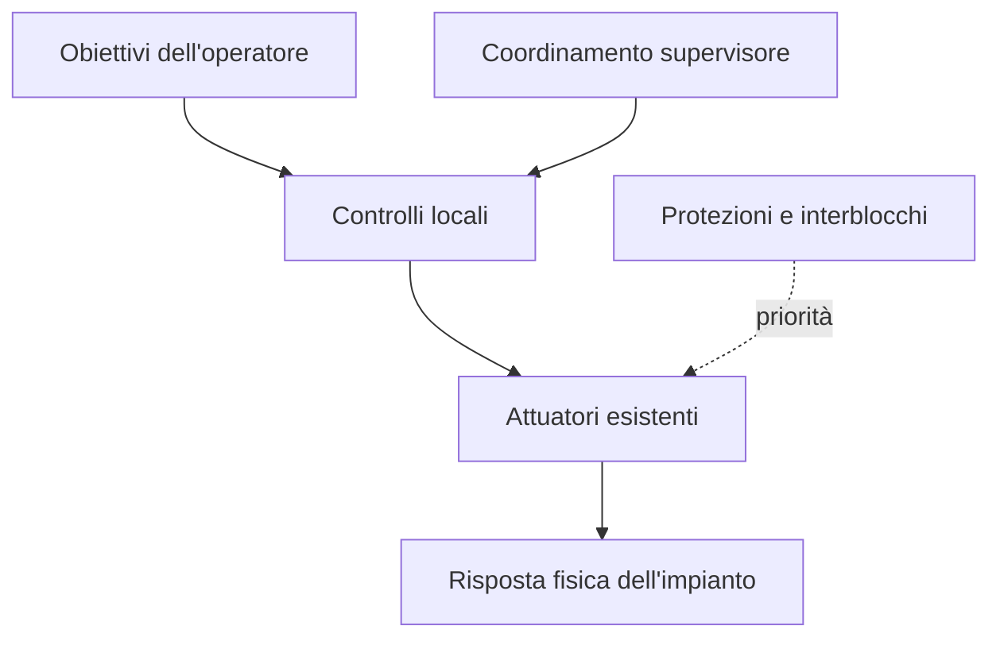

Il supervisore dipende dalle informazioni e dalle condizioni che gli consentono di operare. Una misura mancante, una qualità non ammessa o una protezione possono sospendere la sua azione o far degradare l'autorità effettiva. Il valore interno del simulatore non viene considerato una misura operativa automaticamente valida soltanto perché è noto al calcolo.

## 11.5 Autorità richiesta ed effettiva

L'autorità richiesta conserva l'intenzione scelta; quella effettiva descrive ciò che può operare in quel momento. La distinzione è importante perché permette di vedere il degrado senza cancellare la richiesta originaria. Una sessione può mostrare `SUPERVISORY` richiesto e `ASSISTED` effettivo.

Quando cambi modo, osserva la richiesta agli attuatori e la risposta del processo. Il trasferimento cerca di evitare salti artificiali introdotti soltanto dal cambio di autorità, ma l'impianto conserva inerzia, inventari e tendenze. Un passaggio ben raccordato non garantisce che lo stato fisico fosse già equilibrato.

<a id="capitolo-12"></a>

# 12. Addestramento, missioni e punteggi

## 12.1 Due valutazioni con scopi distinti

Il percorso di training tradizionale valuta traguardi e sequenze dello scenario. Un challenge operativo usa invece una propria definizione versionata di obiettivo, condizioni, domanda eventuale e punteggio multidimensionale. Il fatto che entrambi possano usare una scala da 100 punti non li rende la stessa valutazione.

Il punteggio osserva l'evidenza prodotta dalla sessione. Non invia comandi per aiutarti a raggiungerlo e non modifica la fisica per facilitare il completamento. Una spiegazione del risultato deve quindi risalire a condizioni raggiunte e azioni accettate, non al solo numero finale.

## 12.2 Il training delle operazioni normali

La valutazione integrata delle operazioni normali distribuisce i punti fra quattro obiettivi. La tabella è un riferimento per quel programma; altri scenari possono usare criteri diversi.

| Obiettivo | Punti massimi | Che cosa cerca di osservare |
| --- | ---: | --- |
| Riconoscere il basso carico stabile | 15 | Consapevolezza della condizione iniziale in parallelo |
| Manovrare deliberatamente il carico | 30 | Condizioni raggiunte e ordine di aumento/riduzione accettato |
| Osservare le retroazioni e la disponibilità dello xeno | 20 | Lettura di temperatura, vapore e confini informativi |
| Arresto normale e circolazione successiva | 35 | Scarico, disconnessione, inserzione e raffreddamento nell'ordine previsto |

L'obiettivo non è premiare un clic rapido. Raggiungere una banda operativa, riconoscere un contributo disponibile e compiere una sequenza accettata sono evidenze diverse. I traguardi acquisiti seguono le regole del programma e le proprie dipendenze; non vanno confusi con una lampada che si accende soltanto finché il valore istantaneo rimane in una banda.

Una diagnostica di xeno indisponibile deve rimanere tale anche durante l'esercizio. Rispettare quel confine significa interpretare correttamente ciò che il simulatore mostra, invece di inventare la misura che sarebbe comoda per completare la spiegazione.

## 12.3 Penalità del training normale

Nel programma descritto, l'accettazione dei comandi manuali di SCRAM, scatto turbina e scatto generatore durante la procedura ordinaria comporta penalità rispettivamente di 15, 10 e 10 punti, secondo le relative regole. Il punteggio non scende sotto zero.

Queste penalità riguardano il comando manuale accettato, non ogni intervento automatico che abbia lo stesso effetto. Uno scatto automatico può comunque impedire un obiettivo o rendere problematica la conduzione. La distinzione serve a capire come viene calcolata questa specifica valutazione, non a considerare innocuo qualsiasi intervento automatico.

`RUN`, `PAUSE` e `SINGLE STEP` governano l'host e il tempo; non sono manovre fisiche dell'operatore nel senso richiesto dalle sequenze di carico e arresto. Un comando rifiutato non viene trattato come una manovra realmente eseguita.

## 12.4 Avviare la missione corrente

Il desktop ordinario può essere usato senza una missione associata. Per aprire esplicitamente il pacchetto corrente di inseguimento della domanda, dalla radice del repository usa:

```powershell
dotnet run --project src/NuclearReactorSimulator.App -- --mission-pack=bounded-demand-following-5-10-5@3
```

Il pacchetto `@3` è associato al profilo produttivo Exact-V9. `@2` conserva il precedente collegamento al profilo `@4`; `@1` appartiene al riferimento storico precedente. Le identità restano distinte per poter rieseguire le rispettive sessioni. Non eliminare il suffisso e non aspettarti che un archivio vecchio venga automaticamente reinterpretato come missione nuova.

L'interfaccia non possiede ancora un launcher generale di tutti i challenge né un iniettore manuale universale di guasti. Un pacchetto sconosciuto o incompatibile deve essere rifiutato esplicitamente. Questo evita di mostrare una missione apparentemente valida su uno stato iniziale differente da quello per cui è stata definita.

## 12.5 Domanda, richiesta e risultato

Il profilo di domanda del challenge fornisce un riferimento esterno nel tempo logico. `GRID DEMAND` descrive quella richiesta didattica; `REQUESTED LOAD` descrive la richiesta al generatore; `ACTUAL OUTPUT` descrive l'uscita misurata. L'eventuale errore di inseguimento confronta domanda e risultato, non domanda e numero appena selezionato dall'operatore.

Il diagramma distingue l'origine delle tre informazioni. Le frecce portano dati alla valutazione; nessuna freccia della figura è un automatismo che trasformi da solo la domanda in energia prodotta.

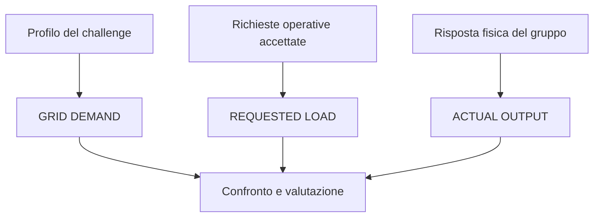

Puoi quindi avere domanda crescente, richiesta ancora invariata e uscita prossima al punto precedente. Oppure una richiesta aumentata con uscita non sostenuta dal ciclo. Le due situazioni richiedono una diagnosi diversa. Se il challenge non possiede una domanda esterna, il relativo dato può essere indisponibile mentre richiesta e uscita mantengono il proprio significato.

## 12.6 Punteggio e classificazione del challenge

Le policy standard osservano disciplina delle protezioni, azioni richieste, qualità operativa, eventuale inseguimento della domanda e tempo logico. La policy standard di demand-following assegna a queste dimensioni rispettivamente 40, 25, 15, 15 e 5 punti; un'altra policy può distribuirli diversamente.

| Punteggio, se l'evidenza è sufficiente e non domina una failure critica | Classificazione |
| --- | --- |
| Inferiore a 60 | `NEEDS IMPROVEMENT` |
| Da 60 a meno di 75 | `SATISFACTORY` |
| Da 75 a meno di 90 | `PROFICIENT` |
| Da 90 | `EXCELLENT` |

Il subtotale non basta quando manca evidenza obbligatoria: può comparire `INCOMPLETE EVIDENCE`. Una failure critica di sicurezza o procedura ha regole di dominanza, espresse come `UNSAFE` o `PROCEDURE FAILURE`. Un esercizio può richiedere uno scatto come risposta corretta a un evento, mentre un altro può considerarlo un fallimento: il significato è definito dal challenge.

Nelle policy standard, assistenza e autorità applicano modificatori neutri. A parità di evidenza non ricevi una penalità nascosta soltanto perché hai usato `GUIDED` o `SUPERVISORY`. Queste scelte cambiano però ciò che devi osservare e come vengono formulate le azioni.

## 12.7 Fine della missione e prosecuzione dell'impianto

Una missione può risultare completata o fallita a un certo passo, mentre il runtime continua a evolvere. Il suo stato terminale descrive l'esito dell'esercizio; non coincide necessariamente con una pausa, un arresto della centrale o la fine di tutte le osservazioni possibili.

La timeline conserva l'identità e l'ordine degli eventi pertinenti. I collegamenti di approfondimento aprono una pagina o un sottosistema senza ripetere il comando citato dalla riga. Puoi quindi studiare perché la missione sia terminata senza impartire involontariamente una nuova manovra.

<a id="capitolo-13"></a>

# 13. Registrazione, checkpoint, replay e archivi

## 13.1 Perché la registrazione è esplicita

Una sessione ordinaria non contiene automaticamente la registrazione completa di ogni passo. Il registratore conserva evidenza deterministica, compresi ordine delle azioni e verifiche dello stato; questa attività ha un costo e viene attivata esplicitamente.

`START RECORDED SESSION` ricrea la sessione dall'inizio esatto. In questo modo sono noti scenario, versione iniziale, richieste e progressione temporale. È una nuova esecuzione registrata, non un modo per aggiungere retroattivamente i minuti che hai già trascorso senza registratore.

Se vuoi confrontare due strategie, attiva quindi la registrazione prima della prima manovra significativa. Porta il sistema al punto che ti interessa, metti in pausa e crea il checkpoint appropriato. Il valore didattico nasce dal confronto fra prove che condividono davvero la stessa origine.

## 13.2 Che cosa conserva un archivio

Il file `.nrs-session.json` conserva informazioni sufficienti a ricostruire e verificare il percorso previsto: identità esatta dello scenario e delle condizioni iniziali, azioni accettate, intenzioni di automazione registrate, eventi e punti di ripristino. Non è un video e non è semplicemente un'immagine dei numeri sullo schermo.

Quando carichi o ripristini, il software ricostruisce l'evoluzione e ne verifica la coerenza. Un replay divergente deve produrre un errore esplicito, anziché essere presentato come una continuazione riuscita. Questo protegge il significato del confronto fra le prove.

## 13.3 Creare e usare un checkpoint

Un checkpoint di sessione identifica un prefisso ripristinabile della registrazione. Per crearne uno, porta il processo nella condizione desiderata, metti in pausa e usa `CREATE CHECKPOINT` quando disponibile. Leggi il punto selezionato e il relativo passo prima di procedere.

Dopo la manovra puoi tornare in F8 e usare `RESTORE SELECTED`. Il ripristino ricostruisce quel punto verificato; i comandi e gli eventi successivi appartenevano al tentativo lasciato alle spalle. La prosecuzione deve partire dal prefisso coerente, senza mescolare vecchie conseguenze future con le azioni del nuovo tentativo.

La figura rappresenta questo uso didattico. I rami sono due esecuzioni alternative dopo lo stesso punto, non due impianti fisici che il software faccia funzionare contemporaneamente.

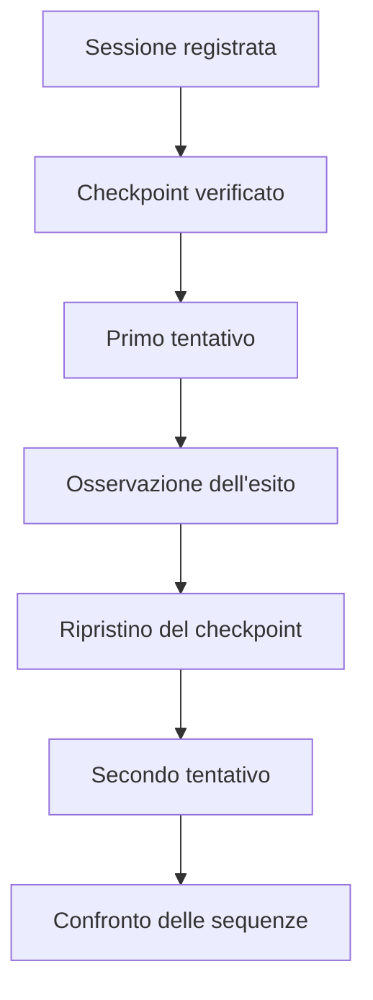

Il confronto è utile quando sai quale decisione è cambiata. Se nel secondo tentativo modifichi anche assistenza, autorità e più componenti, puoi osservare una differenza complessiva, ma sarà più difficile attribuirla a una causa specifica.

## 13.4 Verificare il replay

`VERIFY REPLAY` verifica la riproducibilità della registrazione. Il sistema deve ritrovare le identità e le sequenze attese, comprese le impronte dello stato registrato. Una semplice somiglianza visiva dei valori finali non sostituisce questa verifica.

Se compare una divergenza, conserva l'archivio e il messaggio utile alla diagnosi. Non concludere che la versione corrente abbia «aggiornato» correttamente il vecchio esercizio: la compatibilità esatta richiede di riprodurne il significato, non soltanto di aprire un file con lo stesso nome.

## 13.5 Salvare e caricare

`SAVE ARCHIVE` esporta la sessione registrata nel formato previsto; `LOAD ARCHIVE` seleziona un archivio e lo verifica prima di sostituire la sessione secondo il percorso applicabile. Segui i consensi mostrati dalla pagina e usa una destinazione locale supportata dal salvataggio desktop.

Il salvataggio è stato migliorato per evitare di troncare il file precedente prima che la sostituzione sia pronta. Questo non rende equivalenti ogni provider o destinazione remota: un errore deve essere segnalato, non mascherato come un salvataggio riuscito. Dopo un'operazione leggi quindi il risultato confermato.

La registrazione può continuare da un prefisso verificato quando identità, stato e giornali sono coerenti. Lo scopo è mantenere una sola storia deterministica dell'esecuzione effettiva, non incollare liberamente frammenti di archivi diversi.

## 13.6 Missione e cronologia dopo il ripristino

Quando una sessione è associata esplicitamente a un challenge, la ricostruzione conserva il contesto pertinente di missione: ciclo di vita, evidenze, domanda, valutazione e timeline. Le righe che appartenevano a passi successivi al checkpoint non devono sopravvivere al ripristino.

Un archivio senza associazione di missione rimane `UNBOUND`; il software non inventa il pacchetto partendo da una somiglianza del titolo dello scenario. Anche un'associazione incompatibile deve fallire esplicitamente. Questa distinzione permette di preservare sia le prove libere sia quelle legate a una missione esatta.

<a id="capitolo-14"></a>

# 14. Un metodo per la diagnosi

## 14.1 Ricostruire ciò che è cambiato per primo

Una diagnosi comincia da una sequenza, non da un elenco di componenti possibili. Cerca il primo comando o evento pertinente, la prima variazione fisica e il primo intervento. `FIRST-OUT`, registro e passo logico aiutano a ordinare questi passaggi anche quando la schermata finale contiene molte conseguenze contemporanee.

Poi identifica il bilancio che dovrebbe spiegare il fenomeno. Una massa sta aumentando perché entra più di quanto esca? Un materiale si scalda perché riceve più energia di quanta ceda? Il rotore accelera perché il carico è cambiato? Questa domanda restringe la ricerca senza imporre subito una spiegazione unica.

Infine verifica la qualità dell'informazione. Un numero indisponibile non è uno zero; una diagnostica e una misura filtrata possono non coincidere nello stesso istante; una richiesta accettata può avere un attuatore ancora in corsa. Prima di parlare di «fisica sbagliata», occorre sapere che cosa stai realmente confrontando.

## 14.2 Esempio completo: pressione del condensatore in aumento

Immagina di vedere la pressione crescere mentre la potenza elettrica è ancora vicina al valore precedente. Il sintomo non dimostra subito un guasto al generatore. Parti dal condensatore: quale massa arriva allo spazio vapore, quanta viene condensata e quale potenza termica viene effettivamente rigettata?

Se il raffreddamento disponibile è diminuito, la conduttanza di superficie può non essere più il limite principale. Se invece arriva più vapore, potrebbe essere cambiata l'ammissione o potrebbe essere intervenuto il bypass. In entrambi i casi una parte dell'energia può accumularsi nello spazio vapore, aumentando la contropressione e riducendo il salto utile della turbina.

La figura segue questa possibile propagazione. Le frecce sono causali; descrivono una famiglia di evoluzioni da verificare con i dati, non affermano che ogni aumento di pressione abbia la stessa origine.

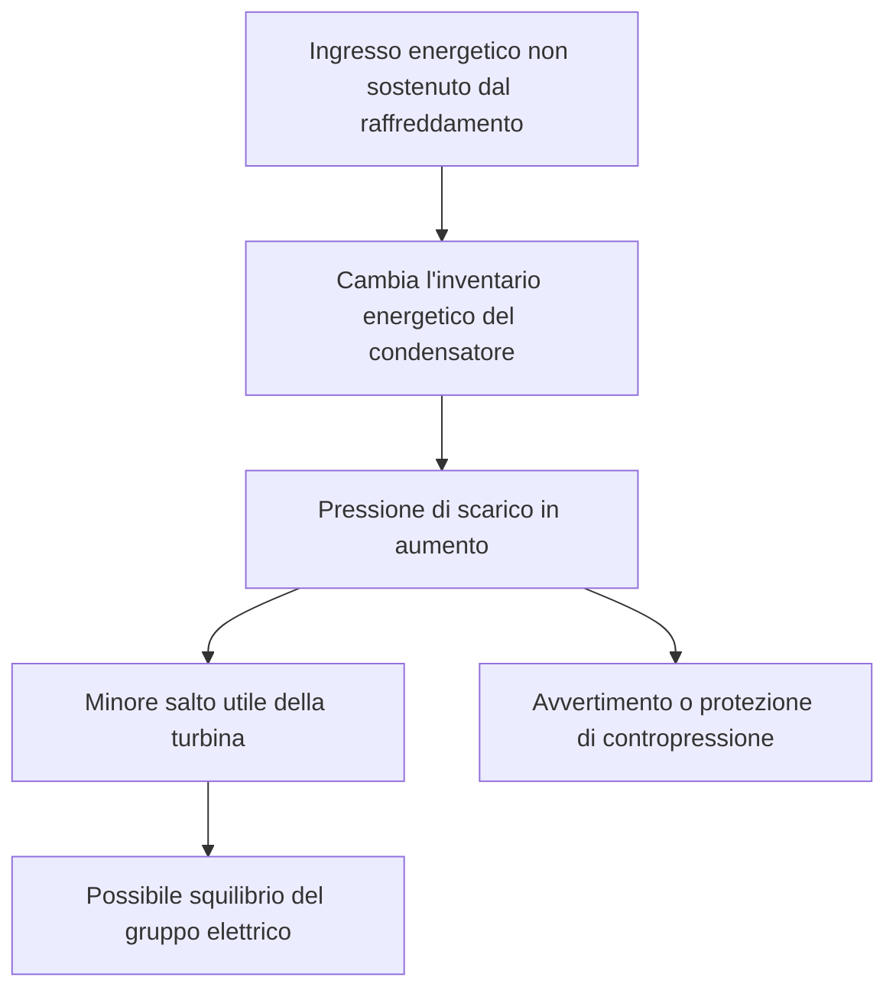

Se intervengono turbina e generatore, il log può quindi registrare eventi elettrici nati come conseguenza di un limite termico. La diagnosi va verificata confrontando tempi, portate e capacità disponibile. Il reset del generatore non cambia la causa che hai appena ricostruito.

## 14.3 Pressione e livello del corpo cilindrico

Pressione in crescita e livello in calo possono indicare un bilancio diverso da quello di pressione e livello entrambi in crescita. Non scegliere la stessa manovra soltanto perché il primo numero è uguale. Cerca separatamente massa ed energia: alimentazione, esportazione di vapore, ritorno dai canali e ricircolo.

Se la richiesta alla pompa di alimentazione cresce ma il flusso non basta, segui il percorso a ritroso verso l'inventario intermedio e la vasca del condensato. Se l'esportazione di vapore scende, segui il percorso in avanti verso linea, valvole, turbina e condensatore. La posizione di una valvola non dimostra la portata e la portata di una pompa non dimostra da sola il bilancio dell'intero separatore.

Considera anche la fase. Il livello del modello dipende dalla distribuzione del volume liquido; può cambiare per ragioni che una lettura puramente «serbatoio pieno o vuoto» non coglie. Le diagnostiche di massa separabile completano la misura, senza sostituirla nel ruolo che possiede per controllo e protezione.

## 14.4 Il rotore accelera dopo una manovra

Individua prima il cambiamento di carico. L'interruttore si è aperto? La richiesta è stata ridotta? La turbina sta ancora ricevendo una portata utile significativa? `NET TORQUE` e potenza all'albero permettono di collegare questi eventi alla tendenza dei giri.

Un riferimento di velocità invariato non dimostra che non sia cambiato nulla: il governor può trovarsi in un diverso modo di funzionamento, un attuatore può essere in corsa o una protezione può aver cambiato l'autorità. Leggi quindi sia l'intenzione sia lo stato effettivo.

Se c'è uno scatto memorizzato, distingui il ritorno fisico in una banda dal ripristino logico del sistema. La velocità può essere diminuita mentre la memoria resta attiva; il successivo consenso di sincronizzazione richiede ancora la propria verifica elettrica.

## 14.5 La potenza elettrica non segue la richiesta

Il primo confronto è fra domanda della missione, richiesta al generatore e scambio misurato. Se la domanda è aumentata ma la richiesta non è cambiata, stai osservando una decisione ancora da compiere o una diversa strategia di controllo. Se la richiesta è cambiata e l'uscita non la sostiene, devi invece indagare il gruppo e il ciclo.

Verifica interruttore, eventuali scatti, potenza meccanica, velocità e fase. Con generatore disconnesso manca il percorso di esportazione, anche se la turbina ruota. Con generatore collegato, la dinamica di rete e rotore può produrre differenze transitorie e persino importazione.

Non attribuire automaticamente lo scostamento a un regolatore da «tarare». Una limitazione a monte o una condizione iniziale non equilibrata può produrre sintomi simili. Il simulatore è utile proprio perché permette di osservare queste possibilità separatamente.

## 14.6 La pompa è in marcia ma la portata è piccola o nulla

Conferma anzitutto il bersaglio e lo stato della pompa. Poi controlla se la pressione di valle contrasti la spinta disponibile, se esista inventario a monte e se un ritegno impedisca il flusso inverso. La combinazione può spiegare una portata piccola senza contraddire il comando di marcia.

Quando il valore operativo è filtrato, lascia trascorrere tempo simulato sufficiente a distinguere il ritardo di presentazione da un vero mancato trasferimento. Se un segnale è degradato, esamina la sua qualità prima di formulare una diagnosi fisica dettagliata.

Questo ragionamento vale per pompe con ruoli differenti, ma non autorizza a scambiarle fra loro: la pompa principale sostiene il ricircolo, quella del condensato svuota la vasca e quella di alimentazione riporta massa verso il corpo cilindrico.

## 14.7 Potenza apparentemente stabile e inventari in deriva

Una coppia di numeri rassicuranti, come 5 MWe e quasi 3000 giri/min, non certifica un equilibrio completo. Un regolatore può sostenere temporaneamente una variabile mentre un inventario si sposta lentamente. Il punto di equilibrio richiede che anche le variabili conservate e le memorie rilevanti non abbiano una deriva incompatibile con l'esercizio.

Osserva quindi livello del corpo cilindrico, massa della vasca, disponibilità d'alimentazione e pressioni per un intervallo coerente con la dinamica che stai studiando. Una verifica brevissima non dimostra l'assenza di una deriva lenta, e una lunga durata a computer fermo in pausa non aggiunge osservazione fisica.

Quando confronti configurazioni termodinamiche diverse, considera anche lo stato iniziale. Lo stesso inventario di massa ed energia può essere interpretato diversamente da due chiusure; sostituire una correlazione non garantisce automaticamente che il vecchio punto sia ancora stazionario.

<a id="capitolo-15"></a>

# 15. Glossario ragionato

Questo glossario collega i termini che più spesso producono equivoci. Per ritrovare una specifica dicitura inglese dell'interfaccia usa anche l'Appendice A.

## Bilancio e inventario

Un **bilancio** confronta ingressi, uscite e accumulo. Un **inventario** è la quantità contenuta, per esempio la massa d'acqua in una vasca o l'energia interna di un volume. Una portata può essere quasi costante mentre l'inventario cambia, se le altre portate non la bilanciano.

## Potenza ed energia

L'**energia** è una quantità accumulata o trasferita; la **potenza** è il ritmo del trasferimento o della produzione. Un MW mantenuto per un secondo trasferisce un MJ. I megawatt termici, MWth, descrivono la scala del calore; i megawatt elettrici, MWe, quella dello scambio elettrico.

## Criticità, reattività e periodo

La **criticità** riguarda il bilancio della catena neutronica. La **reattività** esprime lo scostamento da quel bilancio. Il **periodo** descrive il ritmo relativo della dinamica neutronica. Una posizione fissa delle barre non impone da sola nessuno dei tre, perché contano anche gli altri contributi e la storia dei precursori.

## Titolo, frazione di vuoto e vuoto del condensatore

Il **titolo del vapore** è una frazione di massa; la **frazione di vuoto** è una frazione di volume. Il **vuoto del condensatore** descrive invece una pressione assoluta inferiore a quella atmosferica. Le tre espressioni compaiono nello stesso impianto, ma misurano aspetti differenti.

## Energia interna ed entalpia

L'**energia interna specifica**, `u`, descrive l'energia contenuta per unità di massa nello stato del fluido. L'**entalpia specifica**, `h`, comprende anche il termine di lavoro di flusso `p/ρ`. Per questo un nodo può conservare energia interna mentre una connessione trasporta entalpia senza che le due descrizioni si contraddicano.

## Collettore, corpo cilindrico e vasca del condensato

Un **collettore** raccoglie o distribuisce flussi di più collegamenti. Il **corpo cilindrico** partecipa alla separazione acqua-vapore e al ricircolo. La **vasca del condensato** riceve il liquido dal condensatore e dagli eventuali drenaggi. Il nome del componente indica il suo ruolo nel ciclo, non soltanto la forma di un recipiente.

## Coppia, inerzia e scambio elettrico

La **coppia** tende a cambiare la rotazione; l'**inerzia** determina quanto la velocità risponde a una coppia netta; lo **scambio elettrico** collega quel bilancio alla rete. La generazione normale richiede un bilancio sostenuto, mentre un transitorio può consumare o ricostituire energia cinetica.

## Riferimento, richiesta e posizione effettiva

Un **riferimento** è il bersaglio di una regolazione. Una **richiesta** è ciò che un comando o un controllo domanda. La **posizione effettiva** è ciò che l'attuatore ha raggiunto nel percorso confermato. Il confronto fra questi livelli spiega ritardi di corsa, saturazioni e interventi prioritari.

## Consenso, interblocco e protezione

Un **consenso** è una condizione necessaria a un'azione; un **interblocco** ne impedisce l'esecuzione in determinate condizioni; una **protezione** può imporre un intervento come SCRAM o scatto. Il **reset** rimuove una memoria quando consentito, senza cancellare la fisica che l'ha prodotta.

## Riconoscimento e primo evento

Il **riconoscimento**, o acknowledge, registra che l'operatore ha visto l'allarme. Il **primo evento**, o first-out, aiuta a trovare l'origine temporale di una catena. Riconoscere tutti gli annunci non elimina la causa e non riscrive l'ordine degli eventi.

## Checkpoint e replay

Un **checkpoint di sessione** è un punto ripristinabile della registrazione. Un **traguardo addestrativo** è invece una condizione osservata dall'esercizio. Il **replay** riesegue e verifica un percorso deterministico; non si limita a mostrare una registrazione video.

## Stato stabile ed equilibrio

Una grandezza **stabile** cambia poco nell'intervallo osservato. Un **equilibrio** richiede un bilanciamento più esteso delle variabili rilevanti. Un punto iniziale, spesso chiamato seed, può essere riproducibile e utile per un esercizio senza costituire per questo un equilibrio perfetto di ogni variante del modello.

<a id="capitolo-16"></a>

# 16. Che cosa il modello rappresenta e che cosa lascia aperto

## 16.1 Un impianto educativo ridotto

Il progetto rende leggibili catene fisiche e di controllo su una macchina deterministica. La taglia elettrica da 10 MWe, il gruppo equivalente di canali e l'inerzia del rotore appartengono a questa composizione educativa. Non esiste una dimostrazione che tutte le dimensioni o le costanti temporali siano una scala fedele di un RBMK industriale.

L'ispirazione a un reattore a canali aiuta a comprendere ricircolo, ebollizione e retroazioni. Non implica una geometria completa della grafite, una ricostruzione di tutte le barre o un calcolo spaziale accoppiato di livello industriale. La distinzione va mantenuta anche quando le viste grafiche sono dettagliate.

## 16.2 Accuratezza termodinamica e coerenza numerica

La chiusura ordinaria Exact-V9 usa proprietà acqua-vapore semplificate con correzioni di coerenza interna. Le verifiche indipendenti hanno rilevato discrepanze significative rispetto al riferimento IAPWS-IF97, anche nella classificazione di pressione e fase in parte del dominio caldo. I valori di quel dominio restano risultati del modello educativo e non devono essere presentati come proprietà industriali qualificate.

Il progetto contiene anche una chiusura reference-consistent distinta, implementata e verificata nei propri confronti mirati. La sua presenza non cambia automaticamente il desktop ordinario e non dimostra che il punto iniziale precedente sia un equilibrio della variante. L'integrazione completa e l'inizializzazione sono problemi separati dall'accuratezza locale della proprietà.

Questa distinzione spiega perché un bilancio che si chiude e un replay riproducibile siano necessari ma non sufficienti per una pretesa di fedeltà fisica. La riproducibilità dice che stai osservando lo stesso modello; non trasforma quel modello in una tabella di riferimento per un impianto reale.

## 16.3 Due fasi e idraulica

La miscela acqua-vapore è ridotta: non vengono risolte tutte le velocità relative delle fasi, gli scambi interfacciali e le storie locali dei regimi di ebollizione. Titolo e vuoto sono quindi utili informazioni di stato, senza costituire una misura di scorrimento fra fasi o una previsione completa di instabilità fisiche.

Le resistenze di tubi e valvole e le curve delle pompe non ricostruiscono acustica di rete, colpo d'ariete, NPSH o cavitazione dettagliata. La presenza di densità e portata non basta a qualificare una circolazione naturale dopo l'arresto delle pompe. Anche un'oscillazione temporale richiede una diagnosi prima di essere chiamata instabilità fisica del canale.

## 16.4 Turbina, condensatore e scarichi

La turbina usa un modello di lavoro ridotto con limiti energetici, e il drenaggio dell'umidità è una separazione ideale con una destinazione esplicita. Non rappresenta tutti i fenomeni di gocce, erosione, separatori o surriscaldamento di una macchina reale.

Il condensatore possiede un bilancio di fase e un limite di trasferimento termico, ma non una descrizione completa della geometria dei tubi, dei gas incondensabili e degli ausiliari del vuoto. Il raffreddamento è una condizione di confine modellata. Bypass e scarico di sovrapressione hanno leggi automatiche con portata limitata, senza una completa meccanica di valvola industriale con isteresi di apertura e richiusura.

Il trasporto con entalpia è già attivo nei percorsi descritti: non è una funzione soltanto futura. Rimangono però i limiti delle proprietà e dei componenti con cui viene composto quel bilancio. Una convenzione energetica corretta non elimina da sola tutti gli altri limiti fisici.

## 16.5 Rete elettrica e scale di potenza

Il modello consente generazione, importazione e dinamica del gruppo collegato, con protezioni specifiche. La rete resta una rappresentazione ridotta, senza riprodurre tutte le dinamiche di un sistema elettrico esteso, la catena completa dei trasformatori o ogni controllo di eccitazione reale.

L'interfaccia espone una tensione di riferimento da 400 kV perché quella è la grandezza definita nel collegamento del modello. Non bisogna ricostruirvi automaticamente un alternatore industriale con tutti i livelli di tensione intermedi. Analogamente, 100 MWth di calibrazione neutronica e 10 MWe di targa non definiscono da soli il rendimento dell'impianto.

## 16.6 Stato iniziale e durata della prova

Il punto desktop attuale è stato verificato nei propri percorsi di regressione e attivazione. Questo non qualifica qualsiasi nuova rampa, durata o sostituzione termodinamica. La lettura deve restare legata alle condizioni effettivamente provate.

La ricerca di un equilibrio per l'integrazione fisica successiva è ancora inconclusiva. Alle previsioni numeriche offline sono seguite prove nel modello fisico: il residuo diminuisce, ma non soddisfa ancora i criteri di equilibrio e l'inviluppo operativo. Queste prove non hanno installato un nuovo stato iniziale produttivo. Per questo il manuale non propone una ricetta di ritocco dei limiti o di modifica arbitraria degli inventari.

Per lo studio operativo la lezione è concreta: guarda le tendenze degli accumuli e non giudicare un equilibrio dal solo fatto che per qualche istante rimangano fermi giri e potenza. Il significato dell'esperimento dipende anche dalla sua durata simulata.

## 16.7 Guasti e incidenti

Il progetto contiene scenari deterministici di guasto e transitori protettivi, comprese classi di perdita e indisponibilità elettrica, entro la fisica modellata. Non è un simulatore generale di fusione del nocciolo, esplosione, incendio o danneggiamento permanente di ogni apparecchiatura.

Un messaggio di errore numerico non va interpretato automaticamente come un'esplosione fisica; uno scatto non dimostra necessariamente un danno materiale permanente. Per attribuire un fenomeno occorre che esistano il relativo modello e la sua evidenza. Anche l'assenza di un danno rappresentato non dimostra che una manovra equivalente sarebbe innocua in un impianto reale.

## 16.8 Strumentazione e interfaccia

Il simulatore rappresenta degradazioni deterministiche dei segnali, ma non tutti i dettagli di età del dato, latenza, ridondanza o trasmissione di un sistema di controllo industriale. La sigla `MEASURED` identifica il percorso di misura del modello e non una certificazione di strumentazione di sicurezza.

Il calcolo usa tempo logico deterministico; la finestra grafica e il sistema operativo hanno invece una propria prestazione di esecuzione. La registrazione, gli aggiornamenti e una sessione lunga possono avere costi osservabili, senza che ciò autorizzi a confondere il rallentamento del computer con una diversa legge della fisica.

<a id="capitolo-17"></a>

# 17. Schede rapide per la consultazione

Le schede seguenti condensano verifiche già spiegate. Sono il punto in cui un elenco breve è utile durante l'uso; se una voce non è chiara, torna al capitolo che ne descrive il bilancio e l'autorità.

## 17.1 Prima di una variazione di potenza o carico

- [ ] Ho identificato scenario, obiettivo e stato iniziale effettivo.
- [ ] Ho controllato circolazione, livello e pressioni, comprese le tendenze.
- [ ] Conosco l'autorità effettiva e gli eventuali blocchi.
- [ ] So quanto cambia la richiesta: un `LOAD RAISE` ordinario vale 5 MWe.
- [ ] Ho scelto almeno un indicatore a monte e uno a valle da osservare dopo il comando.

La verifica finale è confrontare richiesta e risultato prima di aggiungere un'altra manovra. Una richiesta accettata è l'inizio dell'osservazione, non la sua conclusione.

## 17.2 Prima del parallelo

- [ ] Il percorso di vapore e il condensatore sono coerenti con l'esercizio.
- [ ] Il gruppo si avvicina alla condizione sincrona senza una tendenza eccessiva.
- [ ] Frequenza, fase e tensione soddisfano le finestre e compare `SYNC READY`.
- [ ] Non sto ignorando scatti memorizzati o altri consensi mancanti.
- [ ] Dopo `CLOSE BREAKER` controllerò lo stato effettivo e lo scambio elettrico.

Non usare questa scheda per ripetere il parallelo di un desktop che parte già collegato. In quel caso il compito è riconoscere il punto iniziale e valutarne la risposta alla manovra prevista.

## 17.3 Dopo un allarme o un comando rifiutato

- [ ] Ho letto il primo evento e il passo pertinente.
- [ ] Ho distinto misura, diagnostica, qualità del segnale e memoria.
- [ ] Ho individuato la possibile causa, oltre al componente che ne subisce l'effetto.
- [ ] Ho verificato richiesta, stato effettivo e autorità.
- [ ] Sto correggendo le condizioni prima di ripetere il reset o la stessa richiesta.

Per la contropressione ricorda il riferimento educativo di 20 kPa per l'avvertimento e 30 kPa per lo scatto. Per la sovravelocità, 3300 giri/min è la soglia di scatto e 3150 giri/min parte del rientro. I consensi completi restano quelli del sistema.

## 17.4 Prima di ripristinare un checkpoint

- [ ] La registrazione era attiva durante il tratto che voglio studiare.
- [ ] Ho scelto il checkpoint e verificato il suo passo.
- [ ] Ho conservato il tentativo che voglio confrontare, se necessario.
- [ ] So quale singola decisione cambierò nella prova successiva.
- [ ] Dopo il ripristino controllerò scenario, contesto missione e stato effettivo.

Il ripristino serve a ricostruire un'origine coerente del confronto. Una prova nuova diventa più istruttiva quando sai spiegare non soltanto che l'esito è diverso, ma quale prima conseguenza abbia preso un'altra direzione.

## 17.5 Un esercizio di lettura, prima di cercare il punteggio

Avvia il desktop ordinario e rimani inizialmente in pausa. Individua sul mimic il corpo cilindrico, il percorso verso la turbina e il ritorno attraverso il condensatore. Apri i relativi pannelli e associa a ogni tratto una lettura di massa o energia: portata, pressione, potenza o inventario.

Fai avanzare la sessione senza sovrapporre comandi. Cerca quali variabili siano quasi ferme e quali mostrino ancora un assestamento. Ripeti la lettura con il computer operatore e riconosci dove il software mostra una misura, una diagnostica o un'indisponibilità.

Quando decidi di provare una manovra, descrivi prima la conseguenza che ti aspetti. Al termine, torna sullo stesso percorso e verifica dove l'aspettativa abbia trovato conferma. Questo esercizio trasforma il disegno dell'impianto in un sistema che puoi interrogare, anziché in una collezione di indicatori da tenere verdi.

# Appendice A — Dalle etichette inglesi al significato operativo

Queste tabelle sono pensate per ritrovare una dicitura durante l'uso. Le spiegazioni estese rimangono nei capitoli: una traduzione breve non sostituisce il contesto del componente.

## A.1 Reattore e ricircolo

| Etichetta | Lettura in italiano |
| --- | --- |
| `REACTOR THERMAL POWER` | Potenza termica del reattore esposta dal percorso di misura |
| `TOTAL REACTIVITY` | Somma dei contributi di reattività disponibili |
| `ROD REACTIVITY` | Contributo delle barre |
| `NON-ROD REACTIVITY` | Contributi diversi da quelli delle barre |
| `REACTOR PERIOD` | Ritmo relativo della variazione neutronica, come diagnostica |
| `ROD TARGET` | Gruppo o elemento al quale è diretta la richiesta |
| `WITHDRAW` / `HOLD` / `INSERT` | Estrai, ferma il movimento, inserisci |
| `WITHDRAWAL` | Quota di corsa estratta, non quota inserita |
| `FUEL` / `COOLANT` | Combustibile e refrigerante |
| `STEAM QUALITY` | Titolo: frazione massica di vapore |
| `VOID FRACTION` | Frazione del volume occupata dal vapore |
| `MCP` | Pompa principale di circolazione |
| `SUCTION HEADER` | Collettore di aspirazione |
| `PRESSURE HEADER` | Collettore di mandata |
| `HEADER ΔP` | Differenza di pressione associata ai collettori |
| `STEAM DRUM` | Corpo cilindrico di separazione acqua-vapore |
| `DRUM LEVEL` | Livello normalizzato del corpo cilindrico |
| `RECIRCULATION` | Ritorno di massa verso il ricircolo |
| `STEAM EXPORT` | Esportazione di vapore dal lato del separatore |

## A.2 Turbina e condensazione

| Etichetta | Lettura in italiano |
| --- | --- |
| `MAIN STEAM` | Linea principale del vapore |
| `STOP VALVE` | Valvola di intercettazione |
| `CONTROL VALVE` | Valvola di regolazione |
| `ADMISSION VALVE` | Valvola di ammissione |
| `TARGET` | Posizione o richiesta bersaglio, distinta dalla posizione reale |
| `CONTROL AUTO` / `CONTROL MANUAL` | Regolazione automatica oppure richiesta manuale della valvola |
| `APPLY` | Invio del valore preparato nel controllo grafico |
| `ADMISSION FLOW` | Portata al confine di ammissione indicato |
| `STAGE FLOW` | Portata dello stadio; può essere diversa dalla portata totale in ingresso |
| `MOISTURE DRAIN` | Drenaggio della quota liquida separata |
| `SHAFT POWER` | Potenza meccanica sull'albero |
| `ROTOR SPEED` | Velocità del rotore |
| `NET TORQUE` | Coppia netta che determina la variazione di velocità |
| `EXHAUST` | Scarico della turbina |
| `BACKPRESSURE` | Contropressione allo scarico |
| `HEAT REJECTION` | Potenza termica ceduta al raffreddamento |
| `HOTWELL` | Vasca del condensato |
| `CONDENSATE PUMP` | Pompa del condensato |
| `FEEDWATER` | Acqua di alimentazione |
| `THERMAL LIMITED FLOW` | Portata che la capacità termica consente di condensare |
| `INVENTORY LIMITED FLOW` | Portata limitata dalla massa condensabile disponibile |

## A.3 Generatore e controllo

| Etichetta | Lettura in italiano |
| --- | --- |
| `GRID` | Rete elettrica rappresentata dal modello |
| `SPEED REFERENCE` | Riferimento di velocità, distinto dai giri misurati |
| `REQUESTED LOAD` | Richiesta elettrica al generatore |
| `ACTUAL OUTPUT` | Uscita elettrica misurata |
| `GRID EXCHANGE` | Scambio con la rete, positivo in esportazione e negativo in importazione |
| `GRID DEMAND` | Domanda esterna del challenge, quando presente |
| `SPEED RAISE` / `SPEED LOWER` | Incremento o decremento del riferimento di velocità |
| `LOAD RAISE` / `LOAD LOWER` | Incremento o decremento della richiesta elettrica |
| `SYNC READY` | Finestra e consensi di sincronizzazione soddisfatti nel contesto esposto |
| `PHASE DIFFERENCE` | Differenza di fase elettrica rispetto alla rete |
| `CLOSE BREAKER` / `OPEN BREAKER` | Richiesta di collegamento o separazione elettrica |
| `PARALLELED` | Generatore effettivamente collegato in parallelo |
| `DROOP` | Statismo: relazione della regolazione in parallelo con il carico |
| `SETPOINT` | Riferimento usato dal regolatore |
| `REQUESTED AUTHORITY` | Autorità richiesta |
| `EFFECTIVE AUTHORITY` | Autorità che può operare nelle condizioni attuali |

## A.4 Segnali, eventi e sessione

| Etichetta | Lettura in italiano |
| --- | --- |
| `MEASURED` | Grandezza esposta attraverso il percorso di strumentazione |
| `MODEL` | Diagnostica derivata dal modello |
| `STATE` | Stato discreto confermato |
| `UNAVAILABLE` | Informazione non disponibile, senza equivalenza con zero |
| `INVALID` / `SUSPECT` | Validità o qualità del segnale da esaminare secondo la funzione |
| `SCRAM` | Arresto rapido del reattore mediante inserzione delle barre |
| `TRIP` | Scatto del componente o del gruppo interessato |
| `LATCH` / `LATCHED` | Memoria dell'intervento o condizione memorizzata |
| `INTERLOCK` | Interblocco che può impedire un'azione |
| `PERMISSIVE` | Consenso richiesto a una funzione o manovra |
| `ACKNOWLEDGE` | Riconoscimento dell'allarme da parte dell'operatore |
| `FIRST-OUT` | Primo evento conservato della sequenza annunciata |
| `CHECKPOINT` | Punto ripristinabile della sessione, oppure traguardo se il contesto è didattico |
| `REPLAY` | Riesecuzione deterministica verificata |
| `LOGICAL STEP` | Numero del passo logico |
| `RUNTIME` | Nel riepilogo superiore, stato di esecuzione del simulatore |
| `NO ACTIVE MISSION / UNBOUND` | Nessuna missione esplicitamente associata |
| `LIFECYCLE` | Stato del percorso della missione, dall'attivazione al termine |
| `DRILL-DOWN` | Apertura di un approfondimento, senza comando fisico implicito |

# Appendice B — Approfondimenti e fonti

## B.1 Documentazione del progetto

La [guida alla documentazione](../README.md) collega le descrizioni dei sottosistemi. Il [riepilogo della validazione](../validation/README.md) distingue risultati ottenuti e problemi aperti; le [decisioni tecniche](../validation/MODEL_DECISIONS.md) spiegano i vincoli di identità, conservazione e interpretazione dell'evidenza. Il [registro dei limiti](../KNOWN_MODEL_LIMITATIONS.md) raccoglie limitazioni più specifiche e il [checkpoint di progetto](../PROJECT.md) mantiene lo stato corrente dei lavori.

Per approfondire il funzionamento senza confondere gli strati, puoi leggere la [composizione dell'impianto](../PLANT_COMPOSITION.md), i [controlli del reattore e del primario](../REACTOR_PRIMARY_CONTROL_LOOPS.md), i [controlli del ciclo turbina-alimentazione](../TURBINE_STEAM_FEEDWATER_CONTROL_LOOPS.md) e la [gestione di sessioni e replay](../OPERATOR_COMPUTER_SESSION_CHECKPOINT_REPLAY_SAVE.md). Alcuni riferimenti tecnici conservano il contesto della fase in cui sono stati scritti: per identità e stato attuali usa i documenti di sintesi e il codice.

## B.2 Punti di verifica nell'implementazione

Le descrizioni operative di questa revisione sono state confrontate con i seguenti proprietari del comportamento. Questi collegamenti sono destinati a chi vuole verificare un valore o approfondire il software, non sono passaggi necessari per condurre l'esercizio.

| Argomento | Riferimento |
| --- | --- |
| Scenario desktop e identità produttiva | [Programma desktop](../../src/NuclearReactorSimulator.Application/Scenarios/Training/DesktopIntegratedOperationsProductionProgram.cs) |
| Scelta del profilo predefinito | [Politica di selezione](../../src/NuclearReactorSimulator.Application/Scenarios/Training/DesktopHydraulicProductionPolicy.cs) |
| Composizione del punto iniziale e percorsi termici | [Condizioni di generazione](../../src/NuclearReactorSimulator.Application/Scenarios/Training/DesktopSustainedGenerationInitialConditionFactory.cs) |
| Soglie, pompe, condensatore e protezioni | [Definizioni dell'impianto composto](../../src/NuclearReactorSimulator.Application/Scenarios/PreStartup/ColdShutdownInitialConditionFactory.cs) |
| Incrementi dei comandi SPEED e LOAD | [Politica dei comandi](../../src/NuclearReactorSimulator.Application/ControlRoom/ControlRoomRuntimeCommandPolicy.cs) |
| Missione corrente e versioni storiche | [Pacchetti produttivi](../../src/NuclearReactorSimulator.Application/Scenarios/Challenges/Packs/ProductionOperationalChallengePack.cs) |
| Separazione fra vapore utile e drenaggio | [Espansione della turbina](../../src/NuclearReactorSimulator.Simulation/Physics/TurbineIsland/Turbine/TurbineExpansionSolver.cs) |
| Limiti e bilanci di condensazione | [Modello del condensatore](../../src/NuclearReactorSimulator.Simulation/Physics/TurbineIsland/Condenser/CondenserSystemSolver.cs) |
| Temporizzazioni e reset delle protezioni | [Logica di protezione](../../src/NuclearReactorSimulator.Simulation/Physics/Control/Protection/ProtectionSystemSolver.cs) |
| Significato dell'indicatore RUNTIME e comandi visibili | [Finestra principale](../../src/NuclearReactorSimulator.App/Views/MainWindow.axaml) |

## B.3 Principi fisici generali

Per una prima lettura del legame fra calore, vapore, turbina e generatore, la [spiegazione introduttiva della NRC](https://www.nrc.gov/education-regulatory-research/the-student-corner/science-101/how-does-a-nuclear-power-plant-make-electricity) descrive la catena di conversione. La [pagina NRC sui reattori ad acqua bollente](https://www.nrc.gov/reactors/power/bwrs) aiuta a comprendere il principio del vapore diretto: non implica che un BWR a recipiente e il modello a canali di questo progetto abbiano la stessa architettura.

Per la specificità delle retroazioni nei reattori RBMK, lo [studio sulla reattività di vuoto indicizzato da IAEA-INIS](https://inis.iaea.org/records/0rjgs-4f296) mette in relazione comportamento e condizioni operative. È un approfondimento sul sistema reale, distinto dai coefficienti e dal dominio effettivamente implementati nel simulatore.
